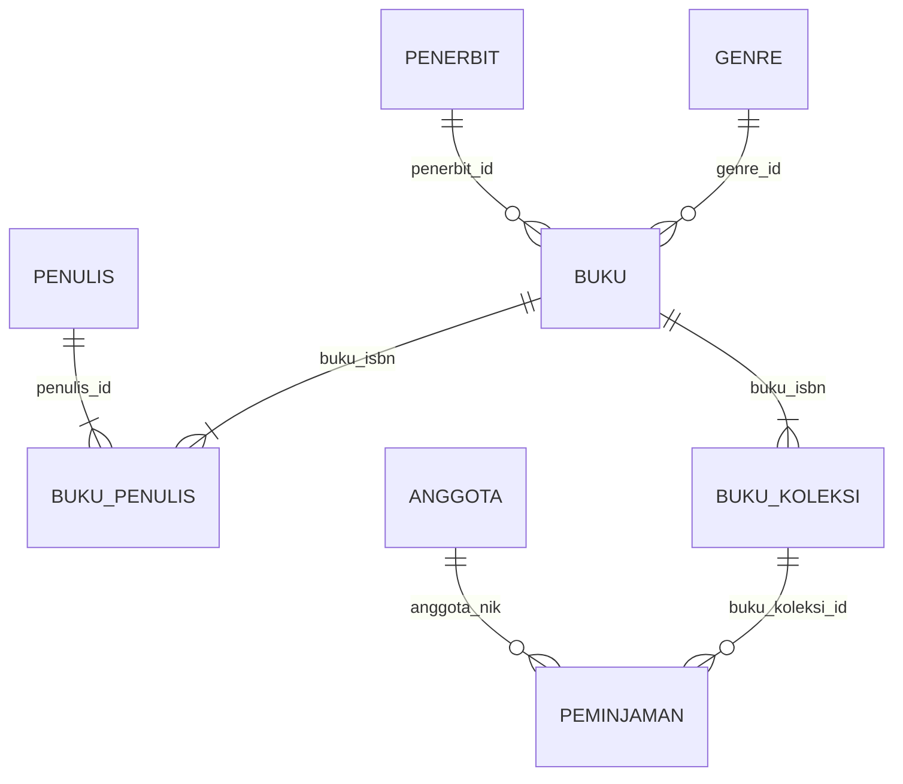

# Data Simulasi Perpustakaan Informatika (Oracle Database / APEX)

Berkas utama: **`perpustakaan_ddl_data.sql`** (481 KB, 86 statement) berisi DDL dan data simulasi perpustakaan program studi Informatika untuk **Oracle Database** (APEX, SQL Developer, SQLcl, SQL*Plus): 501 judul buku informatika riil berbahasa Indonesia dan Inggris, 1.419 eksemplar, 101 anggota, dan 2.030 transaksi peminjaman (3 Jan 2024 s.d. 5 Nov 2026). Ukuran di bawah 500 KB agar dapat diunggah ke APEX SQL Workshop.

Bagian 6 memuat **131 contoh query**: analisis operasional perpustakaan (keterlambatan dan denda, judul terpopuler, ketersediaan eksemplar, tren, pengingat jatuh tempo), dasar SELECT dan penyaringan, fungsi baris tunggal (karakter, angka, tanggal, konversi tipe data, umum/kondisional), fungsi baris jamak (grup), join, subquery, operator himpunan, dan fungsi analitik Oracle.

> README ini dibangkitkan otomatis oleh `generator/rekap.py`; seluruh angka dihitung dari data yang sama dengan isi berkas SQL.

## 1. Isi paket

| Berkas | Ukuran | Statement | Keterangan |
|---|---:|---:|---|
| `perpustakaan_ddl_data.sql` | 481 KB (481.130 byte) | 86 | **DDL + data** dalam satu berkas (yang diunggah ke APEX) |
| `perpustakaan_ddl.sql` | 5 KB (4.706 byte) | 25 | DDL saja |
| `perpustakaan_data.sql` | 477 KB (477.208 byte) | 61 | INSERT saja (jalankan setelah DDL) |
| `contoh_analisis.sql` | 105 KB (105.166 byte) | 131 | Semua contoh query bagian 6, siap dijalankan di SQL Scripts |
| `cek_kuota.sql` |  |  | Diagnosa kuota ruang skema bila muncul ORA-01536 |
| `versi-lengkap/perpustakaan_*.sql` |  |  | Opsional: versi lengkap (938 judul, 2.721 transaksi, ~0,9 MB) untuk SQL Developer/SQLcl; skema sama, terlalu besar untuk APEX |
| `generator/` |  |  | Generator deterministik (`generate.py`), katalog judul riil, contoh query, pembuat README |

## 2. Cara memuat ke Oracle APEX

1. SQL Workshop > SQL Scripts > **Upload**, pilih `perpustakaan_ddl_data.sql` (batas unggah SQL Scripts 500 KB).
2. **Run** > Run Now. Hasil yang diharapkan: **86 statements processed, 0 errors**.
3. Verifikasi jumlah baris dengan query pada bagian 5.
4. (Opsional) Unggah dan jalankan `contoh_analisis.sql`; pilih *View: Detail* untuk melihat hasil tiap query.

Skrip **aman dijalankan berulang**: blok PL/SQL di awal menghapus 8 tabel perpustakaan (bila ada) dengan `DROP TABLE ... CASCADE CONSTRAINTS PURGE`; tabel lain di skema tidak disentuh. Data dimuat dengan `INSERT ALL ... SELECT 1 FROM dual` (100 baris per statement), urut sesuai dependensi FK (genre, penerbit, penulis, anggota, buku, buku_penulis, buku_koleksi, peminjaman), dan diakhiri `COMMIT`. Tanggal ditulis sebagai literal ANSI `DATE 'YYYY-MM-DD'` sehingga tidak bergantung pada `NLS_DATE_FORMAT`.

Untuk SQL Developer buka berkas lalu jalankan sebagai *script* (F5); untuk SQLcl/SQL*Plus gunakan `@perpustakaan_ddl_data.sql`.

## 3. Skema basis data



| Tabel | Kolom | Tipe | Keterangan |
|---|---|---|---|
| **genre** | id | INTEGER | PK |
|  | nama | VARCHAR2(200) | NOT NULL |
| **penerbit** | id | INTEGER | PK |
|  | nama | VARCHAR2(60) |  |
| **penulis** | nik | VARCHAR2(16) | PK (NIK sintetis) |
|  | nama | VARCHAR2(60) | NOT NULL |
| **anggota** | nik | VARCHAR2(16) | PK (NIK sintetis, kode provinsi 73) |
|  | nama | VARCHAR2(200) | NOT NULL |
|  | hp | VARCHAR2(15) | UNIQUE |
| **buku** | isbn | VARCHAR2(13) | PK (ISBN-13 sintetis, check digit valid) |
|  | judul | VARCHAR2(200) | NOT NULL |
|  | tahun_terbit | INTEGER | NOT NULL |
|  | penerbit_id | INTEGER | NOT NULL, FK -> penerbit(id) |
|  | genre_id | INTEGER | NOT NULL, FK -> genre(id) |
| **buku_penulis** | buku_isbn | VARCHAR2(13) | PK bagian 1, FK -> buku(isbn) |
|  | penulis_id | VARCHAR2(16) | PK bagian 2, FK -> penulis(nik) |
| **buku_koleksi** | id | INTEGER | PK (nomor eksemplar) |
|  | buku_isbn | VARCHAR2(13) | NOT NULL, FK -> buku(isbn) **(ditambahkan)** |
|  | cara_masuk | VARCHAR2(20) | NOT NULL: PEMBELIAN / HIBAH / SUMBANGAN / TUKAR |
|  | tanggal_masuk | DATE | NOT NULL |
|  | kondisi | VARCHAR2(20) | NOT NULL: BAIK / RUSAK RINGAN / RUSAK BERAT / HILANG |
| **peminjaman** | buku_koleksi_id | INTEGER | PK bagian 1, FK -> buku_koleksi(id) |
|  | anggota_nik | VARCHAR2(16) | PK bagian 2, FK -> anggota(nik) |
|  | tanggal_pinjam | DATE | PK bagian 3 |
|  | batas_pengembalian | DATE | NOT NULL (pinjam + 7 atau 14 hari) |
|  | tanggal_pengembalian | DATE | NULL = masih dipinjam / belum kembali |

**Perubahan dari model Data Modeler asli**: kolom `buku.buku_koleksi_id` beserta FK `buku_buku_koleksi_FK` dihapus, dan kolom `buku_koleksi.buku_isbn` + FK `buku_koleksi_buku_FK` ditambahkan. Pada model asli satu judul hanya bisa punya satu eksemplar, padahal perpustakaan menyimpan 2-6 eksemplar per judul dan `peminjaman` merujuk ke eksemplar fisik.

Daftar genre:

| id | Genre | Judul | Eksemplar | Peminjaman |
|---:|---|---:|---:|---:|
| 1 | Pemrograman | 65 | 182 | 319 |
| 2 | Algoritma dan Struktur Data | 32 | 94 | 162 |
| 3 | Basis Data | 42 | 118 | 182 |
| 4 | Jaringan Komputer | 41 | 110 | 106 |
| 5 | Sistem Operasi dan Arsitektur Komputer | 35 | 104 | 133 |
| 6 | Rekayasa Perangkat Lunak | 44 | 130 | 207 |
| 7 | Kecerdasan Buatan dan Data Science | 54 | 154 | 204 |
| 8 | Keamanan Informasi | 43 | 128 | 149 |
| 9 | Pengembangan Web dan Mobile | 88 | 239 | 358 |
| 10 | Sistem Informasi dan Manajemen TI | 57 | 160 | 210 |

## 4. Aturan dan asumsi simulasi

Data dibangkitkan oleh `generator/generate.py` dengan seed tetap (`SEED = 20261106`),
sehingga setiap eksekusi menghasilkan berkas yang byte-identik. Tanggal acuan
simulasi (hari "ini") adalah **5 Nov 2026**.

**Katalog buku**
- Judul, penulis, penerbit, tahun terbit, dan genre adalah **data riil** buku informatika
  yang beredar. Katalog sumber (`catalog_id.py`, `catalog_en.py`) memuat 401 judul berbahasa
  Indonesia dan 537 berbahasa Inggris; dataset ini memakai 248 + 253 judul di antaranya,
  dipilih secara deterministik dan proporsional per genre agar seluruh berkas tetap di bawah 500 KB.
- ISBN **sintetis** namun valid secara format: prefiks 978-602 / 978-979 untuk
  terbitan Indonesia, 978-0 / 978-1 untuk terbitan berbahasa Inggris, check digit dihitung benar.
- NIK penulis dan anggota **sintetis** (16 digit berpola NIK), nomor HP anggota unik
  dengan prefiks operator Indonesia. Nama anggota fiktif bernuansa Sulawesi Selatan.

**Eksemplar (buku_koleksi)**
- Setiap judul memiliki **2-6 eksemplar**, diadakan dalam 1-2 gelombang pengadaan
  antara Jan 2008 dan Jun 2026, tidak pernah sebelum tahun terbit.
- Cara masuk: pembelian ±70%, hibah ±20%, sumbangan ±8%, tukar ±2%.
- Kondisi: BAIK ±82%, RUSAK RINGAN ±13%, RUSAK BERAT ±5%; **HILANG** hanya diberikan
  pada eksemplar yang pinjaman terakhirnya belum kembali dan sudah >60 hari melewati batas.

**Peminjaman**
- Periode Jan 2024 s.d. 5 Nov 2026; tidak ada transaksi pada hari Minggu.
- Durasi pinjam 14 hari (±65%) atau 7 hari (±35%).
- ±68% dikembalikan tepat waktu, ±27% terlambat 1-21 hari, ±5% terlambat 22-120 hari,
  ±0,7% tidak kembali (hilang). Pinjaman yang jatuh temponya melewati tanggal acuan
  dicatat dengan `tanggal_pengembalian = NULL`.
- Satu eksemplar tidak pernah dipinjam dua orang pada rentang yang tumpang-tindih.
- Satu anggota memegang **maksimal 3 buku** pada saat bersamaan.
- Popularitas judul mengikuti distribusi log-normal dikali faktor kebaruan
  (judul lebih baru lebih sering dipinjam); keaktifan anggota juga log-normal,
  sehingga ada segelintir anggota/judul yang sangat aktif dan ekor panjang yang jarang.

## 5. Rekap data

### 5.1 Jumlah baris per tabel

| Tabel | Baris | Keterangan |
|---|---:|---|
| genre | 10 | 10 bidang informatika |
| penerbit | 78 | penerbit riil; semuanya dirujuk minimal satu judul |
| penulis | 554 | penulis riil; NIK sintetis |
| anggota | 101 | nama fiktif; NIK dan HP sintetis, HP unik |
| buku | 501 | 248 judul berbahasa Indonesia + 253 berbahasa Inggris; ISBN-13 sintetis |
| buku_penulis | 755 | relasi banyak-ke-banyak buku-penulis |
| buku_koleksi | 1.419 | eksemplar fisik, 2-6 per judul |
| peminjaman | 2.030 | 3 Jan 2024 s.d. 5 Nov 2026 |

Verifikasi setelah memuat (hasil harus sama persis):

```sql
SELECT 'genre' tabel, COUNT(*) n FROM genre
UNION ALL SELECT 'penerbit',     COUNT(*) FROM penerbit
UNION ALL SELECT 'penulis',      COUNT(*) FROM penulis
UNION ALL SELECT 'anggota',      COUNT(*) FROM anggota
UNION ALL SELECT 'buku',         COUNT(*) FROM buku
UNION ALL SELECT 'buku_penulis', COUNT(*) FROM buku_penulis
UNION ALL SELECT 'buku_koleksi', COUNT(*) FROM buku_koleksi
UNION ALL SELECT 'peminjaman',   COUNT(*) FROM peminjaman;

-- semua constraint harus ENABLED / VALIDATED
SELECT constraint_type, status, validated, COUNT(*) FROM user_constraints
WHERE  table_name IN ('GENRE','PENERBIT','PENULIS','ANGGOTA','BUKU','BUKU_PENULIS','BUKU_KOLEKSI','PEMINJAMAN')
GROUP  BY constraint_type, status, validated;
```

### 5.2 Katalog buku

|  | Jumlah |
|---|---:|
| Rentang tahun terbit | 1986-2021 |
| Terbit < 2000 | 22 |
| Terbit 2000-2009 | 184 |
| Terbit 2010-2019 | 288 |
| Terbit 2020+ | 7 |
| Judul dengan 1 penulis | 330 |
| Judul dengan 2 penulis | 109 |
| Judul dengan 3 penulis | 47 |
| Judul dengan 4 penulis | 10 |
| Judul dengan 5 penulis | 4 |
| Judul dengan 6 penulis | 1 |

Penulis dan penerbit dengan judul terbanyak:

| # | Penulis | Judul | Penerbit | Judul |
|---:|---|---:|---|---:|
| 1 | Abdul Kadir | 22 | Penerbit Andi | 98 |
| 2 | Wahana Komputer | 9 | Elex Media Komputindo | 48 |
| 3 | Bunafit Nugroho | 8 | O'Reilly Media | 47 |
| 4 | Jogiyanto Hartono | 7 | Informatika Bandung | 31 |
| 5 | Rinaldi Munir | 6 | Addison-Wesley | 30 |
| 6 | Rosa A.S. | 6 | Graha Ilmu | 24 |
| 7 | Jubilee Enterprise | 6 | Pearson | 23 |
| 8 | Teguh Wahyono | 6 | Wiley | 21 |
| 9 | Bambang Hariyanto | 6 | No Starch Press | 13 |
| 10 | William Stallings | 6 | Manning | 11 |

### 5.3 Eksemplar (buku_koleksi)

|  | Jumlah |
|---|---:|
| Judul dengan 2 eksemplar | 247 |
| Judul dengan 3 eksemplar | 148 |
| Judul dengan 4 eksemplar | 64 |
| Judul dengan 5 eksemplar | 27 |
| Judul dengan 6 eksemplar | 15 |
| Cara masuk PEMBELIAN | 1.007 |
| Cara masuk HIBAH | 287 |
| Cara masuk SUMBANGAN | 106 |
| Cara masuk TUKAR | 19 |
| Kondisi BAIK | 1.208 |
| Kondisi RUSAK RINGAN | 148 |
| Kondisi RUSAK BERAT | 51 |
| Kondisi HILANG | 12 |
| Tanggal masuk paling awal | 1 Jan 2008 |
| Tanggal masuk paling akhir | 24 Jun 2026 |
| Eksemplar yang pernah dipinjam | 876 (62%) |

Seluruh eksemplar berkondisi HILANG memiliki tepat satu pinjaman yang belum kembali.

### 5.4 Peminjaman

|  | Nilai |
|---|---:|
| Total transaksi | 2.030 |
| Periode | 3 Jan 2024 - 5 Nov 2026 |
| Sudah dikembalikan | 1.990 |
| Belum kembali (tanggal_pengembalian NULL) | 40 |
| - di antaranya sudah lewat batas per tanggal acuan | 23 |
| Dikembalikan terlambat (% dari yang kembali) | 641 (32,2%) |
| Rata-rata keterlambatan (hari) | 18,2 |
| Keterlambatan maksimum (hari) | 119 |
| Terlambat > 30 hari | 69 |
| Durasi pinjam 14 hari / 7 hari | 1.337 / 693 |
| Rata-rata lama pinjam aktual (hari) | 14,0 |
| Rata-rata transaksi per bulan | 58,0 |
| Bulan tersibuk | Apr 2026 (78) |
| Judul yang pernah dipinjam | 429 dari 501 |

Per tahun:

| Tahun | Transaksi | Terlambat | Belum kembali |
|---|---:|---:|---:|
| 2024 | 640 | 193 | 3 |
| 2025 | 725 | 244 | 4 |
| 2026 | 665 | 204 | 33 |

Sebaran hari peminjaman:

| Hari | Transaksi |
|---|---:|
| Senin | 572 |
| Selasa | 297 |
| Rabu | 293 |
| Kamis | 288 |
| Jumat | 303 |
| Sabtu | 277 |
| Minggu | 0 |

Judul terpopuler:

| # | Judul | Pinjam |
|---:|---|---:|
| 1 | Fluent Python | 52 |
| 2 | Learning React: Modern Patterns for Developing React Apps | 39 |
| 3 | Database Management Systems | 37 |
| 4 | Core Java Volume I: Fundamentals | 33 |
| 5 | Membongkar Teknologi Pemrograman Web Service | 32 |
| 6 | Penuntun Praktis Belajar SQL | 31 |
| 7 | Pengamanan Sistem Komputer | 25 |
| 8 | Algoritma (Algoritma dan Struktur Data 1) dengan C, C++, dan Java | 24 |
| 9 | Metode Numerik | 23 |
| 10 | Storytelling with Data: A Data Visualization Guide for Business Professionals | 20 |

### 5.5 Anggota

|  | Nilai |
|---|---:|
| Anggota terdaftar / pernah meminjam | 101 / 101 |
| Rata-rata pinjaman per anggota | 20,1 |
| Pinjaman per anggota (min - maks) | 1 - 92 |
| Anggota dengan 1-9 pinjaman | 34 |
| Anggota dengan 10-19 pinjaman | 30 |
| Anggota dengan 20-39 pinjaman | 23 |
| Anggota dengan 40-69 pinjaman | 12 |
| Anggota dengan 70+ pinjaman | 2 |
| Sedang memegang buku | 30 |
| Maks. buku dipegang bersamaan | 3 |

Anggota teraktif: Rifaldi Sanusi Jamaluddin (92); Irfan Tenriadji Kadir (73); Fikri Majid Pabbajah (64); Fadli Mustari (61); Fikri Hamid (60). Paling sering terlambat: Rifaldi Sanusi Jamaluddin (32x); Fikri Majid Pabbajah (26x); Irfan Tenriadji Kadir (23x).

### 5.6 Pemeriksaan konsistensi

Dihitung ulang dari data saat README dibuat; semua pelanggaran harus 0.

| Pemeriksaan | Hasil |
|---|---:|
| Judul tanpa penulis | 0 |
| Penulis / penerbit / genre yang tidak dipakai buku | 0 |
| Eksemplar masuk sebelum tahun terbit | 0 |
| Pinjaman sebelum eksemplar masuk | 0 |
| Batas <= tanggal pinjam, atau kembali < pinjam | 0 |
| Transaksi (pinjam/kembali) pada hari Minggu | 0 |
| Eksemplar dipinjam tumpang-tindih | 0 |
| Eksemplar HILANG tanpa pinjaman aktif | 0 |
| Eksemplar per judul (min - maks) | 2 - 6 |

Validasi eksekusi: DDL berkas ini telah dijalankan pada Oracle APEX 26.2 (8 tabel, 39 constraint); DDL+data divalidasi utuh pada PostgreSQL dengan dialek disamakan (0 pelanggaran integritas); skema yang sama dengan data versi lengkap dieksekusi utuh (`WHENEVER SQLERROR EXIT`) pada Oracle Database 23ai Free dengan seluruh constraint ENABLED/VALIDATED.

## 6. Contoh analisis

131 query dikelompokkan ke dalam 12 sub-bagian; indeks fungsi/klausa ke nomor query ada di 6.13. Semua query memakai tanggal acuan data (`DATE '2026-11-05'`) agar hasilnya dapat direproduksi; ganti dengan `SYSDATE` untuk laporan yang mengikuti hari berjalan. Seluruh query tersedia dalam `contoh_analisis.sql` dengan label `-- [kode]` yang sama. Baris hasil dibatasi dengan `FETCH FIRST n ROWS ONLY` (Oracle 12c+) bila daftarnya panjang.

| Sub-bagian | Topik | Query | Kode |
|---|---|---:|---|
| 6.1 | Analisis operasional perpustakaan | 25 | A1-A25 |
| 6.2 | Dasar SELECT, penyaringan, dan pengurutan | 10 | B1-B10 |
| 6.3 | Fungsi baris tunggal: karakter (teks) | 10 | C1-C10 |
| 6.4 | Fungsi baris tunggal: angka | 6 | D1-D6 |
| 6.5 | Fungsi baris tunggal: tanggal | 9 | E1-E9 |
| 6.6 | Fungsi konversi tipe data | 8 | F1-F8 |
| 6.7 | Fungsi umum dan ekspresi kondisional | 6 | G1-G6 |
| 6.8 | Fungsi baris jamak (fungsi grup) | 15 | H1-H15 |
| 6.9 | Penggabungan tabel (JOIN) | 8 | I1-I8 |
| 6.10 | Subquery | 20 | J1-J20 |
| 6.11 | Operator himpunan (UNION, UNION ALL, INTERSECT, MINUS) | 5 | K1-K5 |
| 6.12 | Lanjutan: fungsi analitik (window) | 9 | L1-L9 |

Pemeriksaan kualitas: setiap query dijalankan terhadap data ini pada PostgreSQL + ekstensi orafce (emulasi fungsi Oracle) dengan hasil tidak kosong; sintaks khusus Oracle (`SYSDATE`, parameter NLS, `LISTAGG ... WITHIN GROUP`, `DECODE`, `MEDIAN`, fungsi grup bersarang) ditulis mengikuti dokumentasi Oracle Database SQL Language Reference.

### 6.1 Analisis operasional perpustakaan

Pertanyaan sehari-hari pengelola perpustakaan: siapa yang terlambat dan berapa dendanya, judul apa yang paling diminati, eksemplar mana yang tersedia, bagaimana tren peminjaman, dan koleksi mana yang tidak pernah dipinjam. Query A1-A7 adalah contoh analisis pada versi README sebelumnya; A8-A25 tambahan.

#### A1. Buku yang sedang dipinjam dan sudah terlambat (denda simulasi Rp1.000/hari)

Pinjaman aktif ditandai `tanggal_pengembalian IS NULL`; selisih dua tanggal langsung menghasilkan jumlah hari. `TRUNC(DATE '...')` meniru `TRUNC(SYSDATE)` yang membuang komponen jam agar hitungan hari bulat.

Fungsi: `TRUNC`

```sql
SELECT a.nama, b.judul, p.tanggal_pinjam, p.batas_pengembalian,
       TRUNC(DATE '2026-11-05') - p.batas_pengembalian           AS hari_terlambat,
       (TRUNC(DATE '2026-11-05') - p.batas_pengembalian) * 1000  AS denda
FROM   peminjaman p
JOIN   buku_koleksi k ON k.id = p.buku_koleksi_id
JOIN   buku b         ON b.isbn = k.buku_isbn
JOIN   anggota a      ON a.nik = p.anggota_nik
WHERE  p.tanggal_pengembalian IS NULL AND p.batas_pengembalian < DATE '2026-11-05'
ORDER  BY hari_terlambat DESC;
```

#### A2. Sepuluh judul terpopuler beserta genrenya

Pola klasik Oracle *top-N*: urutkan di subquery, lalu batasi dengan `ROWNUM` di query luar (`ROWNUM` dievaluasi sebelum `ORDER BY`, sehingga tidak boleh dipakai langsung di query yang sama). Pada Oracle 12c+ dapat diganti `FETCH FIRST 10 ROWS ONLY`.

Fungsi: `COUNT`, `ROWNUM`

Topik subquery: Inline view (subquery di FROM)

```sql
SELECT * FROM (
  SELECT b.judul, g.nama AS genre, COUNT(*) AS jumlah_pinjam
  FROM   peminjaman p
  JOIN   buku_koleksi k ON k.id = p.buku_koleksi_id
  JOIN   buku b         ON b.isbn = k.buku_isbn
  JOIN   genre g        ON g.id = b.genre_id
  GROUP  BY b.judul, g.nama
  ORDER  BY jumlah_pinjam DESC)
WHERE ROWNUM <= 10;
```

#### A3. Ketersediaan eksemplar per judul (tidak sedang dipinjam, kondisi layak)

`LEFT JOIN` ke pinjaman aktif: eksemplar yang tidak punya pasangan (`p.buku_koleksi_id IS NULL`) berarti ada di rak. Setiap eksemplar paling banyak punya satu pinjaman aktif sehingga join tidak menggandakan baris. `GROUP BY` memakai ISBN agar judul kembar tidak tercampur.

Fungsi: `CASE`, `COUNT`, `SUM`, `IN`, `LEFT JOIN`

```sql
SELECT b.judul,
       COUNT(k.id)                                                   AS total_eksemplar,
       SUM(CASE WHEN p.buku_koleksi_id IS NOT NULL THEN 1 ELSE 0 END) AS sedang_dipinjam,
       SUM(CASE WHEN p.buku_koleksi_id IS NULL
                 AND k.kondisi IN ('BAIK', 'RUSAK RINGAN') THEN 1 ELSE 0 END) AS tersedia
FROM   buku b
JOIN   buku_koleksi k ON k.buku_isbn = b.isbn
LEFT   JOIN peminjaman p ON p.buku_koleksi_id = k.id AND p.tanggal_pengembalian IS NULL
GROUP  BY b.isbn, b.judul
ORDER  BY tersedia, b.judul;
```

#### A4. Anggota dengan total hari keterlambatan terbanyak

Hanya pinjaman yang sudah kembali terlambat yang dihitung (`tanggal_pengembalian > batas_pengembalian`); `SUM` selisih tanggal memberi total hari.

Fungsi: `COUNT`, `SUM`, `FETCH FIRST`

```sql
SELECT a.nama, COUNT(*) AS kali_terlambat,
       SUM(p.tanggal_pengembalian - p.batas_pengembalian) AS total_hari_terlambat
FROM   peminjaman p JOIN anggota a ON a.nik = p.anggota_nik
WHERE  p.tanggal_pengembalian > p.batas_pengembalian
GROUP  BY a.nama
ORDER  BY total_hari_terlambat DESC
FETCH FIRST 10 ROWS ONLY;
```

#### A5. Tren peminjaman per bulan

`TO_CHAR(tanggal, 'YYYY-MM')` menjadi kunci bulan yang bisa diurutkan sebagai teks; `SUM(CASE ...)` menghitung yang terlambat di baris yang sama.

Fungsi: `TO_CHAR`, `CASE`, `COUNT`, `SUM`

```sql
SELECT TO_CHAR(tanggal_pinjam, 'YYYY-MM') AS bulan, COUNT(*) AS jumlah,
       SUM(CASE WHEN tanggal_pengembalian > batas_pengembalian THEN 1 ELSE 0 END) AS terlambat
FROM   peminjaman
GROUP  BY TO_CHAR(tanggal_pinjam, 'YYYY-MM')
ORDER  BY bulan;
```

#### A6. Judul yang belum pernah dipinjam, per genre

`NOT EXISTS` dengan subquery berkorelasi: judul lolos bila tidak ada satu pun transaksi untuk eksemplar mana pun dari ISBN tersebut.

Fungsi: `EXISTS`

Topik subquery: Subquery berkorelasi

```sql
SELECT g.nama AS genre, b.judul, b.tahun_terbit
FROM   buku b JOIN genre g ON g.id = b.genre_id
WHERE  NOT EXISTS (SELECT 1 FROM peminjaman p JOIN buku_koleksi k ON k.id = p.buku_koleksi_id
                   WHERE  k.buku_isbn = b.isbn)
ORDER  BY g.nama, b.judul;
```

#### A7. Daftar penulis per buku dalam satu baris

`LISTAGG` meratakan relasi banyak-ke-banyak buku-penulis menjadi satu kolom teks terurut.

Fungsi: `LISTAGG`

```sql
SELECT b.judul, LISTAGG(pn.nama, '; ') WITHIN GROUP (ORDER BY pn.nama) AS penulis
FROM   buku b
JOIN   buku_penulis bp ON bp.buku_isbn = b.isbn
JOIN   penulis pn      ON pn.nik = bp.penulis_id
GROUP  BY b.isbn, b.judul
ORDER  BY b.judul;
```

#### A8. Siapa sedang memegang buku apa: pinjaman aktif per anggota

Satu baris per anggota dengan daftar judul dan batas kembali (`LISTAGG`), diurutkan dari yang memegang paling banyak dan batasnya paling dekat.

Fungsi: `TO_CHAR`, `COUNT`, `MIN`, `LISTAGG`

```sql
SELECT a.nama,
       a.hp,
       COUNT(*)                                                       AS buku_dipegang,
       MIN(p.batas_pengembalian)                                      AS batas_terdekat,
       LISTAGG(b.judul || ' (s.d. ' || TO_CHAR(p.batas_pengembalian, 'DD/MM') || ')', '; ')
           WITHIN GROUP (ORDER BY p.batas_pengembalian, b.judul)      AS daftar_buku
FROM   peminjaman p
JOIN   anggota a      ON a.nik = p.anggota_nik
JOIN   buku_koleksi k ON k.id = p.buku_koleksi_id
JOIN   buku b         ON b.isbn = k.buku_isbn
WHERE  p.tanggal_pengembalian IS NULL
GROUP  BY a.nik, a.nama, a.hp
ORDER  BY buku_dipegang DESC, batas_terdekat, a.nama;
```

#### A9. Eksemplar hilang dan anggota yang bertanggung jawab

Eksemplar berkondisi HILANG selalu punya satu pinjaman yang belum kembali; join ke pinjaman aktif memberi peminjam terakhir beserta kontaknya untuk penagihan.

```sql
SELECT k.id                              AS eksemplar,
       b.judul,
       a.nama                            AS peminjam_terakhir,
       a.hp,
       p.tanggal_pinjam,
       p.batas_pengembalian,
       DATE '2026-11-05' - p.batas_pengembalian    AS hari_lewat_batas
FROM   buku_koleksi k
JOIN   buku b         ON b.isbn = k.buku_isbn
JOIN   peminjaman p   ON p.buku_koleksi_id = k.id AND p.tanggal_pengembalian IS NULL
JOIN   anggota a      ON a.nik = p.anggota_nik
WHERE  k.kondisi = 'HILANG'
ORDER  BY hari_lewat_batas DESC;
```

#### A10. Status koleksi per genre: tersedia, dipinjam, rusak berat, hilang

Subquery mengklasifikasikan setiap eksemplar ke tepat satu status (prioritas: hilang, dipinjam, rusak berat, tersedia), lalu query luar merekapnya per genre sehingga jumlah kolom status selalu sama dengan jumlah eksemplar.

Fungsi: `ROUND`, `CASE`, `COUNT`, `SUM`, `DISTINCT`, `LEFT JOIN`

Topik subquery: Inline view (subquery di FROM)

```sql
SELECT g.nama                                                     AS genre,
       COUNT(DISTINCT e.isbn)                                     AS judul,
       COUNT(*)                                                   AS eksemplar,
       SUM(CASE WHEN e.status = 'Tersedia'    THEN 1 ELSE 0 END)  AS tersedia,
       SUM(CASE WHEN e.status = 'Dipinjam'    THEN 1 ELSE 0 END)  AS dipinjam,
       SUM(CASE WHEN e.status = 'Rusak berat' THEN 1 ELSE 0 END)  AS rusak_berat,
       SUM(CASE WHEN e.status = 'Hilang'      THEN 1 ELSE 0 END)  AS hilang,
       ROUND(100 * SUM(CASE WHEN e.status = 'Tersedia' THEN 1 ELSE 0 END) / COUNT(*), 1) AS persen_tersedia
FROM  (SELECT k.id, k.buku_isbn AS isbn, b.genre_id,
              CASE WHEN k.kondisi = 'HILANG'            THEN 'Hilang'
                   WHEN p.buku_koleksi_id IS NOT NULL   THEN 'Dipinjam'
                   WHEN k.kondisi = 'RUSAK BERAT'       THEN 'Rusak berat'
                   ELSE 'Tersedia'
              END AS status
       FROM   buku_koleksi k
       JOIN   buku b ON b.isbn = k.buku_isbn
       LEFT   JOIN peminjaman p ON p.buku_koleksi_id = k.id AND p.tanggal_pengembalian IS NULL) e
JOIN   genre g ON g.id = e.genre_id
GROUP  BY g.id, g.nama
ORDER  BY g.id;
```

#### A11. Judul dengan ketersediaan kritis (paling banyak satu eksemplar layak di rak)

Kandidat pengadaan tambahan. Klausa `WITH` (subquery factoring) memberi nama pada dua hasil antara: status tiap eksemplar (saling lepas, seperti A10) dan popularitas judul. `HAVING` menyaring judul yang eksemplar layaknya di rak <= 1; `NVL` mengisi 0 untuk judul yang belum pernah dipinjam.

Fungsi: `NVL`, `CASE`, `COUNT`, `SUM`, `IN`, `HAVING`, `WITH`, `FETCH FIRST`, `LEFT JOIN`

```sql
WITH status_eksemplar AS (
  SELECT k.id, k.buku_isbn,
         CASE WHEN k.kondisi = 'HILANG'          THEN 'Hilang'
              WHEN p.buku_koleksi_id IS NOT NULL THEN 'Dipinjam'
              WHEN k.kondisi = 'RUSAK BERAT'     THEN 'Rusak berat'
              ELSE 'Tersedia'
         END AS status
  FROM   buku_koleksi k
  LEFT   JOIN peminjaman p ON p.buku_koleksi_id = k.id AND p.tanggal_pengembalian IS NULL),
popularitas AS (
  SELECT k.buku_isbn, COUNT(*) AS kali_dipinjam
  FROM   peminjaman p
  JOIN   buku_koleksi k ON k.id = p.buku_koleksi_id
  GROUP  BY k.buku_isbn)
SELECT b.judul,
       COUNT(*)                                                                AS eksemplar,
       SUM(CASE WHEN e.status = 'Dipinjam' THEN 1 ELSE 0 END)                   AS sedang_dipinjam,
       SUM(CASE WHEN e.status IN ('Rusak berat', 'Hilang') THEN 1 ELSE 0 END)   AS tidak_layak,
       SUM(CASE WHEN e.status = 'Tersedia' THEN 1 ELSE 0 END)                   AS layak_di_rak,
       NVL(pop.kali_dipinjam, 0)                                                AS total_pernah_dipinjam
FROM   status_eksemplar e
JOIN   buku b           ON b.isbn = e.buku_isbn
LEFT   JOIN popularitas pop ON pop.buku_isbn = b.isbn
GROUP  BY b.isbn, b.judul, pop.kali_dipinjam
HAVING SUM(CASE WHEN e.status = 'Tersedia' THEN 1 ELSE 0 END) <= 1
ORDER  BY total_pernah_dipinjam DESC, b.judul
FETCH FIRST 15 ROWS ONLY;
```

#### A12. Anggota teladan: tidak pernah terlambat dan tidak sedang menunggak

`NOT EXISTS` menolak anggota yang punya satu saja pinjaman terlambat atau pinjaman aktif yang sudah lewat batas; `HAVING` menyaring yang cukup aktif agar predikat "teladan" bermakna.

Fungsi: `COUNT`, `MIN`, `MAX`, `EXISTS`, `HAVING`

Topik subquery: Subquery berkorelasi

```sql
SELECT a.nama,
       COUNT(*)              AS jumlah_pinjam,
       MIN(p.tanggal_pinjam) AS pinjam_pertama,
       MAX(p.tanggal_pinjam) AS pinjam_terakhir
FROM   anggota a
JOIN   peminjaman p ON p.anggota_nik = a.nik
WHERE  NOT EXISTS (SELECT 1
                   FROM   peminjaman x
                   WHERE  x.anggota_nik = a.nik
                     AND (x.tanggal_pengembalian > x.batas_pengembalian
                          OR (x.tanggal_pengembalian IS NULL AND x.batas_pengembalian < DATE '2026-11-05')))
GROUP  BY a.nik, a.nama
HAVING COUNT(*) >= 3
ORDER  BY jumlah_pinjam DESC, a.nama;
```

#### A13. Kartu riwayat anggota teraktif dengan status tiap transaksi

Anggota dipilih lewat subquery (yang paling banyak meminjam) sehingga query tetap benar bila data diregenerasi. `CASE` bersyarat menurunkan status MENUNGGAK / DIPINJAM / TERLAMBAT n hari / TEPAT WAKTU dari dua kolom tanggal.

Fungsi: `CASE`, `COUNT`, `FETCH FIRST`

Topik subquery: Subquery baris tunggal

```sql
SELECT p.tanggal_pinjam,
       b.judul,
       p.batas_pengembalian,
       p.tanggal_pengembalian,
       CASE WHEN p.tanggal_pengembalian IS NULL AND p.batas_pengembalian < DATE '2026-11-05' THEN 'MENUNGGAK'
            WHEN p.tanggal_pengembalian IS NULL                                     THEN 'DIPINJAM'
            WHEN p.tanggal_pengembalian > p.batas_pengembalian
                 THEN 'TERLAMBAT ' || (p.tanggal_pengembalian - p.batas_pengembalian) || ' hari'
            ELSE 'TEPAT WAKTU'
       END AS status
FROM   peminjaman p
JOIN   buku_koleksi k ON k.id = p.buku_koleksi_id
JOIN   buku b         ON b.isbn = k.buku_isbn
WHERE  p.anggota_nik = (SELECT anggota_nik
                        FROM   peminjaman
                        GROUP  BY anggota_nik
                        ORDER  BY COUNT(*) DESC, anggota_nik
                        FETCH FIRST 1 ROW ONLY)
ORDER  BY p.tanggal_pinjam DESC
FETCH FIRST 15 ROWS ONLY;
```

#### A14. Peminjaman per genre per tahun dalam bentuk tabel silang (PIVOT)

Klausa `PIVOT` Oracle memutar nilai `tahun` menjadi kolom. Daftar nilai harus disebut eksplisit; `AS thn_2024` memberi nama kolom hasil. Padanan portabelnya adalah `SUM(CASE WHEN tahun = 2024 THEN 1 ELSE 0 END)` per kolom.

Fungsi: `EXTRACT`, `COUNT`, `IN`, `PIVOT`

```sql
SELECT *
FROM  (SELECT g.nama AS genre, EXTRACT(YEAR FROM p.tanggal_pinjam) AS tahun
       FROM   peminjaman p
       JOIN   buku_koleksi k ON k.id = p.buku_koleksi_id
       JOIN   buku b         ON b.isbn = k.buku_isbn
       JOIN   genre g        ON g.id = b.genre_id)
PIVOT (COUNT(*) FOR tahun IN (2024 AS thn_2024, 2025 AS thn_2025, 2026 AS thn_2026))
ORDER  BY genre;
```

#### A15. Pengadaan koleksi per tahun: eksemplar, judul, cara masuk, dan kumulatif

`EXTRACT(YEAR ...)` sebagai kunci grup; `SUM(CASE ...)` memecah menurut cara masuk; `SUM(COUNT(*)) OVER (ORDER BY tahun)` menumpuk total berjalan di atas hasil agregat.

Fungsi: `EXTRACT`, `CASE`, `COUNT`, `SUM`, `OVER`, `DISTINCT`, `IN`

```sql
SELECT EXTRACT(YEAR FROM k.tanggal_masuk)                                   AS tahun,
       COUNT(*)                                                             AS eksemplar_masuk,
       COUNT(DISTINCT k.buku_isbn)                                          AS judul,
       SUM(CASE WHEN k.cara_masuk = 'PEMBELIAN' THEN 1 ELSE 0 END)           AS pembelian,
       SUM(CASE WHEN k.cara_masuk = 'HIBAH' THEN 1 ELSE 0 END)               AS hibah,
       SUM(CASE WHEN k.cara_masuk IN ('SUMBANGAN', 'TUKAR') THEN 1 ELSE 0 END) AS lainnya,
       SUM(COUNT(*)) OVER (ORDER BY EXTRACT(YEAR FROM k.tanggal_masuk))      AS kumulatif
FROM   buku_koleksi k
GROUP  BY EXTRACT(YEAR FROM k.tanggal_masuk)
ORDER  BY tahun;
```

#### A16. Laporan denda per bulan pengembalian (tarif Rp1.000/hari)

Denda dibukukan pada bulan buku dikembalikan (`TO_CHAR(tanggal_pengembalian, 'YYYY-MM')`), bukan bulan dipinjam. `SUM` hari terlambat dikali tarif memberi pendapatan denda; `AVG` keterlambatan dan `MAX` menunjukkan sebarannya.

Fungsi: `ROUND`, `TO_CHAR`, `GREATEST`, `CASE`, `COUNT`, `SUM`, `AVG`, `MAX`

```sql
SELECT TO_CHAR(tanggal_pengembalian, 'YYYY-MM')              AS bulan_kembali,
       COUNT(*)                                               AS pengembalian,
       SUM(CASE WHEN tanggal_pengembalian > batas_pengembalian THEN 1 ELSE 0 END) AS terlambat,
       SUM(GREATEST(tanggal_pengembalian - batas_pengembalian, 0))                AS total_hari_terlambat,
       SUM(GREATEST(tanggal_pengembalian - batas_pengembalian, 0)) * 1000         AS denda_rupiah,
       ROUND(AVG(CASE WHEN tanggal_pengembalian > batas_pengembalian
                      THEN tanggal_pengembalian - batas_pengembalian END), 1)      AS rata_hari_jika_terlambat,
       MAX(tanggal_pengembalian - batas_pengembalian)                             AS terlambat_terlama
FROM   peminjaman
WHERE  tanggal_pengembalian IS NOT NULL
GROUP  BY TO_CHAR(tanggal_pengembalian, 'YYYY-MM')
ORDER  BY bulan_kembali;
```

#### A17. Daftar pengingat: pinjaman yang jatuh tempo hari ini sampai 7 hari ke depan

Pinjaman aktif yang batasnya berada di rentang `BETWEEN hari_ini AND hari_ini + 7`; kolom `sisa_hari` menjadi dasar urutan pengiriman pengingat dan `hp` dipakai untuk menghubungi anggota.

Fungsi: `BETWEEN`

```sql
SELECT p.batas_pengembalian,
       p.batas_pengembalian - DATE '2026-11-05'                AS sisa_hari,
       a.nama,
       a.hp,
       b.judul,
       p.tanggal_pinjam
FROM   peminjaman p
JOIN   anggota a      ON a.nik = p.anggota_nik
JOIN   buku_koleksi k ON k.id = p.buku_koleksi_id
JOIN   buku b         ON b.isbn = k.buku_isbn
WHERE  p.tanggal_pengembalian IS NULL
  AND  p.batas_pengembalian BETWEEN DATE '2026-11-05' AND DATE '2026-11-05' + 7
ORDER  BY p.batas_pengembalian, a.nama;
```

#### A18. Penulis yang karyanya paling sering dipinjam (join lima tabel)

Rantai join peminjaman - buku_koleksi - buku - buku_penulis - penulis. Buku dengan beberapa penulis dihitung untuk tiap penulisnya. `COUNT(DISTINCT b.isbn)` menghitung judul yang benar-benar pernah dipinjam.

Fungsi: `COUNT`, `MIN`, `MAX`, `DISTINCT`, `FETCH FIRST`

```sql
SELECT pn.nama                                   AS penulis,
       COUNT(DISTINCT b.isbn)                    AS judul_dipinjam,
       COUNT(*)                                  AS total_pinjaman,
       MIN(p.tanggal_pinjam)                     AS pertama_dipinjam,
       MAX(p.tanggal_pinjam)                     AS terakhir_dipinjam
FROM   peminjaman p
JOIN   buku_koleksi k  ON k.id = p.buku_koleksi_id
JOIN   buku b          ON b.isbn = k.buku_isbn
JOIN   buku_penulis bp ON bp.buku_isbn = b.isbn
JOIN   penulis pn      ON pn.nik = bp.penulis_id
GROUP  BY pn.nik, pn.nama
ORDER  BY total_pinjaman DESC, penulis
FETCH FIRST 10 ROWS ONLY;
```

#### A19. Utilisasi koleksi per penerbit: pinjaman per eksemplar

`LEFT JOIN` ke peminjaman agar penerbit yang bukunya tidak pernah dipinjam tetap muncul (pinjaman 0). Rasio `pinjaman / eksemplar` menunjukkan seberapa produktif koleksi dari penerbit tersebut.

Fungsi: `ROUND`, `COUNT`, `DISTINCT`, `HAVING`, `LEFT JOIN`

```sql
SELECT pb.nama                                              AS penerbit,
       COUNT(DISTINCT b.isbn)                               AS judul,
       COUNT(DISTINCT k.id)                                 AS eksemplar,
       COUNT(p.tanggal_pinjam)                              AS pinjaman,
       ROUND(COUNT(p.tanggal_pinjam) / COUNT(DISTINCT k.id), 2) AS pinjaman_per_eksemplar
FROM   penerbit pb
JOIN   buku b            ON b.penerbit_id = pb.id
JOIN   buku_koleksi k    ON k.buku_isbn = b.isbn
LEFT   JOIN peminjaman p ON p.buku_koleksi_id = k.id
GROUP  BY pb.id, pb.nama
HAVING COUNT(DISTINCT k.id) >= 15
ORDER  BY pinjaman_per_eksemplar DESC, penerbit;
```

#### A20. Buku berbahasa Indonesia vs Inggris: koleksi dan peminjaman

Bahasa diturunkan dari prefiks ISBN (978-602 dan 978-979 adalah kelompok penerbit Indonesia). `SUBSTR` + `CASE` membentuk kategori, lalu `SUM(COUNT(*)) OVER ()` memberi penyebut untuk persentase tanpa subquery.

Fungsi: `SUBSTR`, `ROUND`, `CASE`, `COUNT`, `SUM`, `AVG`, `OVER`, `DISTINCT`, `IN`, `LEFT JOIN`

```sql
SELECT CASE WHEN SUBSTR(b.isbn, 1, 6) IN ('978602', '978979') THEN 'Indonesia' ELSE 'Inggris' END AS bahasa,
       COUNT(DISTINCT b.isbn)                                        AS judul,
       COUNT(DISTINCT k.id)                                          AS eksemplar,
       COUNT(p.tanggal_pinjam)                                       AS pinjaman,
       ROUND(100 * COUNT(p.tanggal_pinjam) / SUM(COUNT(p.tanggal_pinjam)) OVER (), 1) AS persen_pinjaman,
       ROUND(COUNT(p.tanggal_pinjam) / COUNT(DISTINCT k.id), 2)      AS pinjaman_per_eksemplar,
       ROUND(AVG(b.tahun_terbit))                                    AS rata_tahun_terbit
FROM   buku b
JOIN   buku_koleksi k    ON k.buku_isbn = b.isbn
LEFT   JOIN peminjaman p ON p.buku_koleksi_id = k.id
GROUP  BY CASE WHEN SUBSTR(b.isbn, 1, 6) IN ('978602', '978979') THEN 'Indonesia' ELSE 'Inggris' END
ORDER  BY bahasa;
```

#### A21. Ragam minat anggota: jumlah genre berbeda dan genre favorit

`COUNT(DISTINCT g.id)` mengukur keluasan minat; `STATS_MODE(g.nama)` mengambil genre yang paling sering dipinjam tiap anggota. `HAVING` menyaring anggota dengan cukup transaksi.

Fungsi: `COUNT`, `MIN`, `STATS_MODE`, `DISTINCT`, `HAVING`, `FETCH FIRST`

```sql
SELECT a.nama,
       COUNT(*)                     AS pinjaman,
       COUNT(DISTINCT g.id)         AS genre_berbeda,
       STATS_MODE(g.nama)           AS genre_favorit,
       MIN(g.nama)                  AS genre_pertama_abjad
FROM   peminjaman p
JOIN   anggota a      ON a.nik = p.anggota_nik
JOIN   buku_koleksi k ON k.id = p.buku_koleksi_id
JOIN   buku b         ON b.isbn = k.buku_isbn
JOIN   genre g        ON g.id = b.genre_id
GROUP  BY a.nik, a.nama
HAVING COUNT(*) >= 15
ORDER  BY genre_berbeda DESC, pinjaman DESC, a.nama
FETCH FIRST 12 ROWS ONLY;
```

#### A22. Pemanfaatan koleksi per genre: eksemplar yang pernah dan tidak pernah dipinjam

`COUNT(DISTINCT CASE WHEN p.tanggal_pinjam IS NOT NULL THEN k.id END)` menghitung eksemplar yang punya minimal satu transaksi; selisihnya terhadap total eksemplar adalah koleksi yang belum pernah menyentuh pembaca.

Fungsi: `ROUND`, `CASE`, `COUNT`, `DISTINCT`, `LEFT JOIN`

```sql
SELECT g.nama                                                                        AS genre,
       COUNT(DISTINCT k.id)                                                          AS eksemplar,
       COUNT(DISTINCT CASE WHEN p.tanggal_pinjam IS NOT NULL THEN k.id END)          AS pernah_dipinjam,
       COUNT(DISTINCT k.id)
         - COUNT(DISTINCT CASE WHEN p.tanggal_pinjam IS NOT NULL THEN k.id END)      AS belum_pernah,
       ROUND(100 * COUNT(DISTINCT CASE WHEN p.tanggal_pinjam IS NOT NULL THEN k.id END)
                 / COUNT(DISTINCT k.id), 1)                                          AS persen_terpakai,
       ROUND(COUNT(p.tanggal_pinjam) / COUNT(DISTINCT k.id), 2)                      AS pinjaman_per_eksemplar
FROM   genre g
JOIN   buku b            ON b.genre_id = g.id
JOIN   buku_koleksi k    ON k.buku_isbn = b.isbn
LEFT   JOIN peminjaman p ON p.buku_koleksi_id = k.id
GROUP  BY g.id, g.nama
ORDER  BY persen_terpakai DESC;
```

#### A23. Anggota tidak aktif: pinjaman terakhir lebih dari 6 bulan lalu

`HAVING MAX(tanggal_pinjam) < hari_ini - 180` menyaring berdasarkan agregat tanggal. `MONTHS_BETWEEN` menyatakan lamanya tidak aktif dalam bulan.

Fungsi: `ROUND`, `MONTHS_BETWEEN`, `COUNT`, `MAX`, `HAVING`

```sql
SELECT a.nama,
       a.hp,
       COUNT(*)                                                  AS total_pinjaman,
       MAX(p.tanggal_pinjam)                                     AS pinjaman_terakhir,
       DATE '2026-11-05' - MAX(p.tanggal_pinjam)                           AS hari_tidak_aktif,
       ROUND(MONTHS_BETWEEN(DATE '2026-11-05', MAX(p.tanggal_pinjam)), 1)  AS bulan_tidak_aktif
FROM   anggota a
JOIN   peminjaman p ON p.anggota_nik = a.nik
GROUP  BY a.nik, a.nama, a.hp
HAVING MAX(p.tanggal_pinjam) < DATE '2026-11-05' - 180
ORDER  BY pinjaman_terakhir, a.nama;
```

#### A24. Tingkat keterlambatan menurut durasi pinjam dan kelompok anggota

Tabel silang dengan `SUM(CASE ...)`: baris = kelompok anggota (dosen/staf bila tahun lahir pada NIK < 1999, selain itu mahasiswa), kolom = durasi pinjam 7 atau 14 hari. Tahun lahir dua digit (digit 11-12 NIK) diberi abad dengan aturan seperti format `RR`: 50-99 menjadi 19xx, 00-49 menjadi 20xx.

Fungsi: `SUBSTR`, `ROUND`, `TO_NUMBER`, `CASE`, `COUNT`, `SUM`

```sql
SELECT CASE WHEN CASE WHEN TO_NUMBER(SUBSTR(a.nik, 11, 2)) >= 50 THEN 1900 ELSE 2000 END
                 + TO_NUMBER(SUBSTR(a.nik, 11, 2)) < 1999
            THEN 'Dosen/Staf' ELSE 'Mahasiswa' END                                           AS kelompok,
       COUNT(*)                                                                               AS pinjaman_selesai,
       SUM(CASE WHEN p.batas_pengembalian - p.tanggal_pinjam = 7  THEN 1 ELSE 0 END)          AS durasi_7,
       SUM(CASE WHEN p.batas_pengembalian - p.tanggal_pinjam = 7
                 AND p.tanggal_pengembalian > p.batas_pengembalian THEN 1 ELSE 0 END)          AS terlambat_7,
       SUM(CASE WHEN p.batas_pengembalian - p.tanggal_pinjam = 14 THEN 1 ELSE 0 END)          AS durasi_14,
       SUM(CASE WHEN p.batas_pengembalian - p.tanggal_pinjam = 14
                 AND p.tanggal_pengembalian > p.batas_pengembalian THEN 1 ELSE 0 END)          AS terlambat_14,
       ROUND(100 * SUM(CASE WHEN p.tanggal_pengembalian > p.batas_pengembalian THEN 1 ELSE 0 END)
                 / COUNT(*), 1)                                                                AS persen_terlambat
FROM   peminjaman p
JOIN   anggota a ON a.nik = p.anggota_nik
WHERE  p.tanggal_pengembalian IS NOT NULL
GROUP  BY CASE WHEN CASE WHEN TO_NUMBER(SUBSTR(a.nik, 11, 2)) >= 50 THEN 1900 ELSE 2000 END
                    + TO_NUMBER(SUBSTR(a.nik, 11, 2)) < 1999
               THEN 'Dosen/Staf' ELSE 'Mahasiswa' END
ORDER  BY kelompok;
```

#### A25. Eksemplar paling sering dipinjam dan kondisinya (indikasi keausan)

Eksemplar dengan transaksi terbanyak relatif terhadap usianya adalah kandidat pemeriksaan fisik. `MONTHS_BETWEEN / 12` memberi usia dalam tahun; pembagian dengan `GREATEST(usia, 0.5)` mencegah pembagi nol untuk koleksi baru.

Fungsi: `ROUND`, `MONTHS_BETWEEN`, `GREATEST`, `COUNT`, `FETCH FIRST`, `LEFT JOIN`

```sql
SELECT k.id                                                          AS eksemplar,
       b.judul,
       k.kondisi,
       k.tanggal_masuk,
       COUNT(p.tanggal_pinjam)                                       AS kali_dipinjam,
       ROUND(MONTHS_BETWEEN(DATE '2026-11-05', k.tanggal_masuk) / 12, 1)       AS usia_tahun,
       ROUND(COUNT(p.tanggal_pinjam)
             / GREATEST(MONTHS_BETWEEN(DATE '2026-11-05', k.tanggal_masuk) / 12, 0.5), 1) AS pinjaman_per_tahun
FROM   buku_koleksi k
JOIN   buku b            ON b.isbn = k.buku_isbn
LEFT   JOIN peminjaman p ON p.buku_koleksi_id = k.id
GROUP  BY k.id, b.judul, k.kondisi, k.tanggal_masuk
ORDER  BY kali_dipinjam DESC, pinjaman_per_tahun DESC
FETCH FIRST 10 ROWS ONLY;
```

### 6.2 Dasar SELECT, penyaringan, dan pengurutan

Bahan dasar sebelum fungsi: alias kolom (dengan dan tanpa kutip ganda), konkatenasi, aritmetika dan perilaku NULL, `DISTINCT`, operator pembanding `BETWEEN`/`IN`/`LIKE`/`IS NULL`, prioritas `AND`/`OR`, tiga bentuk anti-join, `ORDER BY` dengan `NULLS FIRST` dan posisi kolom, serta pembatasan baris `FETCH FIRST ... WITH TIES` dan `OFFSET`.

#### B1. Alias, konkatenasi, aritmetika, dan DISTINCT

Alias dalam kutip ganda mempertahankan huruf besar-kecil dan spasi (`"Tahun Terbit"`), tanpa kutip disimpan sebagai huruf besar. `DISTINCT` berlaku untuk seluruh baris hasil, bukan satu kolom. Dengan `DISTINCT`, ekspresi di `ORDER BY` harus ada di `SELECT`.

Fungsi: `EXTRACT`, `DISTINCT`

```sql
SELECT DISTINCT
       b.tahun_terbit                                              AS "Tahun Terbit",
       EXTRACT(YEAR FROM DATE '2026-11-05') - b.tahun_terbit                 AS usia_terbitan,
       'Terbit ' || b.tahun_terbit || ', usia '
         || (EXTRACT(YEAR FROM DATE '2026-11-05') - b.tahun_terbit) || ' tahun'  AS keterangan
FROM   buku b
WHERE  b.genre_id = 2
ORDER  BY b.tahun_terbit DESC;
```

#### B2. Prioritas operator aritmetika dan penularan NULL

Perkalian didahulukan daripada penjumlahan kecuali diberi kurung. Operasi apa pun dengan NULL menghasilkan NULL (`biaya_null`), sehingga pinjaman yang belum kembali perlu `NVL` agar bisa dihitung.

Fungsi: `NVL`, `FETCH FIRST`

```sql
SELECT a.nama,
       p.tanggal_pinjam,
       p.tanggal_pengembalian,
       p.tanggal_pengembalian - p.tanggal_pinjam                      AS lama_hari,
       (p.tanggal_pengembalian - p.tanggal_pinjam) * 500              AS biaya_null,
       NVL(p.tanggal_pengembalian - p.tanggal_pinjam, 0) * 500        AS biaya_nvl,
       NVL(p.tanggal_pengembalian, DATE '2026-11-05') - p.tanggal_pinjam        AS lama_sampai_hari_ini,
       10 + 5 * 2                                                     AS tanpa_kurung,
       (10 + 5) * 2                                                   AS dengan_kurung
FROM   peminjaman p
JOIN   anggota a ON a.nik = p.anggota_nik
WHERE  p.tanggal_pinjam >= DATE '2026-10-28'
ORDER  BY p.tanggal_pinjam, a.nama
FETCH FIRST 10 ROWS ONLY;
```

#### B3. Menyaring dengan BETWEEN, IN, LIKE, dan AND

`BETWEEN` inklusif di kedua ujung; `IN` menggantikan rangkaian `OR`; `LIKE '%PYTHON%'` dipadukan `UPPER` agar tidak peka huruf besar-kecil.

Fungsi: `UPPER`, `BETWEEN`, `LIKE`, `IN`

```sql
SELECT b.judul, b.tahun_terbit, g.nama AS genre
FROM   buku b
JOIN   genre g ON g.id = b.genre_id
WHERE  b.tahun_terbit BETWEEN 2015 AND 2019
  AND  b.genre_id IN (1, 7, 9)
  AND  UPPER(b.judul) LIKE '%PYTHON%'
ORDER  BY b.tahun_terbit DESC, b.judul;
```

#### B4. LIKE dengan karakter wildcard literal (ESCAPE) dan pola posisi (_)

Untuk mencari tanda persen literal, wildcard `%` harus di-escape: `LIKE '%\%%' ESCAPE '\'`. Garis bawah `_` mewakili tepat satu karakter, sehingga `'C__ %'` cocok dengan judul yang tiga karakter pertamanya diawali C lalu spasi (misalnya "C++ ...").

Fungsi: `CASE`, `LIKE`, `ESCAPE`

```sql
SELECT judul,
       CASE WHEN judul LIKE '%\%%' ESCAPE '\' THEN 'mengandung %' ELSE 'pola C__' END AS cocok_karena
FROM   buku
WHERE  judul LIKE '%\%%' ESCAPE '\'
   OR  judul LIKE 'C__ %'
ORDER  BY cocok_karena, judul;
```

#### B5. Prioritas AND di atas OR: hasil berbeda tanpa dan dengan kurung

`AND` dievaluasi sebelum `OR`, sehingga `genre 1 OR genre 9 AND terbit >= 2015` dibaca sebagai `genre 1 OR (genre 9 AND terbit >= 2015)`. Kurung membuat maksud eksplisit; dua hitungan berikut berbeda.

Fungsi: `COUNT`, `UNION ALL`

```sql
SELECT 'genre_id = 1 OR genre_id = 9 AND tahun_terbit >= 2015'   AS kondisi, COUNT(*) AS judul
FROM   buku
WHERE  genre_id = 1 OR genre_id = 9 AND tahun_terbit >= 2015
UNION ALL
SELECT '(genre_id = 1 OR genre_id = 9) AND tahun_terbit >= 2015', COUNT(*)
FROM   buku
WHERE  (genre_id = 1 OR genre_id = 9) AND tahun_terbit >= 2015;
```

#### B6. Tiga cara anti-join: NOT IN, NOT EXISTS, LEFT JOIN ... IS NULL

Ketiganya menghitung eksemplar yang belum pernah dipinjam dan memberi hasil sama di sini. Awas: `NOT IN` mengembalikan kosong bila subquery mengandung NULL (tidak terjadi di sini karena `buku_koleksi_id` NOT NULL); `NOT EXISTS` aman dari masalah itu.

Fungsi: `COUNT`, `IN`, `EXISTS`, `LEFT JOIN`, `UNION ALL`

Topik subquery: Subquery baris jamak (IN, ANY, ALL), Subquery berkorelasi

```sql
SELECT 'NOT IN' AS cara, COUNT(*) AS eksemplar_belum_pernah_dipinjam
FROM   buku_koleksi k
WHERE  k.id NOT IN (SELECT buku_koleksi_id FROM peminjaman)
UNION ALL
SELECT 'NOT EXISTS', COUNT(*)
FROM   buku_koleksi k
WHERE  NOT EXISTS (SELECT 1 FROM peminjaman p WHERE p.buku_koleksi_id = k.id)
UNION ALL
SELECT 'LEFT JOIN ... IS NULL', COUNT(*)
FROM   buku_koleksi k
LEFT   JOIN peminjaman p ON p.buku_koleksi_id = k.id
WHERE  p.buku_koleksi_id IS NULL;
```

#### B7. ORDER BY: beberapa kunci, DESC, NULLS FIRST, posisi kolom, dan ekspresi di luar SELECT

`NULLS FIRST` menaruh pinjaman yang belum kembali di atas (default Oracle untuk `DESC` adalah NULL di depan, tetapi eksplisit lebih jelas). Angka `2` merujuk kolom kedua daftar SELECT. Kunci urut boleh berupa ekspresi yang tidak ditampilkan.

Fungsi: `LENGTH`, `FETCH FIRST`

```sql
SELECT a.nama, p.tanggal_pinjam, p.tanggal_pengembalian, p.batas_pengembalian
FROM   peminjaman p
JOIN   anggota a ON a.nik = p.anggota_nik
WHERE  p.tanggal_pinjam >= DATE '2026-10-20'
ORDER  BY p.tanggal_pengembalian DESC NULLS FIRST,
          2 DESC,
          LENGTH(a.nama)
FETCH FIRST 12 ROWS ONLY;
```

#### B8. Membatasi baris: FETCH FIRST ... WITH TIES dan paginasi dengan OFFSET

`WITH TIES` menyertakan baris yang nilainya sama dengan baris terakhir yang lolos, sehingga hasil bisa lebih dari 5 baris. `OFFSET 10 ROWS FETCH NEXT 10 ROWS ONLY` mengambil halaman kedua (baris 11-20); `ORDER BY` wajib deterministik agar halaman tidak tumpang-tindih.

Fungsi: `COUNT`, `FETCH FIRST`, `OFFSET`, `WITH TIES`

```sql
SELECT b.judul, COUNT(*) AS pinjaman
FROM   peminjaman p
JOIN   buku_koleksi k ON k.id = p.buku_koleksi_id
JOIN   buku b         ON b.isbn = k.buku_isbn
GROUP  BY b.isbn, b.judul
ORDER  BY pinjaman DESC
FETCH FIRST 5 ROWS WITH TIES;

SELECT b.judul, COUNT(*) AS pinjaman
FROM   peminjaman p
JOIN   buku_koleksi k ON k.id = p.buku_koleksi_id
JOIN   buku b         ON b.isbn = k.buku_isbn
GROUP  BY b.isbn, b.judul
ORDER  BY pinjaman DESC, b.judul
OFFSET 10 ROWS FETCH NEXT 10 ROWS ONLY;
```

#### B9. COUNT dengan DISTINCT pada kolom, ekspresi, dan gabungan kolom

`COUNT(DISTINCT ekspresi)` menghitung nilai unik hasil ekspresi, termasuk hasil fungsi tanggal. Gabungan dua kolom dengan pemisah meniru `COUNT(DISTINCT (a, b))` yang tidak didukung Oracle.

Fungsi: `TRUNC`, `TO_CHAR`, `COUNT`, `DISTINCT`

```sql
SELECT COUNT(*)                                                        AS total_pinjaman,
       COUNT(DISTINCT anggota_nik)                                     AS anggota_berbeda,
       COUNT(DISTINCT buku_koleksi_id)                                 AS eksemplar_berbeda,
       COUNT(DISTINCT TRUNC(tanggal_pinjam, 'MM'))                     AS bulan_berbeda,
       COUNT(DISTINCT TO_CHAR(tanggal_pinjam, 'YYYY-MM') || '|' || anggota_nik) AS pasangan_bulan_anggota
FROM   peminjaman;
```

#### B10. Tanda kutip tunggal di dalam teks: kutip ganda ('') dan operator q'[...]'

Apostrof dalam literal ditulis dua kali (`'O''Reilly'`). Operator kutip alternatif `q'[...]'` membiarkan apostrof apa adanya sehingga teks panjang lebih mudah dibaca.

Fungsi: `LIKE`, `FETCH FIRST`

```sql
SELECT pb.nama                                                                  AS penerbit,
       'Terbitan ' || pb.nama || ' berjudul ''' || b.judul || ''''                AS dengan_kutip_ganda,
       q'[Terbitan ]' || pb.nama || q'[ berjudul ']' || b.judul || q'[']'         AS dengan_operator_q
FROM   buku b
JOIN   penerbit pb ON pb.id = b.penerbit_id
WHERE  pb.nama LIKE 'O''Reilly%'
ORDER  BY b.judul
FETCH FIRST 5 ROWS ONLY;
```

### 6.3 Fungsi baris tunggal: karakter (teks)

Fungsi karakter menerima satu baris dan mengembalikan satu nilai per baris: mengubah huruf (`UPPER`, `LOWER`, `INITCAP`), memotong dan mencari (`SUBSTR`, `INSTR`, `LENGTH`), mengisi (`LPAD`, `RPAD`), membersihkan (`TRIM`, `LTRIM`, `RTRIM`), mengganti (`REPLACE`, `TRANSLATE`), menggabung (`CONCAT`, `||`), kode karakter (`ASCII`, `CHR`), ekspresi reguler (`REGEXP_*`), dan `SOUNDEX`.

#### C1. Mengubah huruf dan menghitung panjang nama anggota

`INITCAP` memerlukan masukan yang konsisten, karena itu digabung dengan `UPPER`/`LOWER` (contoh fungsi bersarang). Alias kolom boleh dipakai di `ORDER BY`.

Fungsi: `UPPER`, `LOWER`, `INITCAP`, `LENGTH`, `FETCH FIRST`

```sql
SELECT nama,
       UPPER(nama)          AS huruf_besar,
       LOWER(nama)          AS huruf_kecil,
       INITCAP(UPPER(nama)) AS kapital_awal,
       LENGTH(nama)         AS panjang
FROM   anggota
ORDER  BY panjang DESC, nama
FETCH FIRST 10 ROWS ONLY;
```

#### C2. Memisahkan nama depan, nama belakang, dan inisial dengan SUBSTR + INSTR

`INSTR(teks, ' ', -1)` mencari dari belakang (posisi spasi terakhir); `SUBSTR(teks, -4)` mengambil 4 karakter terakhir. Hasil `INSTR` menjadi argumen `SUBSTR` (fungsi bersarang).

Fungsi: `SUBSTR`, `INSTR`, `FETCH FIRST`

```sql
SELECT nama,
       INSTR(nama, ' ')                                                  AS spasi_pertama,
       INSTR(nama, ' ', -1)                                              AS spasi_terakhir,
       SUBSTR(nama, 1, INSTR(nama, ' ') - 1)                             AS nama_depan,
       SUBSTR(nama, INSTR(nama, ' ', -1) + 1)                            AS nama_belakang,
       SUBSTR(nama, 1, 1) || SUBSTR(nama, INSTR(nama, ' ', -1) + 1, 1)   AS inisial,
       SUBSTR(nama, -4)                                                  AS empat_huruf_akhir
FROM   anggota
ORDER  BY nama_belakang, nama_depan
FETCH FIRST 10 ROWS ONLY;
```

#### C3. Kode eksemplar dan label punggung buku dengan LPAD/RPAD

`LPAD` menambah karakter di kiri sampai panjang tertentu (nomor berawalan nol), `RPAD` di kanan (titik-titik pengisi). Angka dikonversi dulu dengan `TO_CHAR` agar eksplisit.

Fungsi: `SUBSTR`, `LPAD`, `RPAD`, `TO_CHAR`, `BETWEEN`

```sql
SELECT 'EKS-' || LPAD(TO_CHAR(k.id), 5, '0')                   AS kode_eksemplar,
       RPAD(SUBSTR(b.judul, 1, 40), 43, '.') || b.tahun_terbit  AS label_punggung,
       LPAD(TO_CHAR(b.tahun_terbit), 8, '*')                     AS tahun_rata_kanan,
       RPAD(k.kondisi, 12) || '|'                                AS kondisi_rata_kiri
FROM   buku_koleksi k
JOIN   buku b ON b.isbn = k.buku_isbn
WHERE  k.id BETWEEN 1 AND 10
ORDER  BY k.id;
```

#### C4. TRIM, LTRIM, RTRIM: perhatikan argumen kedua adalah HIMPUNAN karakter

`LTRIM(isbn, '978')` tidak membuang string "978", melainkan semua karakter 9/7/8 di awal, sehingga hasilnya bisa lebih pendek dari yang diduga; gunakan `SUBSTR` untuk membuang prefiks. `RTRIM` dengan semua digit menghasilkan NULL (string kosong = NULL di Oracle). `TRIM` membuang spasi di kedua sisi.

Fungsi: `LENGTH`, `SUBSTR`, `TRIM`, `LTRIM`, `RTRIM`, `LIKE`, `FETCH FIRST`

```sql
SELECT isbn,
       LTRIM(isbn, '978')                     AS ltrim_himpunan_978,
       SUBSTR(isbn, 4)                        AS tanpa_prefiks_978,
       RTRIM(isbn, '0123456789')              AS rtrim_semua_digit,
       TRIM(LEADING '9' FROM isbn)            AS trim_leading_9,
       LENGTH('   ' || judul || '   ')        AS panjang_dengan_spasi,
       LENGTH(TRIM('   ' || judul || '   ')) AS panjang_tanpa_spasi
FROM   buku
WHERE  isbn LIKE '978979%'
ORDER  BY isbn
FETCH FIRST 5 ROWS ONLY;
```

#### C5. Menyamarkan nomor HP dan menormalkan teks dengan REPLACE dan TRANSLATE

`REPLACE` mengganti sebuah substring; `TRANSLATE` memetakan karakter satu per satu (10 digit menjadi 10 bintang). Jika string tujuan `TRANSLATE` lebih pendek, karakter yang tidak punya pasangan akan dibuang.

Fungsi: `UPPER`, `LOWER`, `SUBSTR`, `REPLACE`, `TRANSLATE`, `FETCH FIRST`

```sql
SELECT nama,
       hp,
       '+62' || SUBSTR(hp, 2)                                                   AS hp_internasional,
       SUBSTR(hp, 1, 4) || TRANSLATE(SUBSTR(hp, 5), '0123456789', '**********') AS hp_tersamar,
       REPLACE(nama, ' ', '_')                                                  AS nama_garis_bawah,
       REPLACE(LOWER(nama), ' ', '.') || '@kampus.ac.id'                        AS email_usulan,
       TRANSLATE(UPPER(nama), 'AIUEO', '41930')                                 AS gaya_leet
FROM   anggota
ORDER  BY nama
FETCH FIRST 8 ROWS ONLY;
```

#### C6. Menggabungkan teks dengan CONCAT, ||, CHR dan membaca kode ASCII

`CONCAT` hanya menerima dua argumen, sehingga untuk tiga potongan harus bersarang; operator `||` lebih praktis. `CHR(10)` adalah karakter baris baru; `ASCII` mengembalikan kode karakter pertama.

Fungsi: `SUBSTR`, `CONCAT`, `CHR`, `ASCII`, `MOD`, `FETCH FIRST`

```sql
SELECT CONCAT(CONCAT(b.judul, ' -- '), p.nama)                   AS judul_penerbit,
       b.judul || CHR(10) || p.nama || CHR(10) || b.tahun_terbit    AS label_tiga_baris,
       ASCII(SUBSTR(b.judul, 1, 1))                                 AS kode_ascii_huruf_awal,
       CHR(ASCII(SUBSTR(b.judul, 1, 1)) + 1)                        AS huruf_berikutnya,
       CHR(65 + MOD(b.tahun_terbit, 26))                            AS huruf_dari_tahun
FROM   buku b
JOIN   penerbit p ON p.id = b.penerbit_id
WHERE  b.genre_id = 3
ORDER  BY b.judul
FETCH FIRST 5 ROWS ONLY;
```

#### C7. Ekspresi reguler: REGEXP_COUNT, REGEXP_SUBSTR, REGEXP_INSTR, REGEXP_REPLACE

Mengambil angka dari judul (versi perangkat lunak, tahun, jilid). Argumen ke-3 dan ke-4 `REGEXP_SUBSTR` adalah posisi awal dan kemunculan ke-n; `REGEXP_REPLACE` dengan rujukan balik `\2 \1` menukar dua kata pertama.

Fungsi: `REGEXP_LIKE`, `REGEXP_COUNT`, `REGEXP_SUBSTR`, `REGEXP_INSTR`, `REGEXP_REPLACE`, `FETCH FIRST`

```sql
SELECT judul,
       REGEXP_COUNT(judul, '[[:digit:]]+')                                       AS jumlah_angka,
       REGEXP_SUBSTR(judul, '[[:digit:]]+')                                      AS angka_pertama,
       REGEXP_SUBSTR(judul, '[[:digit:]]+', 1, 2)                                AS angka_kedua,
       REGEXP_INSTR(judul, '[[:digit:]]')                                        AS posisi_angka_pertama,
       REGEXP_REPLACE(judul, '[^[:alnum:] ]', '')                                AS tanpa_tanda_baca,
       REGEXP_REPLACE(judul, '^([[:alpha:]]+) ([[:alpha:]]+)', '\2 \1')          AS dua_kata_pertama_ditukar
FROM   buku
WHERE  REGEXP_LIKE(judul, '[[:digit:]]')
ORDER  BY jumlah_angka DESC, judul
FETCH FIRST 10 ROWS ONLY;
```

#### C8. REGEXP_LIKE sebagai kondisi pencarian (kata utuh, awalan, validasi format)

`REGEXP_LIKE` adalah kondisi (dipakai di `WHERE`/`CASE`), bukan fungsi yang mengembalikan nilai. Parameter `'i'` mengabaikan besar-kecil huruf. Pola `(^|[^[:alnum:]])SQL([^[:alnum:]]|$)` mencari kata utuh "SQL".

Fungsi: `REGEXP_LIKE`, `COUNT`, `UNION ALL`

```sql
SELECT 'Judul mengandung kata utuh SQL'           AS kriteria, COUNT(*) AS jumlah
FROM   buku
WHERE  REGEXP_LIKE(judul, '(^|[^[:alnum:]])SQL([^[:alnum:]]|$)', 'i')
UNION ALL
SELECT 'Judul diawali angka', COUNT(*)
FROM   buku
WHERE  REGEXP_LIKE(judul, '^[[:digit:]]')
UNION ALL
SELECT 'Judul mengandung C++ atau C#', COUNT(*)
FROM   buku
WHERE  REGEXP_LIKE(judul, 'C(\+\+|#)')
UNION ALL
SELECT 'Nomor HP valid (08 diikuti 10 digit)', COUNT(*)
FROM   anggota
WHERE  REGEXP_LIKE(hp, '^08[[:digit:]]{10}$')
UNION ALL
SELECT 'Nama anggota tiga kata atau lebih', COUNT(*)
FROM   anggota
WHERE  REGEXP_LIKE(nama, '^[^ ]+ [^ ]+ [^ ]+');
```

#### C9. Mencari nama yang bunyinya mirip dengan SOUNDEX

`SOUNDEX` mengubah nama menjadi kode fonetik (huruf pertama + 3 angka), sehingga variasi ejaan seperti "Raharjo" dan "Rahardjo" menghasilkan kode yang sama.

Fungsi: `SOUNDEX`

```sql
SELECT nama, SOUNDEX(nama) AS kode_soundex
FROM   penulis
WHERE  SOUNDEX(nama) IN (SOUNDEX('Budi Rahardjo'), SOUNDEX('Rinaldi Moenir'), SOUNDEX('Abdoel Kadir'))
ORDER  BY kode_soundex, nama;
```

#### C10. Validasi check digit ISBN-13 dengan SUBSTR, TO_NUMBER, dan MOD

Check digit ISBN-13 = (10 - (jumlah 12 digit pertama berbobot bergantian 1 dan 3) mod 10) mod 10. Query membangun rumus itu dari `SUBSTR` per posisi; semua ISBN pada data ini valid. `LENGTH` dan `REGEXP_LIKE` memeriksa format dasarnya.

Fungsi: `LENGTH`, `SUBSTR`, `REGEXP_LIKE`, `MOD`, `TO_NUMBER`, `CASE`, `COUNT`

```sql
SELECT status_isbn, COUNT(*) AS judul
FROM  (SELECT isbn,
              CASE
                WHEN LENGTH(isbn) <> 13 OR NOT REGEXP_LIKE(isbn, '^[[:digit:]]{13}$') THEN 'FORMAT SALAH'
                WHEN MOD(10 - MOD(  TO_NUMBER(SUBSTR(isbn, 1, 1))     + TO_NUMBER(SUBSTR(isbn, 2, 1)) * 3
                                  + TO_NUMBER(SUBSTR(isbn, 3, 1))     + TO_NUMBER(SUBSTR(isbn, 4, 1)) * 3
                                  + TO_NUMBER(SUBSTR(isbn, 5, 1))     + TO_NUMBER(SUBSTR(isbn, 6, 1)) * 3
                                  + TO_NUMBER(SUBSTR(isbn, 7, 1))     + TO_NUMBER(SUBSTR(isbn, 8, 1)) * 3
                                  + TO_NUMBER(SUBSTR(isbn, 9, 1))     + TO_NUMBER(SUBSTR(isbn, 10, 1)) * 3
                                  + TO_NUMBER(SUBSTR(isbn, 11, 1))    + TO_NUMBER(SUBSTR(isbn, 12, 1)) * 3, 10), 10)
                     = TO_NUMBER(SUBSTR(isbn, 13, 1))                                          THEN 'VALID'
                ELSE 'CHECK DIGIT SALAH'
              END AS status_isbn
       FROM   buku)
GROUP  BY status_isbn
ORDER  BY status_isbn;
```

### 6.4 Fungsi baris tunggal: angka

`ROUND` dan `TRUNC` menerima jumlah desimal (boleh negatif untuk membulatkan ke puluhan/ribuan), `MOD` memberi sisa bagi, `CEIL`/`FLOOR` membulatkan ke atas/bawah, `ABS`/`SIGN` menangani tanda, `POWER`, `SQRT`, `LN`, `LOG`, `EXP` untuk perhitungan matematis, `WIDTH_BUCKET` untuk pengelompokan interval, serta `GREATEST`/`LEAST` untuk membatasi nilai.

#### D1. Membulatkan rata-rata lama pinjam: ROUND, TRUNC, CEIL, FLOOR

Selisih dua kolom `DATE` adalah angka hari (pecahan). `ROUND(x)` membulatkan ke bilangan bulat, `ROUND(x, 2)` ke 2 desimal, `TRUNC(x, 1)` memotong tanpa membulatkan; `CEIL` dan `FLOOR` selalu ke atas/bawah.

Fungsi: `ROUND`, `TRUNC`, `CEIL`, `FLOOR`, `COUNT`, `AVG`, `FETCH FIRST`

```sql
SELECT a.nama,
       COUNT(*)                                                   AS jumlah_pinjam,
       AVG(p.tanggal_pengembalian - p.tanggal_pinjam)             AS rata_hari_mentah,
       ROUND(AVG(p.tanggal_pengembalian - p.tanggal_pinjam), 2)   AS rata_2_desimal,
       ROUND(AVG(p.tanggal_pengembalian - p.tanggal_pinjam))      AS rata_bulat,
       TRUNC(AVG(p.tanggal_pengembalian - p.tanggal_pinjam), 1)   AS rata_potong_1_desimal,
       CEIL(AVG(p.tanggal_pengembalian - p.tanggal_pinjam))       AS pembulatan_atas,
       FLOOR(AVG(p.tanggal_pengembalian - p.tanggal_pinjam))      AS pembulatan_bawah
FROM   peminjaman p
JOIN   anggota a ON a.nik = p.anggota_nik
WHERE  p.tanggal_pengembalian IS NOT NULL
GROUP  BY a.nama
ORDER  BY jumlah_pinjam DESC
FETCH FIRST 10 ROWS ONLY;
```

#### D2. Denda keterlambatan: MOD, TRUNC/ROUND dengan desimal negatif, CEIL untuk kelipatan

Denda Rp1.500/hari. `TRUNC(x / 7)` dan `MOD(x, 7)` memecah hari menjadi minggu + sisa; `ROUND(x, -3)` membulatkan ke ribuan terdekat, `TRUNC(x, -3)` memotong ke ribuan; `CEIL(x / 5000) * 5000` membulatkan ke atas ke kelipatan Rp5.000.

Fungsi: `ROUND`, `TRUNC`, `MOD`, `CEIL`, `FETCH FIRST`

```sql
SELECT a.nama,
       b.judul,
       p.tanggal_pengembalian - p.batas_pengembalian                        AS hari_terlambat,
       TRUNC((p.tanggal_pengembalian - p.batas_pengembalian) / 7)           AS minggu_penuh,
       MOD(p.tanggal_pengembalian - p.batas_pengembalian, 7)                AS sisa_hari,
       (p.tanggal_pengembalian - p.batas_pengembalian) * 1500               AS denda,
       ROUND((p.tanggal_pengembalian - p.batas_pengembalian) * 1500, -3)    AS denda_bulat_ribuan,
       TRUNC((p.tanggal_pengembalian - p.batas_pengembalian) * 1500, -3)    AS denda_potong_ribuan,
       CEIL((p.tanggal_pengembalian - p.batas_pengembalian) * 1500 / 5000) * 5000 AS denda_kelipatan_5000
FROM   peminjaman p
JOIN   anggota a      ON a.nik = p.anggota_nik
JOIN   buku_koleksi k ON k.id = p.buku_koleksi_id
JOIN   buku b         ON b.isbn = k.buku_isbn
WHERE  p.tanggal_pengembalian > p.batas_pengembalian
ORDER  BY hari_terlambat DESC, a.nama
FETCH FIRST 10 ROWS ONLY;
```

#### D3. ABS, SIGN, GREATEST, LEAST pada selisih tanggal kembali terhadap batas

Selisih negatif berarti dikembalikan lebih awal. `SIGN` menghasilkan -1/0/1, `ABS` membuang tanda, `GREATEST(x, 0)` mencegah denda negatif, `LEAST(..., 30)` membatasi hari denda maksimal 30.

Fungsi: `ABS`, `SIGN`, `GREATEST`, `LEAST`, `FETCH FIRST`

```sql
SELECT a.nama,
       p.tanggal_pinjam,
       p.batas_pengembalian,
       p.tanggal_pengembalian,
       p.tanggal_pengembalian - p.batas_pengembalian                        AS selisih,
       ABS(p.tanggal_pengembalian - p.batas_pengembalian)                   AS selisih_absolut,
       SIGN(p.tanggal_pengembalian - p.batas_pengembalian)                  AS tanda,
       GREATEST(p.tanggal_pengembalian - p.batas_pengembalian, 0)           AS hari_denda,
       LEAST(GREATEST(p.tanggal_pengembalian - p.batas_pengembalian, 0), 30) AS hari_denda_maks_30
FROM   peminjaman p
JOIN   anggota a ON a.nik = p.anggota_nik
WHERE  p.tanggal_pengembalian IS NOT NULL
  AND  p.tanggal_pinjam >= DATE '2026-10-01'
ORDER  BY p.tanggal_pinjam, a.nama
FETCH FIRST 12 ROWS ONLY;
```

#### D4. POWER, SQRT, LN, LOG, EXP: simpangan baku dihitung manual vs STDDEV_POP

Simpangan baku populasi = akar dari (rata-rata kuadrat - kuadrat rata-rata); hasilnya sama dengan `STDDEV_POP`. `LOG(10, n)` adalah logaritma basis 10, `LN(n)` logaritma natural, `POWER(2, CEIL(LOG(2, n)))` pangkat dua terdekat di atas n.

Fungsi: `ROUND`, `CEIL`, `POWER`, `SQRT`, `EXP`, `LN`, `LOG`, `COUNT`, `AVG`, `STDDEV_POP`

```sql
SELECT g.nama                                                                      AS genre,
       COUNT(*)                                                                    AS jumlah_judul,
       ROUND(AVG(b.tahun_terbit), 2)                                               AS rata_tahun,
       ROUND(SQRT(AVG(POWER(b.tahun_terbit, 2)) - POWER(AVG(b.tahun_terbit), 2)), 2) AS simpangan_baku_manual,
       ROUND(STDDEV_POP(b.tahun_terbit), 2)                                        AS stddev_pop,
       ROUND(LOG(10, COUNT(*)), 3)                                                 AS log10_jumlah,
       ROUND(LN(COUNT(*)), 3)                                                      AS ln_jumlah,
       ROUND(EXP(LN(COUNT(*))))                                                    AS exp_ln_kembali_ke_jumlah,
       POWER(2, CEIL(LOG(2, COUNT(*))))                                            AS pangkat_dua_terdekat
FROM   buku b
JOIN   genre g ON g.id = b.genre_id
GROUP  BY g.nama
ORDER  BY jumlah_judul DESC;
```

#### D5. Histogram lama pinjam dengan WIDTH_BUCKET dan grafik batang RPAD

`WIDTH_BUCKET(x, 0, 40, 4)` membagi rentang 0-40 hari menjadi 4 kelas selebar 10 hari; nilai di atas 40 masuk kelas 5. `CAST(... AS INTEGER)` menjadikan panjang batang bilangan bulat untuk `RPAD`.

Fungsi: `RPAD`, `WIDTH_BUCKET`, `CAST`, `COUNT`, `MIN`, `MAX`

```sql
SELECT WIDTH_BUCKET(tanggal_pengembalian - tanggal_pinjam, 0, 40, 4) AS kelas,
       MIN(tanggal_pengembalian - tanggal_pinjam)                      AS hari_min,
       MAX(tanggal_pengembalian - tanggal_pinjam)                      AS hari_maks,
       COUNT(*)                                                        AS jumlah,
       RPAD('#', CAST(COUNT(*) / 25 AS INTEGER), '#')                  AS grafik
FROM   peminjaman
WHERE  tanggal_pengembalian IS NOT NULL
GROUP  BY WIDTH_BUCKET(tanggal_pengembalian - tanggal_pinjam, 0, 40, 4)
ORDER  BY kelas;
```

#### D6. Normalisasi skor popularitas 0-100 (min-max) dan pembulatan ke kelipatan

`MIN`/`MAX` sebagai fungsi analitik (`OVER ()`) menyediakan batas bawah dan atas tanpa subquery; `ROUND(x / 5) * 5` membulatkan ke kelipatan 5 terdekat, `FLOOR(x / 10) * 10` ke puluhan di bawahnya.

Fungsi: `ROUND`, `FLOOR`, `COUNT`, `MIN`, `MAX`, `OVER`, `FETCH FIRST`

Topik subquery: Inline view (subquery di FROM)

```sql
SELECT judul,
       pinjaman,
       ROUND(100 * (pinjaman - MIN(pinjaman) OVER ())
                 / (MAX(pinjaman) OVER () - MIN(pinjaman) OVER ()), 1)   AS skor_0_100,
       ROUND(100 * (pinjaman - MIN(pinjaman) OVER ())
                 / (MAX(pinjaman) OVER () - MIN(pinjaman) OVER ()) / 5) * 5 AS skor_kelipatan_5,
       FLOOR(100 * (pinjaman - MIN(pinjaman) OVER ())
                 / (MAX(pinjaman) OVER () - MIN(pinjaman) OVER ()) / 10) * 10 AS skor_puluhan
FROM  (SELECT b.judul, COUNT(*) AS pinjaman
       FROM   peminjaman p
       JOIN   buku_koleksi k ON k.id = p.buku_koleksi_id
       JOIN   buku b         ON b.isbn = k.buku_isbn
       GROUP  BY b.isbn, b.judul)
ORDER  BY pinjaman DESC, judul
FETCH FIRST 10 ROWS ONLY;
```

### 6.5 Fungsi baris tunggal: tanggal

Tipe `DATE` Oracle menyimpan tanggal sekaligus jam. Aritmetika tanggal: `tanggal + n` menambah n hari, `tanggal1 - tanggal2` menghasilkan selisih hari. Fungsi khusus: `SYSDATE`, `ADD_MONTHS`, `MONTHS_BETWEEN`, `LAST_DAY`, `NEXT_DAY`, `TRUNC`/`ROUND` tanggal, `EXTRACT`, literal `INTERVAL`, dan `NUMTODSINTERVAL`.

#### E1. Tanggal dan waktu sesi: SYSDATE, SYSTIMESTAMP, CURRENT_DATE, aritmetika dasar

`SYSDATE` adalah waktu server basis data, `CURRENT_DATE` mengikuti zona waktu sesi. `SYSDATE - TRUNC(SYSDATE)` adalah pecahan hari yang sudah berjalan (dikali 24 menjadi jam). Hasil berubah setiap kali dijalankan.

Fungsi: `ROUND`, `TRUNC`, `SYSDATE`, `SYSTIMESTAMP`, `CURRENT_DATE`, `SESSIONTIMEZONE`

```sql
SELECT SYSDATE                                    AS sysdate_server,
       SYSTIMESTAMP                               AS systimestamp_server,
       CURRENT_DATE                               AS current_date_sesi,
       SESSIONTIMEZONE                            AS zona_waktu_sesi,
       SYSDATE + 7                                AS seminggu_lagi,
       SYSDATE - 30                               AS tiga_puluh_hari_lalu,
       TRUNC(SYSDATE)                             AS hari_ini_pukul_00,
       ROUND((SYSDATE - TRUNC(SYSDATE)) * 24, 2)  AS jam_berjalan_hari_ini,
       TRUNC(SYSDATE - DATE '2024-01-03')         AS hari_sejak_transaksi_pertama
FROM   dual;
```

#### E2. Usia koleksi dan jadwal: ADD_MONTHS, MONTHS_BETWEEN, LAST_DAY, NEXT_DAY

`ADD_MONTHS` aman untuk akhir bulan (31 Jan + 1 bulan = 28/29 Feb). `MONTHS_BETWEEN` menghasilkan pecahan bulan. `NEXT_DAY(tanggal, 'MONDAY')` memberi hari Senin berikutnya; nama hari mengikuti bahasa sesi (`NLS_DATE_LANGUAGE`).

Fungsi: `ROUND`, `TRUNC`, `ADD_MONTHS`, `MONTHS_BETWEEN`, `LAST_DAY`, `NEXT_DAY`, `BETWEEN`

```sql
SELECT k.id,
       k.tanggal_masuk,
       ADD_MONTHS(k.tanggal_masuk, 12)                                 AS akhir_garansi_12_bulan,
       ADD_MONTHS(k.tanggal_masuk, -1)                                 AS sebulan_sebelumnya,
       ROUND(MONTHS_BETWEEN(DATE '2026-11-05', k.tanggal_masuk), 1)    AS usia_koleksi_bulan,
       TRUNC(MONTHS_BETWEEN(DATE '2026-11-05', k.tanggal_masuk) / 12)  AS usia_koleksi_tahun,
       LAST_DAY(k.tanggal_masuk)                                       AS akhir_bulan_masuk,
       LAST_DAY(k.tanggal_masuk) - k.tanggal_masuk                     AS sisa_hari_bulan_itu,
       NEXT_DAY(k.tanggal_masuk, 'MONDAY')                             AS senin_berikutnya,
       NEXT_DAY(LAST_DAY(k.tanggal_masuk), 'FRIDAY')                   AS jumat_pertama_bulan_depan
FROM   buku_koleksi k
WHERE  k.id BETWEEN 1 AND 8
ORDER  BY k.id;
```

#### E3. Memotong dan membulatkan tanggal: TRUNC dan ROUND dengan format

`TRUNC(tanggal, 'MM')` memberi tanggal 1 bulan itu, `ROUND(tanggal, 'MM')` membulatkan ke bulan terdekat (tanggal 16 ke atas naik ke bulan berikutnya); `'YYYY'` ke tahun, `'Q'` ke awal kuartal, `'IW'` ke Senin minggu ISO. Dipakai di riwayat satu eksemplar yang paling sering dipinjam.

Fungsi: `ROUND`, `TRUNC`, `TO_CHAR`, `COUNT`, `FETCH FIRST`

Topik subquery: Subquery baris tunggal

```sql
SELECT tanggal_pinjam,
       TRUNC(tanggal_pinjam, 'MM')    AS trunc_bulan,
       ROUND(tanggal_pinjam, 'MM')    AS round_bulan,
       TRUNC(tanggal_pinjam, 'YYYY')  AS trunc_tahun,
       ROUND(tanggal_pinjam, 'YYYY')  AS round_tahun,
       TRUNC(tanggal_pinjam, 'Q')     AS awal_kuartal,
       TRUNC(tanggal_pinjam, 'IW')    AS senin_minggu_iso,
       TO_CHAR(tanggal_pinjam, 'IW')  AS minggu_iso_ke,
       TO_CHAR(tanggal_pinjam, 'DDD') AS hari_ke_dalam_tahun
FROM   peminjaman
WHERE  buku_koleksi_id = (SELECT buku_koleksi_id
                          FROM   peminjaman
                          GROUP  BY buku_koleksi_id
                          ORDER  BY COUNT(*) DESC, buku_koleksi_id
                          FETCH FIRST 1 ROW ONLY)
ORDER  BY tanggal_pinjam;
```

#### E4. Rekap bulanan 12 bulan terakhir: TRUNC(tanggal, 'MM') dan EXTRACT sebagai kunci GROUP BY

`ADD_MONTHS(TRUNC(tanggal, 'MM'), -11)` memberi tanggal 1 dari 11 bulan sebelumnya. Format `'YYYY "Q"Q'` menyisipkan huruf Q literal di dalam format tanggal. Semua ekspresi non-agregat harus ada di `GROUP BY`.

Fungsi: `TRUNC`, `ADD_MONTHS`, `EXTRACT`, `TO_CHAR`, `COUNT`, `MIN`, `MAX`

```sql
SELECT TRUNC(tanggal_pinjam, 'MM')            AS awal_bulan,
       TO_CHAR(tanggal_pinjam, 'YYYY "Q"Q')   AS kuartal,
       EXTRACT(YEAR FROM tanggal_pinjam)      AS tahun,
       EXTRACT(MONTH FROM tanggal_pinjam)     AS bulan,
       COUNT(*)                               AS jumlah_pinjam,
       MIN(tanggal_pinjam)                    AS pinjam_pertama,
       MAX(tanggal_pinjam)                    AS pinjam_terakhir
FROM   peminjaman
WHERE  tanggal_pinjam >= ADD_MONTHS(TRUNC(DATE '2026-11-05', 'MM'), -11)
GROUP  BY TRUNC(tanggal_pinjam, 'MM'), TO_CHAR(tanggal_pinjam, 'YYYY "Q"Q'),
          EXTRACT(YEAR FROM tanggal_pinjam), EXTRACT(MONTH FROM tanggal_pinjam)
ORDER  BY awal_bulan;
```

#### E5. Aritmetika tanggal pada pinjaman aktif: + n hari, INTERVAL, NUMTODSINTERVAL, ADD_MONTHS

`tanggal + INTERVAL '7' DAY` setara `tanggal + 7`. Untuk menambah bulan gunakan `ADD_MONTHS`, bukan `INTERVAL '1' MONTH`, karena 31 Jan + INTERVAL 1 bulan menghasilkan ORA-01839. `NUMTODSINTERVAL` mengubah angka menjadi interval hari.

Fungsi: `ADD_MONTHS`, `INTERVAL`, `NUMTODSINTERVAL`, `FETCH FIRST`

```sql
SELECT a.nama,
       p.tanggal_pinjam,
       p.batas_pengembalian,
       p.batas_pengembalian - p.tanggal_pinjam                                AS lama_pinjam_hari,
       (p.batas_pengembalian - p.tanggal_pinjam) * 24                         AS lama_pinjam_jam,
       p.batas_pengembalian - 2                                               AS pengingat_h_minus_2,
       p.batas_pengembalian + INTERVAL '7' DAY                                AS jika_diperpanjang_7_hari,
       p.tanggal_pinjam + NUMTODSINTERVAL(p.batas_pengembalian - p.tanggal_pinjam, 'DAY') AS batas_hitung_ulang,
       ADD_MONTHS(p.tanggal_pinjam, 1)                                        AS sebulan_setelah_pinjam,
       DATE '2026-11-05' - p.batas_pengembalian                               AS hari_lewat_batas
FROM   peminjaman p
JOIN   anggota a ON a.nik = p.anggota_nik
WHERE  p.tanggal_pengembalian IS NULL
ORDER  BY p.batas_pengembalian, a.nama
FETCH FIRST 10 ROWS ONLY;
```

#### E6. Menampilkan tanggal dalam berbagai format TO_CHAR, termasuk bahasa Indonesia

Elemen format: `DD/MM/YYYY`, `DD-MON-RR`, `Day`/`Month` (nama, awalan `fm` membuang spasi pengisi), `Dy`, `Q` kuartal, `IW` minggu ISO, `DDD` hari ke-n, `J` hari Julian, `Ddspth` ejaan ordinal. Argumen ketiga `'NLS_DATE_LANGUAGE=INDONESIAN'` membuat nama hari/bulan berbahasa Indonesia tanpa mengubah pengaturan sesi.

Fungsi: `TO_CHAR`, `MIN`, `FETCH FIRST`

```sql
SELECT tanggal_pinjam,
       TO_CHAR(tanggal_pinjam, 'DD/MM/YYYY')                                            AS format_id,
       TO_CHAR(tanggal_pinjam, 'DD-MON-RR')                                             AS format_oracle_klasik,
       TO_CHAR(tanggal_pinjam, 'fmDay, DD Month YYYY')                                  AS panjang_inggris,
       TO_CHAR(tanggal_pinjam, 'fmDay, DD Month YYYY', 'NLS_DATE_LANGUAGE=INDONESIAN')  AS panjang_indonesia,
       TO_CHAR(tanggal_pinjam, 'Dy', 'NLS_DATE_LANGUAGE=INDONESIAN')                    AS hari_singkat,
       TO_CHAR(tanggal_pinjam, 'Q')                                                     AS kuartal,
       TO_CHAR(tanggal_pinjam, 'IW')                                                    AS minggu_iso,
       TO_CHAR(tanggal_pinjam, 'DDD')                                                   AS hari_ke,
       TO_CHAR(tanggal_pinjam, 'J')                                                     AS hari_julian,
       TO_CHAR(tanggal_pinjam, 'YYYY-MM-DD"T"HH24:MI:SS')                               AS iso_8601,
       TO_CHAR(tanggal_pinjam, 'Ddspth Month YYYY')                                     AS ejaan_ordinal
FROM   peminjaman
WHERE  anggota_nik = (SELECT MIN(nik) FROM anggota)
ORDER  BY tanggal_pinjam
FETCH FIRST 6 ROWS ONLY;
```

#### E7. Menyaring berdasarkan periode: hari ini, minggu/bulan/kuartal berjalan, n hari terakhir

Pola umum laporan periodik: bandingkan `TRUNC(kolom, format)` dengan `TRUNC(tanggal_acuan, format)`. Ganti `DATE '2026-11-05'` dengan `SYSDATE` untuk laporan harian yang berjalan.

Fungsi: `TRUNC`, `EXTRACT`, `TO_CHAR`, `COUNT`, `UNION ALL`

```sql
SELECT 'Hari ini (5 Nov 2026)'        AS periode, COUNT(*) AS jumlah
FROM   peminjaman WHERE tanggal_pinjam = DATE '2026-11-05'
UNION ALL
SELECT 'Minggu ISO berjalan', COUNT(*)
FROM   peminjaman WHERE TRUNC(tanggal_pinjam, 'IW') = TRUNC(DATE '2026-11-05', 'IW')
UNION ALL
SELECT 'Bulan berjalan', COUNT(*)
FROM   peminjaman WHERE TRUNC(tanggal_pinjam, 'MM') = TRUNC(DATE '2026-11-05', 'MM')
UNION ALL
SELECT '30 hari terakhir', COUNT(*)
FROM   peminjaman WHERE tanggal_pinjam > DATE '2026-11-05' - 30
UNION ALL
SELECT 'Kuartal berjalan', COUNT(*)
FROM   peminjaman WHERE TRUNC(tanggal_pinjam, 'Q') = TRUNC(DATE '2026-11-05', 'Q')
UNION ALL
SELECT 'Tahun berjalan', COUNT(*)
FROM   peminjaman WHERE EXTRACT(YEAR FROM tanggal_pinjam) = EXTRACT(YEAR FROM DATE '2026-11-05')
UNION ALL
SELECT 'Semua hari Sabtu', COUNT(*)
FROM   peminjaman WHERE TO_CHAR(tanggal_pinjam, 'DY', 'NLS_DATE_LANGUAGE=ENGLISH') = 'SAT'
UNION ALL
SELECT 'Semua bulan Januari', COUNT(*)
FROM   peminjaman WHERE EXTRACT(MONTH FROM tanggal_pinjam) = 1;
```

#### E8. Kalender harian bulan berjalan termasuk hari tanpa transaksi (CONNECT BY LEVEL)

`CONNECT BY LEVEL <= n` pada `dual` membangkitkan deret baris (generator angka), yang dipetakan ke tanggal 1 sampai akhir bulan dengan `TRUNC(tanggal, 'MM') + LEVEL - 1`. `LEFT JOIN` ke rekap harian (peminjaman dan pengembalian digabung `UNION ALL`) menjaga hari tanpa transaksi tetap muncul dengan nilai 0; `SUM` menyatukan dua baris rekap per tanggal.

Fungsi: `TRUNC`, `LAST_DAY`, `EXTRACT`, `TO_CHAR`, `NVL`, `COUNT`, `SUM`, `LEFT JOIN`, `UNION ALL`, `CONNECT BY`

```sql
SELECT kal.tanggal,
       TO_CHAR(kal.tanggal, 'Dy', 'NLS_DATE_LANGUAGE=INDONESIAN') AS hari,
       NVL(SUM(h.pinjaman), 0)                                    AS pinjaman,
       NVL(SUM(h.kembali), 0)                                     AS pengembalian
FROM  (SELECT TRUNC(DATE '2026-11-05', 'MM') + LEVEL - 1 AS tanggal
       FROM   dual
       CONNECT BY LEVEL <= EXTRACT(DAY FROM LAST_DAY(DATE '2026-11-05'))) kal
LEFT   JOIN (SELECT tanggal_pinjam AS tanggal, COUNT(*) AS pinjaman, NULL AS kembali
             FROM   peminjaman
             GROUP  BY tanggal_pinjam
             UNION ALL
             SELECT tanggal_pengembalian, NULL, COUNT(*)
             FROM   peminjaman
             WHERE  tanggal_pengembalian IS NOT NULL
             GROUP  BY tanggal_pengembalian) h ON h.tanggal = kal.tanggal
WHERE  kal.tanggal <= DATE '2026-11-05'
GROUP  BY kal.tanggal
ORDER  BY kal.tanggal;
```

#### E9. Rekap per tahun akademik dan semester (ganjil Agustus-Januari, genap Februari-Juli)

Label tahun akademik diturunkan dari bulan: Agustus-Desember masuk tahun akademik `tahun/tahun+1`, Januari masuk `tahun-1/tahun`. `CASE` pada `EXTRACT(MONTH ...)` menentukan semester; ekspresi yang sama harus diulang di `GROUP BY`.

Fungsi: `EXTRACT`, `CASE`, `COUNT`, `MIN`, `MAX`, `DISTINCT`, `BETWEEN`

```sql
SELECT CASE WHEN EXTRACT(MONTH FROM tanggal_pinjam) >= 8
                 THEN EXTRACT(YEAR FROM tanggal_pinjam) || '/' || (EXTRACT(YEAR FROM tanggal_pinjam) + 1)
            WHEN EXTRACT(MONTH FROM tanggal_pinjam) = 1
                 THEN (EXTRACT(YEAR FROM tanggal_pinjam) - 1) || '/' || EXTRACT(YEAR FROM tanggal_pinjam)
            ELSE (EXTRACT(YEAR FROM tanggal_pinjam) - 1) || '/' || EXTRACT(YEAR FROM tanggal_pinjam)
       END                                                                           AS tahun_akademik,
       CASE WHEN EXTRACT(MONTH FROM tanggal_pinjam) BETWEEN 2 AND 7 THEN 'Genap' ELSE 'Ganjil' END AS semester,
       MIN(tanggal_pinjam)                                                           AS pinjam_pertama,
       MAX(tanggal_pinjam)                                                           AS pinjam_terakhir,
       COUNT(*)                                                                      AS pinjaman,
       COUNT(DISTINCT anggota_nik)                                                   AS anggota_aktif
FROM   peminjaman
GROUP  BY CASE WHEN EXTRACT(MONTH FROM tanggal_pinjam) >= 8
                 THEN EXTRACT(YEAR FROM tanggal_pinjam) || '/' || (EXTRACT(YEAR FROM tanggal_pinjam) + 1)
            WHEN EXTRACT(MONTH FROM tanggal_pinjam) = 1
                 THEN (EXTRACT(YEAR FROM tanggal_pinjam) - 1) || '/' || EXTRACT(YEAR FROM tanggal_pinjam)
            ELSE (EXTRACT(YEAR FROM tanggal_pinjam) - 1) || '/' || EXTRACT(YEAR FROM tanggal_pinjam)
          END,
          CASE WHEN EXTRACT(MONTH FROM tanggal_pinjam) BETWEEN 2 AND 7 THEN 'Genap' ELSE 'Ganjil' END
ORDER  BY pinjam_pertama;
```

### 6.6 Fungsi konversi tipe data

Konversi eksplisit memakai `TO_CHAR` (angka/tanggal ke teks), `TO_NUMBER` (teks ke angka), `TO_DATE`/`TO_TIMESTAMP` (teks ke tanggal), dan `CAST`. Oracle juga melakukan konversi implisit (mis. `'2015'` dibandingkan dengan kolom `NUMBER`), tetapi hasilnya bergantung pada pengaturan sesi (`NLS_DATE_FORMAT`, `NLS_NUMERIC_CHARACTERS`), sehingga konversi eksplisit lebih aman.

#### F1. Format angka dengan TO_CHAR: pemisah ribuan, desimal, Rupiah, nol di depan, notasi ilmiah, angka Romawi

Elemen format: `9` digit opsional, `0` digit wajib, `G` pemisah ribuan, `D` tanda desimal, `L` simbol mata uang, `FM` membuang spasi pengisi, `EEEE` notasi ilmiah, `RN` angka Romawi. Argumen ketiga mengganti simbol mata uang dan karakter numerik tanpa mengubah sesi.

Fungsi: `TO_CHAR`, `COUNT`, `SUM`, `AVG`, `FETCH FIRST`

```sql
SELECT a.nama,
       SUM(p.tanggal_pengembalian - p.batas_pengembalian) * 1500                                   AS denda_angka,
       TO_CHAR(SUM(p.tanggal_pengembalian - p.batas_pengembalian) * 1500, '999G999G999')          AS pemisah_ribuan,
       TO_CHAR(SUM(p.tanggal_pengembalian - p.batas_pengembalian) * 1500, 'FM999G999G999D00')     AS dua_desimal,
       TO_CHAR(SUM(p.tanggal_pengembalian - p.batas_pengembalian) * 1500, 'FML999G999G999',
               'NLS_CURRENCY=''Rp'' NLS_NUMERIC_CHARACTERS='',.''')                               AS rupiah,
       TO_CHAR(SUM(p.tanggal_pengembalian - p.batas_pengembalian) * 1500, '0000000000')           AS nol_di_depan,
       TO_CHAR(SUM(p.tanggal_pengembalian - p.batas_pengembalian) * 1500, '9.99EEEE')             AS notasi_ilmiah,
       TO_CHAR(COUNT(*), 'RN')                                                                     AS kali_terlambat_romawi,
       TO_CHAR(AVG(p.tanggal_pengembalian - p.batas_pengembalian), 'FM990D0')                      AS rata_hari_1_desimal
FROM   peminjaman p
JOIN   anggota a ON a.nik = p.anggota_nik
WHERE  p.tanggal_pengembalian > p.batas_pengembalian
GROUP  BY a.nama
ORDER  BY denda_angka DESC
FETCH FIRST 8 ROWS ONLY;
```

#### F2. Format tanda bilangan dan heksadesimal: S, MI, PR, 0, X

`S` selalu menampilkan tanda, `MI` meletakkan minus di belakang, `PR` mengapit bilangan negatif dengan `<>`, `000` memaksa tiga digit, `XXX` mengubah ke heksadesimal. Selisih negatif berarti dikembalikan sebelum batas.

Fungsi: `ABS`, `TO_CHAR`, `BETWEEN`

```sql
SELECT tanggal_pengembalian - batas_pengembalian                 AS selisih,
       TO_CHAR(tanggal_pengembalian - batas_pengembalian, 'S999')   AS selalu_bertanda,
       TO_CHAR(tanggal_pengembalian - batas_pengembalian, '999MI')  AS tanda_di_belakang,
       TO_CHAR(tanggal_pengembalian - batas_pengembalian, '999PR')  AS negatif_dalam_kurung,
       TO_CHAR(ABS(tanggal_pengembalian - batas_pengembalian), '000') AS tiga_digit,
       TO_CHAR(ABS(tanggal_pengembalian - batas_pengembalian), 'XXX') AS heksadesimal
FROM   peminjaman
WHERE  tanggal_pengembalian IS NOT NULL
  AND  tanggal_pinjam BETWEEN DATE '2026-10-01' AND DATE '2026-10-03'
ORDER  BY selisih;
```

#### F3. TO_NUMBER dengan format dan NLS, serta konversi implisit teks-angka

`TO_NUMBER` memerlukan format bila teks berisi pemisah ribuan atau simbol mata uang; `NLS_NUMERIC_CHARACTERS=',.'` menyatakan koma sebagai desimal dan titik sebagai ribuan (gaya Indonesia). `'10' + 5` dikonversi implisit menjadi angka (15), sedangkan `'10' || 5` menjadi teks ('105').

Fungsi: `TO_NUMBER`

```sql
SELECT TO_NUMBER('1.234.567,89', '9G999G999D99', 'NLS_NUMERIC_CHARACTERS='',.''')               AS dari_format_indonesia,
       TO_NUMBER('Rp2.500.000', 'L9G999G999', 'NLS_CURRENCY=''Rp'' NLS_NUMERIC_CHARACTERS='',.''') AS dari_rupiah,
       TO_NUMBER('  42  ')                                                                      AS spasi_diabaikan,
       TO_NUMBER('1E3')                                                                         AS notasi_ilmiah,
       TO_NUMBER('FF', 'XX')                                                                    AS dari_heksadesimal,
       '10' + 5                                                                                 AS implisit_teks_ke_angka,
       '10' || 5                                                                                AS implisit_angka_ke_teks
FROM   dual;
```

#### F4. Konversi implisit pada kondisi WHERE (bekerja, tetapi sebaiknya dihindari)

Oracle mengubah `'2015'` menjadi NUMBER agar bisa dibandingkan dengan `tahun_terbit`. Konversi implisit menyembunyikan maksud dan dapat menghalangi pemakaian indeks bila arahnya terbalik (kolom yang dikonversi); tulislah `2015` tanpa kutip atau gunakan `TO_NUMBER`.

Fungsi: `IN`, `FETCH FIRST`

```sql
SELECT b.judul, b.tahun_terbit, b.genre_id
FROM   buku b
WHERE  b.tahun_terbit = '2015'
  AND  b.genre_id IN ('1', '9')
ORDER  BY b.judul
FETCH FIRST 6 ROWS ONLY;
```

#### F5. Membaca tanggal lahir dari NIK: SUBSTR + TO_NUMBER + MOD + TO_DATE('DDMMRR')

Digit 7-12 NIK adalah DDMMYY; untuk perempuan tanggal ditambah 40, sehingga dipulihkan dengan `MOD(dd, 40)`. Format `RR` menafsirkan tahun dua digit relatif terhadap abad berjalan (70 menjadi 1970, 05 menjadi 2005). Subquery `WITH` menghindari pengulangan ekspresi panjang.

Fungsi: `SUBSTR`, `LPAD`, `TRUNC`, `MOD`, `MONTHS_BETWEEN`, `EXTRACT`, `TO_CHAR`, `TO_NUMBER`, `TO_DATE`, `CASE`, `WITH`, `FETCH FIRST`

```sql
WITH lahir AS (
  SELECT nik, nama,
         CASE WHEN TO_NUMBER(SUBSTR(nik, 7, 2)) > 40 THEN 'Perempuan' ELSE 'Laki-laki' END AS jenis_kelamin,
         TO_DATE(LPAD(TO_CHAR(MOD(TO_NUMBER(SUBSTR(nik, 7, 2)), 40)), 2, '0') || SUBSTR(nik, 9, 4), 'DDMMRR') AS tgl_lahir
  FROM   anggota)
SELECT nik,
       nama,
       jenis_kelamin,
       TO_CHAR(tgl_lahir, 'DD fmMonth YYYY', 'NLS_DATE_LANGUAGE=INDONESIAN') AS tanggal_lahir,
       TO_CHAR(tgl_lahir, 'fmDay', 'NLS_DATE_LANGUAGE=INDONESIAN')          AS hari_lahir,
       TRUNC(MONTHS_BETWEEN(DATE '2026-11-05', tgl_lahir) / 12)              AS usia_tahun,
       CASE WHEN EXTRACT(YEAR FROM tgl_lahir) >= 1999 THEN 'Mahasiswa' ELSE 'Dosen/Staf' END AS kelompok
FROM   lahir
ORDER  BY tgl_lahir
FETCH FIRST 10 ROWS ONLY;
```

#### F6. TO_DATE dan TO_TIMESTAMP dengan berbagai format; RR vs YY; literal DATE/TIMESTAMP; CAST antar tipe tanggal

`RR` dan `YY` berbeda untuk tahun dua digit: '75' menjadi 1975 dengan `RR` tetapi 2075 dengan `YY`. `FF3` membaca 3 digit pecahan detik. Literal ANSI `DATE 'YYYY-MM-DD'` tidak bergantung pada `NLS_DATE_FORMAT`.

Fungsi: `TO_DATE`, `TO_TIMESTAMP`, `CAST`

```sql
SELECT TO_DATE('17/08/1945', 'DD/MM/YYYY')                                            AS proklamasi,
       TO_DATE('05-NOV-26', 'DD-MON-RR')                                               AS rr_26_jadi_2026,
       TO_DATE('05-NOV-75', 'DD-MON-RR')                                               AS rr_75_jadi_1975,
       TO_DATE('05-NOV-75', 'DD-MON-YY')                                               AS yy_75_jadi_2075,
       TO_DATE('5 November 2026', 'DD Month YYYY', 'NLS_DATE_LANGUAGE=INDONESIAN')     AS dari_teks_indonesia,
       TO_DATE('2026-11-05 14:30', 'YYYY-MM-DD HH24:MI')                                AS dengan_jam_menit,
       TO_TIMESTAMP('2026-11-05 14:30:15.250', 'YYYY-MM-DD HH24:MI:SS.FF3')             AS timestamp_milidetik,
       DATE '2026-11-05'                                                                AS literal_date_ansi,
       TIMESTAMP '2026-11-05 14:30:15'                                                  AS literal_timestamp_ansi,
       CAST(DATE '2026-11-05' AS TIMESTAMP)                                             AS cast_date_ke_timestamp,
       CAST(TIMESTAMP '2026-11-05 14:30:15' AS DATE)                                    AS cast_timestamp_ke_date
FROM   dual;
```

#### F7. CAST ke VARCHAR2, NUMBER, INTEGER, TIMESTAMP dan konversi implisit NUMBER ke teks

`CAST(x AS NUMBER(10,1))` membulatkan ke presisi tujuan. `TO_CHAR(tanggal)` tanpa format mengikuti `NLS_DATE_FORMAT` sesi, sehingga hasilnya bisa berbeda antar lingkungan. `LENGTH(k.id)` berhasil karena NUMBER dikonversi implisit ke teks.

Fungsi: `LENGTH`, `SUBSTR`, `ROUND`, `TO_CHAR`, `CAST`

```sql
SELECT k.id,
       CAST(k.id AS VARCHAR2(10))                           AS id_sebagai_teks,
       CAST(b.tahun_terbit AS VARCHAR2(4)) || '-' || b.isbn  AS kunci_gabungan,
       CAST('2015' AS NUMBER)                               AS teks_ke_number,
       CAST(ROUND(k.id / 7, 3) AS NUMBER(10, 1))            AS number_1_desimal,
       CAST(SUBSTR(b.isbn, 1, 3) AS INTEGER) + 1            AS prefiks_isbn_plus_1,
       CAST(k.tanggal_masuk AS TIMESTAMP)                   AS date_ke_timestamp,
       TO_CHAR(k.tanggal_masuk)                             AS tanggal_format_sesi,
       TO_CHAR(k.tanggal_masuk, 'YYYY-MM-DD')               AS tanggal_format_tetap,
       LENGTH(k.id)                                         AS panjang_digit_implisit
FROM   buku_koleksi k
JOIN   buku b ON b.isbn = k.buku_isbn
WHERE  k.id <= 5
ORDER  BY k.id;
```

#### F8. Membandingkan tanggal: literal DATE, TO_DATE (format penuh dan RR), dan TO_CHAR pada kolom

Keempat kondisi memberi hitungan yang sama, tetapi berbeda kualitasnya: literal `DATE` dan `TO_DATE` dengan format eksplisit aman di sesi mana pun; tahun dua digit dengan `RR` bergantung pada abad berjalan; `TO_CHAR(kolom) = teks` mengonversi setiap baris sehingga indeks pada kolom tidak terpakai. Bentuk konversi implisit `tanggal_pinjam = '05-NOV-26'` sengaja tidak dicontohkan karena hanya berhasil bila `NLS_DATE_FORMAT` sesi kebetulan cocok.

Fungsi: `TO_CHAR`, `TO_DATE`, `COUNT`, `UNION ALL`

```sql
SELECT 'Literal DATE'                 AS cara, COUNT(*) AS pinjaman
FROM   peminjaman WHERE tanggal_pinjam = DATE '2026-11-05'
UNION ALL
SELECT 'TO_DATE dengan format', COUNT(*)
FROM   peminjaman WHERE tanggal_pinjam = TO_DATE('05/11/2026', 'DD/MM/YYYY')
UNION ALL
SELECT 'TO_DATE tahun dua digit (RR, bahasa eksplisit)', COUNT(*)
FROM   peminjaman WHERE tanggal_pinjam = TO_DATE('05-NOV-26', 'DD-MON-RR', 'NLS_DATE_LANGUAGE=ENGLISH')
UNION ALL
SELECT 'TO_CHAR pada kolom (indeks tidak terpakai)', COUNT(*)
FROM   peminjaman WHERE TO_CHAR(tanggal_pinjam, 'YYYY-MM-DD') = '2026-11-05';
```

### 6.7 Fungsi umum dan ekspresi kondisional

Fungsi umum menangani NULL: `NVL`, `NVL2`, `NULLIF`, `COALESCE`. Logika kondisional diwujudkan dengan `DECODE` (khas Oracle) dan `CASE` (standar SQL, lebih fleksibel karena mendukung kondisi `<`, `>`, `BETWEEN`, dan sebagainya).

#### G1. Menangani NULL pada tanggal pengembalian: NVL, NVL2, NULLIF, COALESCE

`NVL(a, b)` mengganti NULL dengan b (tipe harus sama, karena itu tanggal diubah dulu ke teks); `NVL2(a, b, c)` memilih b bila a tidak NULL, c bila NULL; `NULLIF(a, b)` menghasilkan NULL bila a = b; `COALESCE` mengembalikan argumen pertama yang tidak NULL.

Fungsi: `TO_CHAR`, `NVL`, `NVL2`, `NULLIF`, `COALESCE`, `GREATEST`, `FETCH FIRST`

```sql
SELECT a.nama,
       p.tanggal_pinjam,
       p.batas_pengembalian,
       p.tanggal_pengembalian,
       NVL(TO_CHAR(p.tanggal_pengembalian, 'DD/MM/YYYY'), 'belum kembali')              AS kembali_teks,
       NVL2(p.tanggal_pengembalian, 'SELESAI', 'DIPINJAM')                               AS status_pinjam,
       NVL(p.tanggal_pengembalian, DATE '2026-11-05') - p.tanggal_pinjam                  AS lama_pinjam_hari,
       COALESCE(p.tanggal_pengembalian, p.batas_pengembalian, p.tanggal_pinjam)          AS tanggal_acuan,
       NULLIF(p.tanggal_pengembalian, p.batas_pengembalian)                              AS null_jika_tepat_di_batas,
       GREATEST(NVL(p.tanggal_pengembalian, DATE '2026-11-05') - p.batas_pengembalian, 0) AS hari_terlambat
FROM   peminjaman p
JOIN   anggota a ON a.nik = p.anggota_nik
WHERE  p.tanggal_pinjam >= DATE '2026-10-26'
ORDER  BY p.tanggal_pinjam, a.nama
FETCH FIRST 12 ROWS ONLY;
```

#### G2. DECODE dan CASE sederhana: menerjemahkan kode kondisi menjadi tindakan

`DECODE(kolom, nilai1, hasil1, nilai2, hasil2, ..., default)` adalah bentuk ringkas yang setara dengan `CASE kolom WHEN ... END`. `DECODE(k.cara_masuk, 'PEMBELIAN', 1, 0)` menghasilkan bendera 0/1 yang bisa dijumlahkan.

Fungsi: `DECODE`, `CASE`, `COUNT`, `SUM`

```sql
SELECT k.kondisi,
       k.cara_masuk,
       DECODE(k.kondisi, 'BAIK',         'Layak pinjam',
                         'RUSAK RINGAN', 'Layak pinjam, jadwalkan perbaikan',
                         'RUSAK BERAT',  'Tarik dari rak, usulkan penggantian',
                         'HILANG',       'Hapus dari katalog, tagih anggota',
                                         'Tidak diketahui')                     AS tindakan_decode,
       CASE k.kondisi
            WHEN 'BAIK'         THEN 'Layak pinjam'
            WHEN 'RUSAK RINGAN' THEN 'Layak pinjam, jadwalkan perbaikan'
            WHEN 'RUSAK BERAT'  THEN 'Tarik dari rak, usulkan penggantian'
            WHEN 'HILANG'       THEN 'Hapus dari katalog, tagih anggota'
            ELSE 'Tidak diketahui'
       END                                                                       AS tindakan_case,
       SUM(DECODE(k.cara_masuk, 'PEMBELIAN', 1, 0))                              AS dibeli,
       COUNT(*)                                                                  AS eksemplar
FROM   buku_koleksi k
GROUP  BY k.kondisi, k.cara_masuk
ORDER  BY k.kondisi, k.cara_masuk;
```

#### G3. CASE bersyarat (searched CASE) di SELECT, di dalam SUM, dan di ORDER BY

`SUM(CASE WHEN ... THEN 1 ELSE 0 END)` adalah teknik menghitung bersyarat (pivot manual). CASE luar mengklasifikasikan anggota berdasarkan rasio keterlambatan; CASE di `ORDER BY` menaruh anggota teladan di urutan teratas.

Fungsi: `CASE`, `COUNT`, `SUM`, `HAVING`

```sql
SELECT a.nama,
       COUNT(*)                                                                        AS total,
       SUM(CASE WHEN p.tanggal_pengembalian IS NULL THEN 1 ELSE 0 END)                 AS belum_kembali,
       SUM(CASE WHEN p.tanggal_pengembalian <= p.batas_pengembalian THEN 1 ELSE 0 END) AS tepat_waktu,
       SUM(CASE WHEN p.tanggal_pengembalian >  p.batas_pengembalian THEN 1 ELSE 0 END) AS terlambat,
       CASE
            WHEN SUM(CASE WHEN p.tanggal_pengembalian > p.batas_pengembalian THEN 1 ELSE 0 END) = 0          THEN 'Teladan'
            WHEN SUM(CASE WHEN p.tanggal_pengembalian > p.batas_pengembalian THEN 1 ELSE 0 END) * 4 < COUNT(*) THEN 'Baik'
            WHEN SUM(CASE WHEN p.tanggal_pengembalian > p.batas_pengembalian THEN 1 ELSE 0 END) * 2 < COUNT(*) THEN 'Cukup'
            ELSE 'Perlu pembinaan'
       END                                                                              AS kategori
FROM   peminjaman p
JOIN   anggota a ON a.nik = p.anggota_nik
GROUP  BY a.nama
HAVING COUNT(*) >= 20
ORDER  BY CASE WHEN SUM(CASE WHEN p.tanggal_pengembalian > p.batas_pengembalian THEN 1 ELSE 0 END) = 0 THEN 0 ELSE 1 END,
          terlambat, a.nama;
```

#### G4. DECODE dengan SIGN dan MOD untuk perbandingan, dibandingkan CASE berjenjang

`DECODE` hanya menguji kesamaan, sehingga perbandingan `<`/`>` dilakukan lewat `SIGN(a - b)` yang menghasilkan -1/0/1. `CASE` bersyarat lebih mudah dibaca untuk rentang bertingkat.

Fungsi: `MOD`, `SIGN`, `DECODE`, `CASE`, `FETCH FIRST`

```sql
SELECT b.judul,
       b.tahun_terbit,
       DECODE(SIGN(b.tahun_terbit - 2010), -1, 'Sebelum 2010', 0, 'Tepat 2010', 'Sesudah 2010') AS kategori_decode,
       CASE WHEN b.tahun_terbit <  2000 THEN 'Klasik'
            WHEN b.tahun_terbit <  2010 THEN 'Lama'
            WHEN b.tahun_terbit <  2020 THEN 'Modern'
            ELSE 'Terbaru'
       END                                                                                     AS kategori_case,
       DECODE(MOD(b.tahun_terbit, 2), 0, 'genap', 'ganjil')                                    AS paritas_tahun
FROM   buku b
WHERE  b.genre_id = 7
ORDER  BY b.tahun_terbit DESC, b.judul
FETCH FIRST 10 ROWS ONLY;
```

#### G5. LNNVL: kondisi yang bernilai FALSE atau UNKNOWN (NULL) sekaligus

`LNNVL(kondisi)` bernilai TRUE bila kondisi FALSE **atau** NULL. Satu predikat `LNNVL(tanggal_pengembalian <= batas_pengembalian)` menangkap pinjaman terlambat sekaligus yang belum kembali, tanpa `OR ... IS NULL`.

Fungsi: `LNNVL`, `CASE`, `COUNT`, `MIN`, `MAX`

```sql
SELECT CASE WHEN p.tanggal_pengembalian IS NULL THEN 'Belum kembali' ELSE 'Terlambat' END AS keadaan,
       COUNT(*)                                                                               AS pinjaman,
       MIN(p.tanggal_pinjam)                                                                  AS paling_awal,
       MAX(p.tanggal_pinjam)                                                                  AS paling_akhir
FROM   peminjaman p
WHERE  LNNVL(p.tanggal_pengembalian <= p.batas_pengembalian)
GROUP  BY CASE WHEN p.tanggal_pengembalian IS NULL THEN 'Belum kembali' ELSE 'Terlambat' END
ORDER  BY keadaan;
```

#### G6. Pengurutan kustom dengan DECODE/CASE di ORDER BY

Urutan abjad kondisi (BAIK, HILANG, RUSAK BERAT, RUSAK RINGAN) tidak sesuai tingkat keparahan. `DECODE` di `ORDER BY` memetakan tiap nilai ke angka urut; `CASE` memberi efek yang sama dan dapat memuat kondisi rentang.

Fungsi: `ROUND`, `DECODE`, `COUNT`, `SUM`, `OVER`

```sql
SELECT k.kondisi,
       COUNT(*)                                           AS eksemplar,
       ROUND(100 * COUNT(*) / SUM(COUNT(*)) OVER (), 1)    AS persen,
       DECODE(k.kondisi, 'BAIK', 1, 'RUSAK RINGAN', 2, 'RUSAK BERAT', 3, 'HILANG', 4, 9) AS urutan_keparahan
FROM   buku_koleksi k
GROUP  BY k.kondisi
ORDER  BY DECODE(k.kondisi, 'BAIK', 1, 'RUSAK RINGAN', 2, 'RUSAK BERAT', 3, 'HILANG', 4, 9);
```

### 6.8 Fungsi baris jamak (fungsi grup)

Fungsi grup merangkum banyak baris menjadi satu nilai: `COUNT`, `SUM`, `AVG`, `MIN`, `MAX`, `STDDEV`, `VARIANCE`, `MEDIAN`, `LISTAGG`, `STATS_MODE`, `PERCENTILE_CONT/DISC`, `CORR`. Semua fungsi grup mengabaikan NULL kecuali `COUNT(*)`. Kolom non-agregat di `SELECT` wajib ada di `GROUP BY`; penyaringan hasil agregat memakai `HAVING`. `ROLLUP`, `CUBE`, dan `GROUPING SETS` menambahkan subtotal.

#### H1. Ringkasan satu baris untuk seluruh tabel peminjaman: COUNT, MIN, MAX, SUM, AVG, STDDEV, VARIANCE, MEDIAN

`COUNT(*)` menghitung semua baris, `COUNT(kolom)` hanya yang tidak NULL (selisihnya = pinjaman yang belum kembali), `COUNT(DISTINCT ...)` nilai unik. `AVG` otomatis mengabaikan NULL. `MEDIAN` lebih tahan terhadap pencilan daripada `AVG`.

Fungsi: `ROUND`, `COUNT`, `SUM`, `AVG`, `MIN`, `MAX`, `STDDEV`, `VARIANCE`, `MEDIAN`, `DISTINCT`

```sql
SELECT COUNT(*)                                                 AS jumlah_transaksi,
       COUNT(tanggal_pengembalian)                              AS sudah_kembali,
       COUNT(*) - COUNT(tanggal_pengembalian)                   AS belum_kembali,
       COUNT(DISTINCT anggota_nik)                              AS anggota_unik,
       COUNT(DISTINCT buku_koleksi_id)                          AS eksemplar_unik,
       MIN(tanggal_pinjam)                                      AS pinjam_pertama,
       MAX(tanggal_pinjam)                                      AS pinjam_terakhir,
       SUM(batas_pengembalian - tanggal_pinjam)                 AS total_hari_dipinjamkan,
       ROUND(AVG(batas_pengembalian - tanggal_pinjam), 2)       AS rata_durasi_pinjam,
       ROUND(AVG(tanggal_pengembalian - tanggal_pinjam), 2)     AS rata_lama_aktual,
       MEDIAN(tanggal_pengembalian - tanggal_pinjam)            AS median_lama_aktual,
       ROUND(STDDEV(tanggal_pengembalian - tanggal_pinjam), 2)  AS simpangan_baku,
       ROUND(VARIANCE(tanggal_pengembalian - tanggal_pinjam), 2) AS varians
FROM   peminjaman;
```

#### H2. Pengaruh NULL pada AVG: dengan dan tanpa NVL, pada anggota yang masih memegang buku

`AVG(kolom)` membagi dengan jumlah baris tidak-NULL, sedangkan `AVG(NVL(kolom, acuan))` memperhitungkan pinjaman yang belum kembali (dihitung sampai 5 Nov 2026). `HAVING COUNT(*) <> COUNT(kolom)` menyaring anggota yang punya pinjaman NULL.

Fungsi: `ROUND`, `NVL`, `COUNT`, `AVG`, `MIN`, `MAX`, `HAVING`

```sql
SELECT a.nama,
       COUNT(*)                                                                        AS transaksi,
       COUNT(p.tanggal_pengembalian)                                                   AS kembali,
       ROUND(AVG(p.tanggal_pengembalian - p.tanggal_pinjam), 1)                        AS rata_tanpa_null,
       ROUND(AVG(NVL(p.tanggal_pengembalian, DATE '2026-11-05') - p.tanggal_pinjam), 1) AS rata_dengan_nvl,
       MAX(p.tanggal_pengembalian - p.batas_pengembalian)                              AS keterlambatan_terlama,
       MIN(p.tanggal_pengembalian - p.batas_pengembalian)                              AS pengembalian_paling_awal
FROM   peminjaman p
JOIN   anggota a ON a.nik = p.anggota_nik
GROUP  BY a.nama
HAVING COUNT(*) <> COUNT(p.tanggal_pengembalian)
ORDER  BY transaksi DESC, a.nama;
```

#### H3. GROUP BY dua kolom dengan HAVING; MIN/MAX juga berlaku untuk teks dan tanggal

Pengelompokan per genre dan kondisi. `MIN(judul)`/`MAX(judul)` memberi judul pertama/terakhir menurut abjad, `MIN(tanggal)`/`MAX(tanggal)` tanggal pengadaan terawal/terakhir. `HAVING` dievaluasi setelah pengelompokan.

Fungsi: `COUNT`, `MIN`, `MAX`, `HAVING`

```sql
SELECT g.nama                                               AS genre,
       k.kondisi,
       COUNT(*)                                             AS eksemplar,
       MIN(b.judul)                                         AS judul_pertama_abjad,
       MAX(b.judul)                                         AS judul_terakhir_abjad,
       MIN(k.tanggal_masuk)                                 AS pengadaan_pertama,
       MAX(k.tanggal_masuk)                                 AS pengadaan_terakhir,
       MIN(b.tahun_terbit) || ' - ' || MAX(b.tahun_terbit)  AS rentang_tahun_terbit
FROM   buku_koleksi k
JOIN   buku b  ON b.isbn = k.buku_isbn
JOIN   genre g ON g.id = b.genre_id
GROUP  BY g.nama, k.kondisi
HAVING COUNT(*) >= 5
ORDER  BY g.nama, eksemplar DESC;
```

#### H4. LISTAGG: daftar penulis per judul dalam satu baris

`LISTAGG(kolom, pemisah) WITHIN GROUP (ORDER BY ...)` menggabungkan nilai-nilai satu grup menjadi satu string terurut. `GROUP BY` memakai ISBN (kunci unik) agar judul kembar tidak tercampur.

Fungsi: `COUNT`, `LISTAGG`, `HAVING`

```sql
SELECT b.judul,
       COUNT(bp.penulis_id)                                     AS jumlah_penulis,
       LISTAGG(pn.nama, '; ') WITHIN GROUP (ORDER BY pn.nama)   AS daftar_penulis
FROM   buku b
JOIN   buku_penulis bp ON bp.buku_isbn = b.isbn
JOIN   penulis pn      ON pn.nik = bp.penulis_id
GROUP  BY b.isbn, b.judul
HAVING COUNT(bp.penulis_id) >= 3
ORDER  BY jumlah_penulis DESC, b.judul;
```

#### H5. LISTAGG dengan ON OVERFLOW TRUNCATE: daftar judul per penulis produktif

Hasil `LISTAGG` dibatasi 4000 byte (VARCHAR2). Klausa `ON OVERFLOW TRUNCATE '...' WITH COUNT` (Oracle 12.2+) memotong daftar yang terlalu panjang dan menambahkan jumlah nilai yang terpotong, alih-alih menimbulkan ORA-01489.

Fungsi: `COUNT`, `MIN`, `MAX`, `LISTAGG`, `HAVING`

```sql
SELECT pn.nama                                                        AS penulis,
       COUNT(*)                                                       AS jumlah_judul,
       MIN(b.tahun_terbit) || '-' || MAX(b.tahun_terbit)              AS rentang_terbit,
       LISTAGG(b.judul, ' | ' ON OVERFLOW TRUNCATE '...' WITH COUNT)
           WITHIN GROUP (ORDER BY b.tahun_terbit, b.judul)            AS judul
FROM   penulis pn
JOIN   buku_penulis bp ON bp.penulis_id = pn.nik
JOIN   buku b          ON b.isbn = bp.buku_isbn
GROUP  BY pn.nama
HAVING COUNT(*) >= 5
ORDER  BY jumlah_judul DESC, pn.nama;
```

#### H6. Subtotal dan total dengan ROLLUP; GROUPING membedakan baris subtotal

`ROLLUP(genre, cara_masuk)` menghasilkan baris per (genre, cara_masuk), subtotal per genre, dan total keseluruhan. `GROUPING(kolom)` bernilai 1 pada baris subtotal/total, dipakai `DECODE`/`CASE` untuk memberi label.

Fungsi: `DECODE`, `CASE`, `COUNT`, `SUM`, `GROUPING`, `ROLLUP`

```sql
SELECT DECODE(GROUPING(g.nama), 1, '** TOTAL **', g.nama)                     AS genre,
       CASE WHEN GROUPING(k.cara_masuk) = 1 AND GROUPING(g.nama) = 0 THEN '-- subtotal genre --'
            WHEN GROUPING(k.cara_masuk) = 1                           THEN NULL
            ELSE k.cara_masuk
       END                                                                       AS cara_masuk,
       COUNT(*)                                                                  AS eksemplar,
       SUM(CASE WHEN k.kondisi = 'BAIK' THEN 1 ELSE 0 END)                        AS kondisi_baik
FROM   buku_koleksi k
JOIN   buku b  ON b.isbn = k.buku_isbn
JOIN   genre g ON g.id = b.genre_id
GROUP  BY ROLLUP(g.nama, k.cara_masuk)
ORDER  BY GROUPING(g.nama), g.nama, GROUPING(k.cara_masuk), k.cara_masuk;
```

#### H7. CUBE: semua kombinasi subtotal tahun x durasi pinjam

`CUBE(a, b)` menghasilkan agregat untuk (a, b), (a), (b), dan (). Ekspresi di `GROUPING()` harus sama persis dengan ekspresi di `GROUP BY`.

Fungsi: `EXTRACT`, `COUNT`, `GROUPING`, `CUBE`

```sql
SELECT EXTRACT(YEAR FROM p.tanggal_pinjam)                   AS tahun,
       p.batas_pengembalian - p.tanggal_pinjam               AS durasi_hari,
       COUNT(*)                                              AS transaksi,
       GROUPING(EXTRACT(YEAR FROM p.tanggal_pinjam))         AS g_tahun,
       GROUPING(p.batas_pengembalian - p.tanggal_pinjam)     AS g_durasi
FROM   peminjaman p
GROUP  BY CUBE(EXTRACT(YEAR FROM p.tanggal_pinjam), p.batas_pengembalian - p.tanggal_pinjam)
ORDER  BY g_tahun, tahun, g_durasi, durasi_hari;
```

#### H8. GROUPING SETS: dua rekap berbeda (per genre dan per tahun) dalam satu query

`GROUPING SETS ((genre), (tahun), ())` setara dengan `UNION ALL` tiga query agregat, tetapi hanya satu kali membaca data. `NULLS LAST` menaruh baris total di akhir.

Fungsi: `TO_CHAR`, `COUNT`, `GROUPING SETS`, `DISTINCT`

```sql
SELECT g.nama                                  AS genre,
       TO_CHAR(p.tanggal_pinjam, 'YYYY')       AS tahun,
       COUNT(*)                                AS transaksi,
       COUNT(DISTINCT p.anggota_nik)           AS anggota
FROM   peminjaman p
JOIN   buku_koleksi k ON k.id = p.buku_koleksi_id
JOIN   buku b         ON b.isbn = k.buku_isbn
JOIN   genre g        ON g.id = b.genre_id
GROUP  BY GROUPING SETS ((g.nama), (TO_CHAR(p.tanggal_pinjam, 'YYYY')), ())
ORDER  BY genre NULLS LAST, tahun NULLS LAST;
```

#### H9. Fungsi grup bersarang (MAX(COUNT(*))) dan padanannya dengan subquery

Oracle mengizinkan fungsi grup bersarang satu tingkat bila ada `GROUP BY`: `COUNT(*)` dihitung per anggota, lalu `MAX`/`MIN`/`AVG` merangkumnya. Bentuk subquery (bagian kedua) lebih portabel ke basis data lain.

Fungsi: `ROUND`, `COUNT`, `AVG`, `MIN`, `MAX`

```sql
SELECT MAX(COUNT(*))           AS pinjaman_terbanyak_satu_anggota,
       MIN(COUNT(*))           AS pinjaman_tersedikit_satu_anggota,
       ROUND(AVG(COUNT(*)), 2) AS rata_pinjaman_per_anggota,
       COUNT(COUNT(*))         AS jumlah_anggota_aktif
FROM   peminjaman
GROUP  BY anggota_nik;

SELECT MAX(jumlah)            AS pinjaman_terbanyak_satu_anggota,
       MIN(jumlah)            AS pinjaman_tersedikit_satu_anggota,
       ROUND(AVG(jumlah), 2)  AS rata_pinjaman_per_anggota,
       COUNT(*)               AS jumlah_anggota_aktif
FROM   (SELECT anggota_nik, COUNT(*) AS jumlah
        FROM   peminjaman
        GROUP  BY anggota_nik);
```

#### H10. HAVING dengan subquery: genre yang rata-rata keterlambatannya di atas rata-rata keseluruhan

Agregat per grup dibandingkan dengan agregat global yang dihitung subquery di `HAVING`. `GREATEST(selisih, 0)` membuat pengembalian lebih awal dihitung 0 hari terlambat.

Fungsi: `ROUND`, `GREATEST`, `CASE`, `COUNT`, `SUM`, `AVG`, `HAVING`

Topik subquery: Subquery di HAVING, Subquery baris tunggal

```sql
SELECT g.nama                                                                   AS genre,
       COUNT(*)                                                                 AS dikembalikan,
       ROUND(AVG(GREATEST(p.tanggal_pengembalian - p.batas_pengembalian, 0)), 2) AS rata_hari_terlambat,
       ROUND(100 * SUM(CASE WHEN p.tanggal_pengembalian > p.batas_pengembalian THEN 1 ELSE 0 END) / COUNT(*), 1) AS persen_terlambat
FROM   peminjaman p
JOIN   buku_koleksi k ON k.id = p.buku_koleksi_id
JOIN   buku b         ON b.isbn = k.buku_isbn
JOIN   genre g        ON g.id = b.genre_id
WHERE  p.tanggal_pengembalian IS NOT NULL
GROUP  BY g.nama
HAVING AVG(GREATEST(p.tanggal_pengembalian - p.batas_pengembalian, 0)) >
       (SELECT AVG(GREATEST(tanggal_pengembalian - batas_pengembalian, 0))
        FROM   peminjaman
        WHERE  tanggal_pengembalian IS NOT NULL)
ORDER  BY rata_hari_terlambat DESC;
```

#### H11. Statistik sebaran per genre: STATS_MODE, MEDIAN, PERCENTILE_CONT, PERCENTILE_DISC, CORR

`STATS_MODE` nilai yang paling sering muncul, `PERCENTILE_CONT(0.9)` persentil ke-90 dengan interpolasi, `PERCENTILE_DISC` tanpa interpolasi (mengambil nilai nyata). `CORR` mengukur korelasi dua besaran (-1 s.d. 1).

Fungsi: `ROUND`, `COUNT`, `MEDIAN`, `STATS_MODE`, `PERCENTILE_CONT`, `PERCENTILE_DISC`, `CORR`

```sql
SELECT g.nama                                                                                  AS genre,
       COUNT(*)                                                                                AS dikembalikan,
       STATS_MODE(p.tanggal_pengembalian - p.tanggal_pinjam)                                   AS modus_lama_pinjam,
       MEDIAN(p.tanggal_pengembalian - p.tanggal_pinjam)                                       AS median_lama_pinjam,
       PERCENTILE_CONT(0.9) WITHIN GROUP (ORDER BY p.tanggal_pengembalian - p.tanggal_pinjam)  AS persentil_90,
       PERCENTILE_DISC(0.9) WITHIN GROUP (ORDER BY p.tanggal_pengembalian - p.tanggal_pinjam)  AS persentil_90_diskrit,
       ROUND(CORR(b.tahun_terbit, p.tanggal_pengembalian - p.tanggal_pinjam), 3)               AS korelasi_tahun_vs_lama
FROM   peminjaman p
JOIN   buku_koleksi k ON k.id = p.buku_koleksi_id
JOIN   buku b         ON b.isbn = k.buku_isbn
JOIN   genre g        ON g.id = b.genre_id
WHERE  p.tanggal_pengembalian IS NOT NULL
GROUP  BY g.nama
ORDER  BY g.nama;
```

#### H12. Transaksi per hari dalam seminggu: TO_CHAR berbahasa Indonesia, persentase dari total, grafik batang

Kunci pengelompokan `tanggal - TRUNC(tanggal, 'IW') + 1` memberi nomor hari ISO (1 = Senin) yang tidak bergantung pada `NLS_TERRITORY`. `SUM(COUNT(*)) OVER ()` menjumlahkan semua grup untuk menghitung persentase.

Fungsi: `RPAD`, `ROUND`, `TRUNC`, `TO_CHAR`, `CAST`, `COUNT`, `SUM`, `OVER`

```sql
SELECT tanggal_pinjam - TRUNC(tanggal_pinjam, 'IW') + 1                   AS urutan_hari_iso,
       TO_CHAR(tanggal_pinjam, 'fmDay', 'NLS_DATE_LANGUAGE=INDONESIAN')   AS hari,
       COUNT(*)                                                           AS transaksi,
       ROUND(100 * COUNT(*) / SUM(COUNT(*)) OVER (), 1)                    AS persen,
       RPAD('#', CAST(COUNT(*) / 20 AS INTEGER), '#')                      AS grafik
FROM   peminjaman
GROUP  BY tanggal_pinjam - TRUNC(tanggal_pinjam, 'IW') + 1,
          TO_CHAR(tanggal_pinjam, 'fmDay', 'NLS_DATE_LANGUAGE=INDONESIAN')
ORDER  BY urutan_hari_iso;
```

#### H13. Produktivitas penerbit: COUNT DISTINCT, rasio antar agregat, HAVING

`COUNT(DISTINCT b.isbn)` menghitung judul (bukan eksemplar) walaupun join ke `buku_koleksi` menggandakan baris. Rasio dua agregat (`COUNT(k.id) / COUNT(DISTINCT b.isbn)`) memberi rata-rata eksemplar per judul.

Fungsi: `ROUND`, `COUNT`, `MIN`, `MAX`, `DISTINCT`, `HAVING`

```sql
SELECT pb.nama                                           AS penerbit,
       COUNT(DISTINCT b.isbn)                            AS judul,
       COUNT(k.id)                                       AS eksemplar,
       COUNT(DISTINCT b.genre_id)                        AS ragam_genre,
       MIN(b.tahun_terbit)                               AS terbit_terlama,
       MAX(b.tahun_terbit)                               AS terbit_terbaru,
       ROUND(COUNT(k.id) / COUNT(DISTINCT b.isbn), 2)    AS eksemplar_per_judul
FROM   penerbit pb
JOIN   buku b         ON b.penerbit_id = pb.id
JOIN   buku_koleksi k ON k.buku_isbn = b.isbn
GROUP  BY pb.nama
HAVING COUNT(DISTINCT b.isbn) >= 10
ORDER  BY judul DESC, penerbit;
```

#### H14. Kelompok usia anggota (dari NIK) dan perilaku peminjamannya

Usia dihitung dari tanggal lahir pada NIK (lihat F5) lalu dikelompokkan dengan `CASE`; karena `GROUP BY` memerlukan ekspresi yang sama, perhitungan dibungkus `WITH` agar hanya ditulis sekali.

Fungsi: `SUBSTR`, `LPAD`, `ROUND`, `TRUNC`, `MOD`, `MONTHS_BETWEEN`, `TO_CHAR`, `TO_NUMBER`, `TO_DATE`, `NULLIF`, `CASE`, `COUNT`, `SUM`, `DISTINCT`, `BETWEEN`, `WITH`, `LEFT JOIN`

```sql
WITH usia AS (
  SELECT a.nik, a.nama,
         TRUNC(MONTHS_BETWEEN(DATE '2026-11-05',
               TO_DATE(LPAD(TO_CHAR(MOD(TO_NUMBER(SUBSTR(a.nik, 7, 2)), 40)), 2, '0') || SUBSTR(a.nik, 9, 4), 'DDMMRR')) / 12) AS umur
  FROM   anggota a)
SELECT CASE WHEN u.umur < 21 THEN '< 21'
            WHEN u.umur BETWEEN 21 AND 24 THEN '21-24'
            WHEN u.umur BETWEEN 25 AND 34 THEN '25-34'
            ELSE '35+'
       END                                                                               AS kelompok_usia,
       COUNT(DISTINCT u.nik)                                                              AS anggota,
       COUNT(p.tanggal_pinjam)                                                            AS pinjaman,
       ROUND(COUNT(p.tanggal_pinjam) / COUNT(DISTINCT u.nik), 1)                          AS pinjaman_per_anggota,
       ROUND(100 * SUM(CASE WHEN p.tanggal_pengembalian > p.batas_pengembalian THEN 1 ELSE 0 END)
                 / NULLIF(COUNT(p.tanggal_pengembalian), 0), 1)                            AS persen_terlambat
FROM   usia u
LEFT   JOIN peminjaman p ON p.anggota_nik = u.nik
GROUP  BY CASE WHEN u.umur < 21 THEN '< 21'
               WHEN u.umur BETWEEN 21 AND 24 THEN '21-24'
               WHEN u.umur BETWEEN 25 AND 34 THEN '25-34'
               ELSE '35+'
          END
ORDER  BY kelompok_usia;
```

#### H15. HAVING dengan COUNT(DISTINCT) dan beberapa syarat agregat sekaligus

Anggota yang meminjam dari sedikitnya 7 genre berbeda **dan** rata-rata lama pinjamnya di bawah 12 hari. `HAVING` boleh memuat beberapa agregat yang dihubungkan `AND`, termasuk agregat yang tidak ditampilkan di `SELECT`.

Fungsi: `ROUND`, `COUNT`, `AVG`, `MAX`, `DISTINCT`, `HAVING`

```sql
SELECT a.nama,
       COUNT(*)                                                     AS pinjaman,
       COUNT(DISTINCT b.genre_id)                                   AS genre_berbeda,
       ROUND(AVG(p.tanggal_pengembalian - p.tanggal_pinjam), 1)     AS rata_lama_pinjam
FROM   peminjaman p
JOIN   anggota a      ON a.nik = p.anggota_nik
JOIN   buku_koleksi k ON k.id = p.buku_koleksi_id
JOIN   buku b         ON b.isbn = k.buku_isbn
GROUP  BY a.nik, a.nama
HAVING COUNT(DISTINCT b.genre_id) >= 7
   AND AVG(p.tanggal_pengembalian - p.tanggal_pinjam) < 12
   AND MAX(p.tanggal_pengembalian - p.batas_pengembalian) <= 30
ORDER  BY genre_berbeda DESC, pinjaman DESC, a.nama;
```

### 6.9 Penggabungan tabel (JOIN)

Skema ini membutuhkan join berantai (peminjaman - buku_koleksi - buku - genre/penerbit/penulis). Contoh mencakup `INNER JOIN` enam tabel, `LEFT`/`RIGHT`/`FULL OUTER JOIN` beserta jebakan kondisi di `WHERE`, notasi lama Oracle `(+)`, self-join, non-equijoin dengan `BETWEEN`, `CROSS JOIN` untuk matriks lengkap, dan `JOIN ... USING`.

#### I1. INNER JOIN enam tabel: transaksi lengkap bulan berjalan

Setiap `JOIN ... ON` menghubungkan kunci asing ke kunci utamanya. Alias tabel satu huruf menjaga query tetap ringkas; kolom yang namanya sama di beberapa tabel (`nama`) wajib diberi awalan alias.

Fungsi: `TRUNC`

```sql
SELECT p.tanggal_pinjam,
       a.nama      AS anggota,
       b.judul,
       g.nama      AS genre,
       pb.nama     AS penerbit,
       k.id        AS eksemplar,
       k.kondisi,
       p.batas_pengembalian,
       p.tanggal_pengembalian
FROM   peminjaman p
JOIN   anggota a      ON a.nik = p.anggota_nik
JOIN   buku_koleksi k ON k.id = p.buku_koleksi_id
JOIN   buku b         ON b.isbn = k.buku_isbn
JOIN   genre g        ON g.id = b.genre_id
JOIN   penerbit pb    ON pb.id = b.penerbit_id
WHERE  p.tanggal_pinjam >= TRUNC(DATE '2026-11-05', 'MM')
ORDER  BY p.tanggal_pinjam DESC, a.nama;
```

#### I2. LEFT OUTER JOIN: semua genre, termasuk yang tidak dipinjam pada periode tertentu

Kondisi periode diletakkan di klausa `ON`, bukan `WHERE`. Bila dipindah ke `WHERE`, baris genre tanpa pasangan (NULL) ikut tersaring dan outer join berubah menjadi inner join. `COUNT(p.tanggal_pinjam)` menghitung 0 untuk genre tanpa transaksi.

Fungsi: `TRUNC`, `COUNT`, `MIN`, `MAX`, `BETWEEN`, `LEFT JOIN`

```sql
SELECT g.nama                     AS genre,
       COUNT(p.tanggal_pinjam)    AS pinjaman_minggu_ini,
       MIN(p.tanggal_pinjam)      AS pertama,
       MAX(p.tanggal_pinjam)      AS terakhir
FROM   genre g
LEFT   JOIN buku b         ON b.genre_id = g.id
LEFT   JOIN buku_koleksi k ON k.buku_isbn = b.isbn
LEFT   JOIN peminjaman p   ON p.buku_koleksi_id = k.id
                          AND p.tanggal_pinjam BETWEEN TRUNC(DATE '2026-11-05', 'IW') AND DATE '2026-11-05'
GROUP  BY g.id, g.nama
ORDER  BY pinjaman_minggu_ini DESC, genre;
```

#### I3. Notasi outer join lama Oracle (+) dan jebakan kondisi di WHERE

Pada notasi `(+)`, tanda ditempatkan di sisi yang boleh NULL, termasuk pada kondisi tambahan (`p.tanggal_pinjam(+) >= ...`). Query kedua menaruh kondisi tanpa `(+)` sehingga menjadi inner join: genre tanpa transaksi hilang. Notasi ANSI (`LEFT JOIN ... ON`) lebih disarankan.

Fungsi: `TRUNC`, `COUNT`, `(+)`

```sql
SELECT g.nama AS genre, COUNT(p.tanggal_pinjam) AS pinjaman_bulan_ini
FROM   genre g, buku b, buku_koleksi k, peminjaman p
WHERE  b.genre_id (+) = g.id
  AND  k.buku_isbn (+) = b.isbn
  AND  p.buku_koleksi_id (+) = k.id
  AND  p.tanggal_pinjam (+) >= TRUNC(DATE '2026-11-05', 'MM')
GROUP  BY g.nama
ORDER  BY pinjaman_bulan_ini DESC, genre;

SELECT g.nama AS genre, COUNT(p.tanggal_pinjam) AS pinjaman_bulan_ini
FROM   genre g, buku b, buku_koleksi k, peminjaman p
WHERE  b.genre_id (+) = g.id
  AND  k.buku_isbn (+) = b.isbn
  AND  p.buku_koleksi_id (+) = k.id
  AND  p.tanggal_pinjam >= TRUNC(DATE '2026-11-05', 'MM')
GROUP  BY g.nama
ORDER  BY pinjaman_bulan_ini DESC, genre;
```

#### I4. FULL OUTER JOIN: judul yang dipinjam hanya pada 2024 atau hanya pada 2026

Dua rekap tahunan digabung dengan `FULL OUTER JOIN` pada ISBN; `COALESCE` memilih judul dari sisi mana pun yang terisi, dan `WHERE` menyisakan judul yang hanya muncul di salah satu tahun.

Fungsi: `EXTRACT`, `NVL`, `COALESCE`, `CASE`, `COUNT`, `FETCH FIRST`, `FULL OUTER JOIN`

Topik subquery: Inline view (subquery di FROM)

```sql
SELECT COALESCE(t24.judul, t26.judul)                AS judul,
       t24.pinjaman                                  AS pinjaman_2024,
       t26.pinjaman                                  AS pinjaman_2026,
       CASE WHEN t24.judul IS NULL THEN 'Baru diminati 2026'
            ELSE 'Tidak lagi dipinjam 2026' END      AS pola
FROM  (SELECT k.buku_isbn, b.judul, COUNT(*) AS pinjaman
       FROM   peminjaman p
       JOIN   buku_koleksi k ON k.id = p.buku_koleksi_id
       JOIN   buku b         ON b.isbn = k.buku_isbn
       WHERE  EXTRACT(YEAR FROM p.tanggal_pinjam) = 2024
       GROUP  BY k.buku_isbn, b.judul) t24
FULL   OUTER JOIN
      (SELECT k.buku_isbn, b.judul, COUNT(*) AS pinjaman
       FROM   peminjaman p
       JOIN   buku_koleksi k ON k.id = p.buku_koleksi_id
       JOIN   buku b         ON b.isbn = k.buku_isbn
       WHERE  EXTRACT(YEAR FROM p.tanggal_pinjam) = 2026
       GROUP  BY k.buku_isbn, b.judul) t26 ON t26.buku_isbn = t24.buku_isbn
WHERE  t24.judul IS NULL OR t26.judul IS NULL
ORDER  BY pola, NVL(t24.pinjaman, 0) + NVL(t26.pinjaman, 0) DESC, judul
FETCH FIRST 20 ROWS ONLY;
```

#### I5. Self-join: pasangan buku yang dipinjam bersamaan oleh anggota yang sama

Tabel `peminjaman` digabung dengan dirinya sendiri pada anggota dan tanggal yang sama; syarat `p2.buku_koleksi_id > p1.buku_koleksi_id` mencegah pasangan dengan diri sendiri dan pasangan ganda terbalik (analisis keranjang belanja sederhana).

Fungsi: `COUNT`, `MIN`, `FETCH FIRST`

```sql
SELECT b1.judul                   AS buku_pertama,
       b2.judul                   AS buku_kedua,
       COUNT(*)                   AS kali_bersamaan,
       MIN(p1.tanggal_pinjam)     AS contoh_tanggal
FROM   peminjaman p1
JOIN   peminjaman p2   ON p2.anggota_nik = p1.anggota_nik
                      AND p2.tanggal_pinjam = p1.tanggal_pinjam
                      AND p2.buku_koleksi_id > p1.buku_koleksi_id
JOIN   buku_koleksi k1 ON k1.id = p1.buku_koleksi_id
JOIN   buku b1         ON b1.isbn = k1.buku_isbn
JOIN   buku_koleksi k2 ON k2.id = p2.buku_koleksi_id
JOIN   buku b2         ON b2.isbn = k2.buku_isbn
GROUP  BY b1.judul, b2.judul
ORDER  BY kali_bersamaan DESC, buku_pertama, buku_kedua
FETCH FIRST 10 ROWS ONLY;
```

#### I6. Non-equijoin dengan BETWEEN: kategori dan tarif denda dari tabel rentang

Tabel rentang dibuat sementara lewat `WITH ... UNION ALL ... FROM dual`. Kondisi join bukan kesamaan, melainkan `hari_terlambat BETWEEN batas_bawah AND batas_atas`; tarif per kategori ikut terbawa ke perhitungan denda.

Fungsi: `COUNT`, `SUM`, `BETWEEN`, `WITH`, `UNION ALL`

```sql
WITH kategori AS (
  SELECT 'Ringan' AS nama, 1  AS hari_min, 7    AS hari_maks, 1000 AS tarif FROM dual UNION ALL
  SELECT 'Sedang',         8,              30,               1500          FROM dual UNION ALL
  SELECT 'Berat',          31,             9999,             2000          FROM dual)
SELECT kat.nama                                                       AS kategori,
       kat.hari_min || '-' || kat.hari_maks || ' hari'                AS rentang,
       kat.tarif                                                      AS tarif_per_hari,
       COUNT(*)                                                       AS pinjaman,
       SUM(p.tanggal_pengembalian - p.batas_pengembalian)             AS total_hari,
       SUM((p.tanggal_pengembalian - p.batas_pengembalian) * kat.tarif) AS total_denda
FROM   peminjaman p
JOIN   kategori kat ON (p.tanggal_pengembalian - p.batas_pengembalian) BETWEEN kat.hari_min AND kat.hari_maks
GROUP  BY kat.nama, kat.hari_min, kat.hari_maks, kat.tarif
ORDER  BY kat.hari_min;
```

#### I7. CROSS JOIN untuk matriks lengkap genre x tahun, termasuk sel bernilai nol

`CROSS JOIN` menghasilkan semua kombinasi genre dan tahun (produk Kartesius), lalu `LEFT JOIN` ke rekap aktual mengisi nilainya; kombinasi tanpa transaksi tetap muncul sebagai 0. Pola ini penting untuk laporan dan grafik yang sumbu-sumbunya harus lengkap.

Fungsi: `EXTRACT`, `NVL`, `COUNT`, `DISTINCT`, `LEFT JOIN`, `CROSS JOIN`

```sql
SELECT g.nama                 AS genre,
       t.tahun,
       NVL(x.pinjaman, 0)     AS pinjaman
FROM   genre g
CROSS  JOIN (SELECT DISTINCT EXTRACT(YEAR FROM tanggal_pinjam) AS tahun FROM peminjaman) t
LEFT   JOIN (SELECT b.genre_id, EXTRACT(YEAR FROM p.tanggal_pinjam) AS tahun, COUNT(*) AS pinjaman
             FROM   peminjaman p
             JOIN   buku_koleksi k ON k.id = p.buku_koleksi_id
             JOIN   buku b         ON b.isbn = k.buku_isbn
             GROUP  BY b.genre_id, EXTRACT(YEAR FROM p.tanggal_pinjam)) x
       ON x.genre_id = g.id AND x.tahun = t.tahun
WHERE  g.id <= 4
ORDER  BY g.id, t.tahun;
```

#### I8. JOIN ... USING ketika nama kolom kunci sama (lewat inline view)

`USING (kolom)` menggantikan `ON a.kolom = b.kolom` bila kedua sisi memakai nama kolom yang sama; kolom tersebut lalu **tidak boleh diberi awalan alias**. Karena skema ini menamai kunci asing `genre_id` tetapi kunci utama `id`, inline view menyamakan namanya terlebih dahulu.

Fungsi: `COUNT`, `MIN`, `MAX`, `USING`

```sql
SELECT genre_id,
       nama                 AS genre,
       COUNT(*)             AS judul,
       MIN(tahun_terbit)    AS terbit_terlama,
       MAX(tahun_terbit)    AS terbit_terbaru
FROM  (SELECT id AS genre_id, nama FROM genre) g
JOIN   buku USING (genre_id)
GROUP  BY genre_id, nama
ORDER  BY genre_id;
```

### 6.10 Subquery

Subquery adalah query di dalam query. Dibedakan menurut hasilnya -- baris tunggal (dibandingkan dengan `=`, `<`, `>`), baris jamak (`IN`, `ANY`, `ALL`), multi-kolom/pairwise (`(a, b) IN (SELECT a, b ...)`) -- dan menurut letaknya: `WHERE`, `HAVING`, daftar `SELECT` (subquery skalar), `FROM` (inline view), klausa `WITH` (termasuk rekursif), `CROSS APPLY`, serta DML. Subquery berkorelasi merujuk kolom query luar dan dievaluasi per baris. Contoh juga menunjukkan dua jebakan klasik: ORA-01427 dan NULL pada `NOT IN`.

#### J1. Subquery baris tunggal di WHERE dan subquery skalar berkorelasi di SELECT

`= (SELECT MAX(...))` hanya sah bila subquery mengembalikan tepat satu baris. Dua subquery di daftar `SELECT` dievaluasi per judul (berkorelasi lewat `b.isbn`) dan masing-masing harus mengembalikan satu nilai.

Fungsi: `COUNT`, `MAX`

Topik subquery: Subquery baris tunggal, Subquery skalar di SELECT, Subquery berkorelasi

```sql
SELECT b.judul,
       b.tahun_terbit,
       (SELECT COUNT(*) FROM buku_koleksi k WHERE k.buku_isbn = b.isbn)                  AS eksemplar,
       (SELECT COUNT(*)
        FROM   peminjaman p
        JOIN   buku_koleksi k ON k.id = p.buku_koleksi_id
        WHERE  k.buku_isbn = b.isbn)                                                     AS pinjaman
FROM   buku b
WHERE  b.tahun_terbit = (SELECT MAX(tahun_terbit) FROM buku)
ORDER  BY b.judul;
```

#### J2. Subquery baris tunggal di HAVING: genre dengan jumlah peminjaman tertinggi

Subquery menghitung jumlah pinjaman per genre lalu `MAX(COUNT(*))` (fungsi grup bersarang, khas Oracle) mengambil nilai terbesarnya; `HAVING` membandingkan agregat tiap grup dengan nilai tunggal itu. Pola yang sama berlaku untuk `MIN(COUNT(*))` (genre paling sepi).

Fungsi: `COUNT`, `MAX`, `HAVING`

Topik subquery: Subquery baris tunggal, Subquery di HAVING

```sql
SELECT g.nama AS genre, COUNT(*) AS pinjaman
FROM   peminjaman p
JOIN   buku_koleksi k ON k.id = p.buku_koleksi_id
JOIN   buku b         ON b.isbn = k.buku_isbn
JOIN   genre g        ON g.id = b.genre_id
GROUP  BY g.nama
HAVING COUNT(*) = (SELECT MAX(COUNT(*))
                   FROM   peminjaman p2
                   JOIN   buku_koleksi k2 ON k2.id = p2.buku_koleksi_id
                   JOIN   buku b2         ON b2.isbn = k2.buku_isbn
                   GROUP  BY b2.genre_id);
```

#### J3. ORA-01427 (subquery baris tunggal mengembalikan banyak baris) dan perbaikannya dengan subquery multi-kolom

Operator `=` menuntut subquery mengembalikan tepat satu baris; subquery dengan `GROUP BY genre_id` menghasilkan sepuluh baris sehingga gagal dengan ORA-01427. Perbaikannya: bandingkan **berpasangan** `(genre_id, tahun_terbit) IN (SELECT genre_id, MAX(tahun_terbit) ...)` sehingga tiap judul dicocokkan dengan tahun terbaru genre-nya sendiri.

Fungsi: `MAX`, `IN`

Topik subquery: Subquery baris tunggal, Subquery multi-kolom (pairwise)

```sql
-- Bentuk berikut GAGAL dengan ORA-01427 karena subquery menghasilkan satu baris per genre:
--   SELECT judul FROM buku WHERE tahun_terbit = (SELECT MAX(tahun_terbit) FROM buku GROUP BY genre_id)
-- Perbaikan: subquery multi-kolom (pairwise), judul terbaru di tiap genre
SELECT g.nama AS genre, b.tahun_terbit, b.judul
FROM   buku b
JOIN   genre g ON g.id = b.genre_id
WHERE  (b.genre_id, b.tahun_terbit) IN (SELECT genre_id, MAX(tahun_terbit)
                                        FROM   buku
                                        GROUP  BY genre_id)
ORDER  BY g.nama, b.judul;
```

#### J4. Perbandingan berpasangan vs tidak berpasangan: pinjaman terakhir setiap anggota

Bentuk berpasangan `(anggota_nik, tanggal_pinjam) IN (SELECT anggota_nik, MAX(tanggal_pinjam) ... GROUP BY anggota_nik)` mencocokkan kedua kolom pada baris subquery yang sama. Bentuk tidak berpasangan (`anggota_nik IN (...) AND tanggal_pinjam IN (...)`) mencocokkan kolom secara terpisah, sehingga ikut meloloskan pinjaman anggota lain yang kebetulan terjadi pada tanggal terakhir seseorang; hitungannya lebih besar. Jumlah berpasangan bisa sedikit di atas jumlah anggota bila seseorang meminjam beberapa buku pada hari terakhirnya.

Fungsi: `NVL2`, `COUNT`, `MAX`, `IN`, `FETCH FIRST`, `UNION ALL`

Topik subquery: Subquery multi-kolom (pairwise), Subquery baris jamak (IN, ANY, ALL)

```sql
SELECT 'Berpasangan: (anggota, tanggal) IN (...)'                AS cara, COUNT(*) AS baris
FROM   peminjaman
WHERE  (anggota_nik, tanggal_pinjam) IN (SELECT anggota_nik, MAX(tanggal_pinjam)
                                         FROM   peminjaman
                                         GROUP  BY anggota_nik)
UNION ALL
SELECT 'Tidak berpasangan: anggota IN (...) AND tanggal IN (...)', COUNT(*)
FROM   peminjaman
WHERE  anggota_nik    IN (SELECT anggota_nik FROM peminjaman)
  AND  tanggal_pinjam IN (SELECT MAX(tanggal_pinjam) FROM peminjaman GROUP BY anggota_nik);

SELECT a.nama,
       p.tanggal_pinjam                                        AS pinjaman_terakhir,
       b.judul,
       NVL2(p.tanggal_pengembalian, 'sudah kembali', 'masih dipinjam') AS status
FROM   peminjaman p
JOIN   anggota a      ON a.nik = p.anggota_nik
JOIN   buku_koleksi k ON k.id = p.buku_koleksi_id
JOIN   buku b         ON b.isbn = k.buku_isbn
WHERE  (p.anggota_nik, p.tanggal_pinjam) IN (SELECT anggota_nik, MAX(tanggal_pinjam)
                                             FROM   peminjaman
                                             GROUP  BY anggota_nik)
ORDER  BY p.tanggal_pinjam DESC, a.nama
FETCH FIRST 10 ROWS ONLY;
```

#### J5. Subquery baris jamak dengan IN dan NOT IN

Anggota yang pernah meminjam buku Keamanan Informasi tetapi tidak pernah meminjam Jaringan Komputer. `NOT IN` aman di sini karena `anggota_nik` tidak pernah NULL.

Fungsi: `COUNT`, `IN`

Topik subquery: Subquery baris jamak (IN, ANY, ALL), Subquery skalar di SELECT

```sql
SELECT a.nama,
       (SELECT COUNT(*) FROM peminjaman p WHERE p.anggota_nik = a.nik) AS total_pinjaman
FROM   anggota a
WHERE  a.nik IN (SELECT p.anggota_nik
                 FROM   peminjaman p
                 JOIN   buku_koleksi k ON k.id = p.buku_koleksi_id
                 JOIN   buku b         ON b.isbn = k.buku_isbn
                 WHERE  b.genre_id = 8)
  AND  a.nik NOT IN (SELECT p.anggota_nik
                     FROM   peminjaman p
                     JOIN   buku_koleksi k ON k.id = p.buku_koleksi_id
                     JOIN   buku b         ON b.isbn = k.buku_isbn
                     WHERE  b.genre_id = 4)
ORDER  BY total_pinjaman DESC, a.nama;
```

#### J6. Jebakan NULL pada NOT IN: subquery yang memuat NULL membuat hasil kosong

`x NOT IN (a, b, NULL)` setara `x <> a AND x <> b AND x <> NULL`; bagian terakhir bernilai UNKNOWN sehingga seluruh kondisi tidak pernah TRUE dan query mengembalikan 0 baris. Kolom `tanggal_pengembalian` memuat NULL (pinjaman aktif). Solusi: saring NULL di subquery, atau gunakan `NOT EXISTS` yang kebal terhadap NULL.

Fungsi: `COUNT`, `DISTINCT`, `IN`, `EXISTS`, `UNION ALL`

Topik subquery: Subquery baris jamak (IN, ANY, ALL), Subquery berkorelasi

```sql
SELECT 'NOT IN, subquery mengandung NULL'   AS cara, COUNT(DISTINCT tanggal_pinjam) AS hari_pinjam_tanpa_pengembalian
FROM   peminjaman
WHERE  tanggal_pinjam NOT IN (SELECT tanggal_pengembalian FROM peminjaman)
UNION ALL
SELECT 'NOT IN, NULL disaring di subquery', COUNT(DISTINCT tanggal_pinjam)
FROM   peminjaman
WHERE  tanggal_pinjam NOT IN (SELECT tanggal_pengembalian FROM peminjaman WHERE tanggal_pengembalian IS NOT NULL)
UNION ALL
SELECT 'NOT EXISTS (kebal NULL)', COUNT(DISTINCT p.tanggal_pinjam)
FROM   peminjaman p
WHERE  NOT EXISTS (SELECT 1 FROM peminjaman x WHERE x.tanggal_pengembalian = p.tanggal_pinjam);
```

#### J7. Operator ANY dan ALL pada subquery baris jamak

`> ALL` berarti lebih besar dari nilai terbesar subquery, `> ANY` lebih besar dari nilai terkecil. Baris ketiga menunjukkan bentuk setara dengan `MAX`. Hitungan 0 pada `> ALL` wajar bila genre Algoritma memuat buku terbaru di katalog.

Fungsi: `COUNT`, `MAX`, `ANY`, `ALL`, `UNION ALL`

Topik subquery: Subquery baris jamak (IN, ANY, ALL)

```sql
SELECT 'Terbit > ALL (lebih baru dari semua buku Algoritma)'      AS kriteria, COUNT(*) AS judul
FROM   buku
WHERE  tahun_terbit > ALL (SELECT tahun_terbit FROM buku WHERE genre_id = 2)
UNION ALL
SELECT 'Terbit > ANY (lebih baru dari minimal satu buku Algoritma)', COUNT(*)
FROM   buku
WHERE  tahun_terbit > ANY (SELECT tahun_terbit FROM buku WHERE genre_id = 2)
UNION ALL
SELECT 'Setara > ALL: tahun_terbit > (SELECT MAX(...))', COUNT(*)
FROM   buku
WHERE  tahun_terbit > (SELECT MAX(tahun_terbit) FROM buku WHERE genre_id = 2);
```

#### J8. IN, EXISTS, dan JOIN untuk pertanyaan yang sama: kapan hasilnya berbeda

"Anggota yang pernah meminjam buku Keamanan Informasi" dapat ditulis dengan `IN` (subquery tak berkorelasi), `EXISTS` (berkorelasi), atau `JOIN`. Ketiganya memberi jumlah anggota yang sama **asalkan** `JOIN` dipadukan `DISTINCT`; tanpa `DISTINCT`, join menggandakan anggota sebanyak transaksinya. `IN`/`EXISTS` adalah *semi-join*: satu baris luar paling banyak muncul sekali.

Fungsi: `COUNT`, `DISTINCT`, `IN`, `EXISTS`, `UNION ALL`

Topik subquery: Subquery baris jamak (IN, ANY, ALL), Subquery berkorelasi

```sql
SELECT 'IN' AS cara, COUNT(*) AS anggota
FROM   anggota a
WHERE  a.nik IN (SELECT p.anggota_nik
                 FROM   peminjaman p
                 JOIN   buku_koleksi k ON k.id = p.buku_koleksi_id
                 JOIN   buku b         ON b.isbn = k.buku_isbn
                 WHERE  b.genre_id = 8)
UNION ALL
SELECT 'EXISTS', COUNT(*)
FROM   anggota a
WHERE  EXISTS (SELECT 1
               FROM   peminjaman p
               JOIN   buku_koleksi k ON k.id = p.buku_koleksi_id
               JOIN   buku b         ON b.isbn = k.buku_isbn
               WHERE  p.anggota_nik = a.nik
                 AND  b.genre_id = 8)
UNION ALL
SELECT 'JOIN + DISTINCT', COUNT(DISTINCT a.nik)
FROM   anggota a
JOIN   peminjaman p   ON p.anggota_nik = a.nik
JOIN   buku_koleksi k ON k.id = p.buku_koleksi_id
JOIN   buku b         ON b.isbn = k.buku_isbn
WHERE  b.genre_id = 8
UNION ALL
SELECT 'JOIN tanpa DISTINCT (baris ganda)', COUNT(*)
FROM   anggota a
JOIN   peminjaman p   ON p.anggota_nik = a.nik
JOIN   buku_koleksi k ON k.id = p.buku_koleksi_id
JOIN   buku b         ON b.isbn = k.buku_isbn
WHERE  b.genre_id = 8;
```

#### J9. Subquery berkorelasi: judul yang eksemplarnya di atas rata-rata genre-nya sendiri

Rekap eksemplar per judul dihitung sekali di `WITH`, lalu subquery di `WHERE` dan `SELECT` merujuk `e.genre_id` dari baris luar (korelasi satu tingkat) untuk menghitung rata-rata genre yang bersangkutan.

Fungsi: `ROUND`, `COUNT`, `AVG`, `WITH`, `FETCH FIRST`

Topik subquery: Subquery berkorelasi, Subquery skalar di SELECT

```sql
WITH eks AS (
  SELECT b.isbn, b.judul, b.genre_id, COUNT(k.id) AS eksemplar
  FROM   buku b
  JOIN   buku_koleksi k ON k.buku_isbn = b.isbn
  GROUP  BY b.isbn, b.judul, b.genre_id)
SELECT g.nama                                                                        AS genre,
       e.judul,
       e.eksemplar,
       ROUND((SELECT AVG(e2.eksemplar) FROM eks e2 WHERE e2.genre_id = e.genre_id), 2) AS rata_genre
FROM   eks e
JOIN   genre g ON g.id = e.genre_id
WHERE  e.eksemplar > (SELECT AVG(e2.eksemplar) FROM eks e2 WHERE e2.genre_id = e.genre_id) + 1
ORDER  BY e.eksemplar DESC, genre, e.judul
FETCH FIRST 12 ROWS ONLY;
```

#### J10. Peringkat dengan subquery berkorelasi dibandingkan RANK()

Sebelum ada fungsi analitik, peringkat dihitung dengan subquery skalar berkorelasi: "jumlah anggota yang pinjamannya lebih banyak dari saya, ditambah satu". Kolom `peringkat_subquery` dan `peringkat_rank` identik (termasuk perlakuan nilai seri), tetapi `RANK()` jauh lebih efisien karena hanya satu kali membaca data.

Fungsi: `COUNT`, `RANK`, `OVER`, `WITH`, `FETCH FIRST`

Topik subquery: Subquery berkorelasi, Subquery skalar di SELECT

```sql
WITH per_anggota AS (
  SELECT a.nik, a.nama, COUNT(*) AS pinjaman
  FROM   peminjaman p
  JOIN   anggota a ON a.nik = p.anggota_nik
  GROUP  BY a.nik, a.nama)
SELECT pa.nama,
       pa.pinjaman,
       (SELECT COUNT(*) + 1 FROM per_anggota x WHERE x.pinjaman > pa.pinjaman) AS peringkat_subquery,
       RANK() OVER (ORDER BY pa.pinjaman DESC)                                 AS peringkat_rank
FROM   per_anggota pa
ORDER  BY pa.pinjaman DESC, pa.nama
FETCH FIRST 10 ROWS ONLY;
```

#### J11. Total berjalan dengan subquery berkorelasi dibandingkan SUM() OVER

Subquery `SELECT SUM(x.pinjaman) FROM bulanan x WHERE x.bulan <= b.bulan` menjumlahkan semua bulan sampai bulan baris luar (korelasi lewat `b.bulan`); hasilnya sama dengan `SUM(...) OVER (ORDER BY bulan)`. Kolom ketiga memakai pola serupa untuk peringkat kesibukan bulan.

Fungsi: `TRUNC`, `COUNT`, `SUM`, `OVER`, `WITH`

Topik subquery: Subquery berkorelasi, Subquery skalar di SELECT

```sql
WITH bulanan AS (
  SELECT TRUNC(tanggal_pinjam, 'MM') AS bulan, COUNT(*) AS pinjaman
  FROM   peminjaman
  GROUP  BY TRUNC(tanggal_pinjam, 'MM'))
SELECT b.bulan,
       b.pinjaman,
       (SELECT SUM(x.pinjaman) FROM bulanan x WHERE x.bulan <= b.bulan)    AS kumulatif_subquery,
       SUM(b.pinjaman) OVER (ORDER BY b.bulan)                             AS kumulatif_analitik,
       (SELECT COUNT(*) FROM bulanan x WHERE x.pinjaman > b.pinjaman) + 1  AS peringkat_kesibukan
FROM   bulanan b
WHERE  b.bulan >= DATE '2026-01-01'
ORDER  BY b.bulan;
```

#### J12. Pembagian relasional dengan NOT EXISTS bersarang: anggota yang pernah meminjam dari semua genre

"Tidak ada genre yang belum pernah dipinjam anggota ini": `NOT EXISTS` luar memeriksa daftar genre, `NOT EXISTS` dalam memeriksa transaksi anggota pada genre tersebut. Subquery terdalam merujuk `a.nik` dua tingkat di atasnya, yang sah karena berada di klausa `WHERE`.

Fungsi: `COUNT`, `EXISTS`

Topik subquery: Subquery berkorelasi, Subquery skalar di SELECT

```sql
SELECT a.nama,
       (SELECT COUNT(*) FROM peminjaman p WHERE p.anggota_nik = a.nik) AS total_pinjaman
FROM   anggota a
WHERE  NOT EXISTS (SELECT 1
                   FROM   genre g
                   WHERE  NOT EXISTS (SELECT 1
                                      FROM   peminjaman p
                                      JOIN   buku_koleksi k ON k.id = p.buku_koleksi_id
                                      JOIN   buku b         ON b.isbn = k.buku_isbn
                                      WHERE  p.anggota_nik = a.nik
                                        AND  b.genre_id = g.id))
ORDER  BY total_pinjaman DESC, a.nama;
```

#### J13. Subquery skalar yang tidak mengembalikan baris bernilai NULL, bukan error

Subquery skalar yang kosong menghasilkan NULL (berbeda dengan subquery yang mengembalikan >1 baris, yang menimbulkan ORA-01427). Karena itu hasilnya lazim dibungkus `NVL`/`NVL2`/`COALESCE`. Query kedua memakai pola ini per genre: tanggal pinjaman terakhir pada minggu berjalan, yang untuk sebagian genre memang tidak ada.

Fungsi: `TRUNC`, `TO_CHAR`, `NVL`, `NVL2`, `MAX`

Topik subquery: Subquery skalar di SELECT, Subquery berkorelasi

```sql
SELECT (SELECT id FROM genre WHERE nama = 'Fiksi')                                   AS id_fiksi_null,
       NVL((SELECT id FROM genre WHERE nama = 'Fiksi'), 0)                           AS id_fiksi_nvl,
       NVL2((SELECT id FROM genre WHERE nama = 'Basis Data'), 'ada', 'tidak ada')    AS genre_basis_data,
       NVL2((SELECT id FROM genre WHERE nama = 'Fiksi'), 'ada', 'tidak ada')         AS genre_fiksi
FROM   dual;

SELECT g.nama                                                                  AS genre,
       (SELECT MAX(p.tanggal_pinjam)
        FROM   peminjaman p
        JOIN   buku_koleksi k ON k.id = p.buku_koleksi_id
        JOIN   buku b         ON b.isbn = k.buku_isbn
        WHERE  b.genre_id = g.id
          AND  p.tanggal_pinjam >= TRUNC(DATE '2026-11-05', 'IW'))                        AS pinjam_terakhir_minggu_ini,
       NVL(TO_CHAR((SELECT MAX(p.tanggal_pinjam)
                    FROM   peminjaman p
                    JOIN   buku_koleksi k ON k.id = p.buku_koleksi_id
                    JOIN   buku b         ON b.isbn = k.buku_isbn
                    WHERE  b.genre_id = g.id
                      AND  p.tanggal_pinjam >= TRUNC(DATE '2026-11-05', 'IW')), 'DD/MM/YYYY'),
           'belum ada minggu ini')                                             AS keterangan
FROM   genre g
ORDER  BY g.id;
```

#### J14. Inline view di FROM untuk agregasi bertingkat: rata-rata pinjaman per anggota di tiap genre

Subquery di `FROM` menghitung pinjaman per (genre, anggota); query luar merangkum hasil itu per genre. Dua tingkat `GROUP BY` seperti ini tidak dapat ditulis dalam satu query tanpa fungsi grup bersarang.

Fungsi: `ROUND`, `COUNT`, `SUM`, `AVG`, `MAX`

Topik subquery: Inline view (subquery di FROM)

```sql
SELECT genre,
       COUNT(*)                        AS anggota_peminjam,
       ROUND(AVG(pinjaman), 2)         AS rata_pinjaman_per_anggota,
       MAX(pinjaman)                   AS maks_satu_anggota,
       SUM(pinjaman)                   AS total
FROM  (SELECT g.nama AS genre, p.anggota_nik, COUNT(*) AS pinjaman
       FROM   peminjaman p
       JOIN   buku_koleksi k ON k.id = p.buku_koleksi_id
       JOIN   buku b         ON b.isbn = k.buku_isbn
       JOIN   genre g        ON g.id = b.genre_id
       GROUP  BY g.nama, p.anggota_nik) t
GROUP  BY genre
ORDER  BY rata_pinjaman_per_anggota DESC;
```

#### J15. Subquery skalar tak berkorelasi di SELECT: persentase dan selisih terhadap rata-rata

`(SELECT COUNT(*) FROM peminjaman)` dievaluasi sekali dan dipakai sebagai penyebut di tiap baris; selisih terhadap rata-rata per genre memakai subquery skalar kedua. Bentuk alternatifnya adalah `SUM(COUNT(*)) OVER ()`.

Fungsi: `ROUND`, `COUNT`, `DISTINCT`

Topik subquery: Subquery skalar di SELECT

```sql
SELECT g.nama                                                              AS genre,
       COUNT(*)                                                            AS pinjaman,
       ROUND(100 * COUNT(*) / (SELECT COUNT(*) FROM peminjaman), 1)        AS persen_total,
       COUNT(*) - (SELECT COUNT(*) / COUNT(DISTINCT b2.genre_id)
                   FROM   peminjaman p2
                   JOIN   buku_koleksi k2 ON k2.id = p2.buku_koleksi_id
                   JOIN   buku b2         ON b2.isbn = k2.buku_isbn)        AS selisih_dari_rata_genre
FROM   peminjaman p
JOIN   buku_koleksi k ON k.id = p.buku_koleksi_id
JOIN   buku b         ON b.isbn = k.buku_isbn
JOIN   genre g        ON g.id = b.genre_id
GROUP  BY g.nama
ORDER  BY pinjaman DESC;
```

#### J16. Subquery bersarang tiga tingkat: semua judul yang pernah dipinjam anggota teraktif

Subquery terdalam (baris tunggal, `ORDER BY ... FETCH FIRST 1 ROW ONLY`) menentukan anggota teraktif; tingkat tengah mengambil eksemplar yang pernah ia pinjam; tingkat luar memetakan eksemplar ke ISBN. Oracle mengizinkan `ORDER BY` di dalam subquery hanya bila diikuti klausa pembatas baris (`FETCH FIRST`); tanpa itu muncul ORA-00907.

Fungsi: `COUNT`, `IN`, `FETCH FIRST`

Topik subquery: Subquery baris jamak (IN, ANY, ALL), Subquery baris tunggal

```sql
SELECT g.nama AS genre, b.judul
FROM   buku b
JOIN   genre g ON g.id = b.genre_id
WHERE  b.isbn IN (SELECT k.buku_isbn
                  FROM   buku_koleksi k
                  WHERE  k.id IN (SELECT p.buku_koleksi_id
                                  FROM   peminjaman p
                                  WHERE  p.anggota_nik = (SELECT anggota_nik
                                                          FROM   peminjaman
                                                          GROUP  BY anggota_nik
                                                          ORDER  BY COUNT(*) DESC, anggota_nik
                                                          FETCH FIRST 1 ROW ONLY)))
ORDER  BY g.nama, b.judul;
```

#### J17. WITH berantai: anggota yang meminjam di atas rata-rata dengan tingkat keterlambatan di bawah rata-rata

CTE pertama merekap per anggota, CTE kedua menghitung pembanding global dari CTE pertama; query utama menggabungkan keduanya (`CROSS JOIN` ke tabel satu baris) dan menyaring. Setiap CTE dapat dirujuk oleh CTE berikutnya.

Fungsi: `ROUND`, `CASE`, `COUNT`, `SUM`, `AVG`, `WITH`, `CROSS JOIN`

Topik subquery: Inline view (subquery di FROM)

```sql
WITH per_anggota AS (
  SELECT a.nik, a.nama,
         COUNT(*)                                                                        AS pinjaman,
         SUM(CASE WHEN p.tanggal_pengembalian > p.batas_pengembalian THEN 1 ELSE 0 END)  AS terlambat
  FROM   peminjaman p
  JOIN   anggota a ON a.nik = p.anggota_nik
  GROUP  BY a.nik, a.nama),
pembanding AS (
  SELECT AVG(pinjaman) AS rata_pinjaman, SUM(terlambat) AS total_terlambat, SUM(pinjaman) AS total_pinjaman
  FROM   per_anggota)
SELECT pa.nama,
       pa.pinjaman,
       pa.terlambat,
       ROUND(100 * pa.terlambat / pa.pinjaman, 1)                   AS persen_terlambat,
       ROUND(pb.rata_pinjaman, 1)                                   AS rata_pinjaman_semua,
       ROUND(100 * pb.total_terlambat / pb.total_pinjaman, 1)       AS persen_terlambat_semua
FROM   per_anggota pa
CROSS  JOIN pembanding pb
WHERE  pa.pinjaman > pb.rata_pinjaman
  AND  100 * pa.terlambat / pa.pinjaman < 100 * pb.total_terlambat / pb.total_pinjaman
ORDER  BY persen_terlambat, pa.pinjaman DESC;
```

#### J18. WITH rekursif: deret bulan lengkap sebagai kerangka laporan

Subquery factoring rekursif (Oracle 11gR2+) membangkitkan deret bulan dari anggota jangkar (`SELECT DATE ... FROM dual`) dan anggota rekursif yang merujuk dirinya sendiri (`ADD_MONTHS(awal_bulan, 1)`); daftar kolom `(awal_bulan)` wajib ditulis. Deret dimulai tiga bulan sebelum transaksi pertama sehingga terlihat bahwa bulan tanpa pinjaman tetap muncul dengan nilai 0 -- berbeda dengan `GROUP BY` biasa yang melewatkannya.

Fungsi: `TRUNC`, `ADD_MONTHS`, `TO_CHAR`, `NVL`, `COUNT`, `SUM`, `OVER`, `DISTINCT`, `WITH`, `LEFT JOIN`, `UNION ALL`

Topik subquery: WITH rekursif, Inline view (subquery di FROM)

```sql
WITH bulan (awal_bulan) AS (
  SELECT DATE '2023-10-01' FROM dual
  UNION ALL
  SELECT ADD_MONTHS(awal_bulan, 1) FROM bulan WHERE awal_bulan < DATE '2026-11-01')
SELECT TO_CHAR(bl.awal_bulan, 'YYYY-MM')                    AS bulan,
       NVL(m.pinjaman, 0)                                    AS pinjaman,
       NVL(m.anggota, 0)                                     AS anggota_aktif,
       SUM(NVL(m.pinjaman, 0)) OVER (ORDER BY bl.awal_bulan) AS kumulatif
FROM   bulan bl
LEFT   JOIN (SELECT TRUNC(tanggal_pinjam, 'MM') AS awal_bulan,
                    COUNT(*)                    AS pinjaman,
                    COUNT(DISTINCT anggota_nik) AS anggota
             FROM   peminjaman
             GROUP  BY TRUNC(tanggal_pinjam, 'MM')) m ON m.awal_bulan = bl.awal_bulan
ORDER  BY bl.awal_bulan;
```

#### J19. CROSS APPLY (inline view berkorelasi): tiga pinjaman terakhir tiap anggota teraktif

Inline view biasa tidak boleh merujuk tabel di sebelah kirinya; `CROSS APPLY` (Oracle 12c+, padanan `LATERAL` di SQL standar) mengizinkannya, sehingga subquery dapat memakai `ORDER BY ... FETCH FIRST 3 ROWS ONLY` **per anggota**. `OUTER APPLY` mempertahankan baris kiri yang tidak punya pasangan.

Fungsi: `NVL2`, `COUNT`, `FETCH FIRST`, `CROSS APPLY`

Topik subquery: Inline view (subquery di FROM), Subquery berkorelasi

```sql
SELECT ta.nama, t.tanggal_pinjam, t.judul, t.status
FROM  (SELECT a.nik, a.nama
       FROM   anggota a
       JOIN   peminjaman p ON p.anggota_nik = a.nik
       GROUP  BY a.nik, a.nama
       ORDER  BY COUNT(*) DESC, a.nama
       FETCH FIRST 4 ROWS ONLY) ta
CROSS  APPLY (SELECT p.tanggal_pinjam, b.judul,
                     NVL2(p.tanggal_pengembalian, 'sudah kembali', 'masih dipinjam') AS status
              FROM   peminjaman p
              JOIN   buku_koleksi k ON k.id = p.buku_koleksi_id
              JOIN   buku b         ON b.isbn = k.buku_isbn
              WHERE  p.anggota_nik = ta.nik
              ORDER  BY p.tanggal_pinjam DESC
              FETCH FIRST 3 ROWS ONLY) t
ORDER  BY ta.nama, t.tanggal_pinjam DESC;
```

#### J20. Subquery dalam DML: CREATE TABLE AS SELECT, UPDATE berkorelasi multi-kolom, DELETE dengan subquery

Contoh bekerja pada tabel kerja `anggota_rekap` yang dibuat dari subquery dan dihapus kembali di akhir, sehingga data utama tidak tersentuh. `UPDATE ... SET (kolom1, kolom2) = (SELECT ...)` mengisi dua kolom sekaligus dari satu subquery berkorelasi; `DELETE ... WHERE nik NOT IN (SELECT ...)` membuang anggota yang tidak meminjam dalam 6 bulan terakhir. Blok PL/SQL di awal menghapus sisa percobaan sebelumnya (mengabaikan ORA-00942) agar contoh aman diulang.

Fungsi: `ADD_MONTHS`, `CAST`, `COUNT`, `MAX`, `IN`, `FETCH FIRST`, `CREATE TABLE AS`, `UPDATE`, `DELETE`

Topik subquery: Subquery dalam DML, Subquery berkorelasi, Subquery multi-kolom (pairwise)

```sql
-- 0) Bersihkan sisa percobaan sebelumnya (abaikan ORA-00942: tabel belum ada)
BEGIN
  EXECUTE IMMEDIATE 'DROP TABLE anggota_rekap PURGE';
EXCEPTION
  WHEN OTHERS THEN
    IF SQLCODE <> -942 THEN RAISE; END IF;
END;
/

-- 1) CREATE TABLE ... AS SELECT: subquery sebagai sumber tabel kerja
CREATE TABLE anggota_rekap AS
SELECT nik, nama, 0 AS jumlah_pinjam, CAST(NULL AS DATE) AS pinjam_terakhir
FROM   anggota;

-- 2) UPDATE dengan subquery berkorelasi yang mengisi dua kolom sekaligus
UPDATE anggota_rekap r
SET    (jumlah_pinjam, pinjam_terakhir) = (SELECT COUNT(*), MAX(p.tanggal_pinjam)
                                           FROM   peminjaman p
                                           WHERE  p.anggota_nik = r.nik);

-- 3) DELETE dengan subquery: buang anggota yang tidak meminjam dalam 6 bulan terakhir
DELETE FROM anggota_rekap
WHERE  nik NOT IN (SELECT anggota_nik
                   FROM   peminjaman
                   WHERE  tanggal_pinjam >= ADD_MONTHS(DATE '2026-11-05', -6));

-- 4) Hasil
SELECT nama, jumlah_pinjam, pinjam_terakhir
FROM   anggota_rekap
ORDER  BY jumlah_pinjam DESC, nama
FETCH FIRST 10 ROWS ONLY;

-- 5) Hapus tabel kerja
DROP TABLE anggota_rekap PURGE;
```

### 6.11 Operator himpunan (UNION, UNION ALL, INTERSECT, MINUS)

Operator himpunan menggabungkan hasil dua query yang jumlah dan tipe kolomnya sepadan. `UNION` membuang duplikat, `UNION ALL` tidak; `INTERSECT` mengambil irisan; `MINUS` (padanan `EXCEPT` di SQL standar) mengambil selisih. Nama kolom hasil mengikuti query pertama dan `ORDER BY` hanya boleh di akhir.

#### K1. UNION vs UNION ALL: anggota yang pernah terlambat atau sedang menunggak

`UNION ALL` mempertahankan semua baris (satu baris per transaksi terlambat atau menunggak), sedangkan `UNION` membuang duplikat sehingga menghasilkan jumlah NIK unik. Perbedaannya besar karena seorang anggota bisa terlambat berkali-kali.

Fungsi: `COUNT`, `UNION`, `UNION ALL`

```sql
SELECT 'UNION (unik)' AS operator, COUNT(*) AS anggota
FROM  (SELECT anggota_nik FROM peminjaman WHERE tanggal_pengembalian > batas_pengembalian
       UNION
       SELECT anggota_nik FROM peminjaman WHERE tanggal_pengembalian IS NULL AND batas_pengembalian < DATE '2026-11-05')
UNION ALL
SELECT 'UNION ALL (dengan duplikat)', COUNT(*)
FROM  (SELECT anggota_nik FROM peminjaman WHERE tanggal_pengembalian > batas_pengembalian
       UNION ALL
       SELECT anggota_nik FROM peminjaman WHERE tanggal_pengembalian IS NULL AND batas_pengembalian < DATE '2026-11-05');
```

#### K2. INTERSECT: anggota yang aktif meminjam pada 2024 dan 2026

Irisan dua himpunan NIK; hasilnya dipakai sebagai daftar `IN` untuk mengambil nama. `INTERSECT` otomatis membuang duplikat.

Fungsi: `EXTRACT`, `COUNT`, `IN`, `FETCH FIRST`, `INTERSECT`

Topik subquery: Subquery baris jamak (IN, ANY, ALL), Subquery skalar di SELECT

```sql
SELECT a.nama,
       (SELECT COUNT(*) FROM peminjaman p WHERE p.anggota_nik = a.nik) AS total_pinjaman
FROM   anggota a
WHERE  a.nik IN (SELECT anggota_nik FROM peminjaman WHERE EXTRACT(YEAR FROM tanggal_pinjam) = 2024
                 INTERSECT
                 SELECT anggota_nik FROM peminjaman WHERE EXTRACT(YEAR FROM tanggal_pinjam) = 2026)
ORDER  BY total_pinjaman DESC, a.nama
FETCH FIRST 15 ROWS ONLY;
```

#### K3. MINUS: anggota yang berhenti meminjam dan anggota yang baru aktif

`A MINUS B` menghasilkan anggota di A yang tidak ada di B. Dua arah selisih (2024 minus 2026 dan sebaliknya) digabung dengan `UNION ALL` dan diberi label.

Fungsi: `EXTRACT`, `IN`, `UNION ALL`, `MINUS`

Topik subquery: Subquery baris jamak (IN, ANY, ALL)

```sql
SELECT 'Aktif 2024, tidak meminjam 2026' AS pola, a.nama
FROM   anggota a
WHERE  a.nik IN (SELECT anggota_nik FROM peminjaman WHERE EXTRACT(YEAR FROM tanggal_pinjam) = 2024
                 MINUS
                 SELECT anggota_nik FROM peminjaman WHERE EXTRACT(YEAR FROM tanggal_pinjam) = 2026)
UNION ALL
SELECT 'Baru meminjam 2026, belum pernah 2024', a.nama
FROM   anggota a
WHERE  a.nik IN (SELECT anggota_nik FROM peminjaman WHERE EXTRACT(YEAR FROM tanggal_pinjam) = 2026
                 MINUS
                 SELECT anggota_nik FROM peminjaman WHERE EXTRACT(YEAR FROM tanggal_pinjam) = 2024)
ORDER  BY 1, 2;
```

#### K4. UNION ALL untuk menyatukan dua jenis kejadian menjadi satu linimasa

Pengadaan eksemplar dan peminjaman berasal dari tabel berbeda tetapi dapat disajikan sebagai satu daftar kejadian berurutan. Jumlah dan tipe kolom tiap cabang harus sama; nama kolom diambil dari cabang pertama, dan `ORDER BY` serta `FETCH FIRST` berlaku untuk gabungan.

Fungsi: `FETCH FIRST`, `UNION ALL`

```sql
SELECT 'PENGADAAN'       AS jenis, k.tanggal_masuk AS tanggal, b.judul AS keterangan, k.cara_masuk AS detail
FROM   buku_koleksi k
JOIN   buku b ON b.isbn = k.buku_isbn
WHERE  k.tanggal_masuk >= DATE '2026-05-01'
UNION ALL
SELECT 'PEMINJAMAN', p.tanggal_pinjam, b.judul, a.nama
FROM   peminjaman p
JOIN   buku_koleksi k ON k.id = p.buku_koleksi_id
JOIN   buku b         ON b.isbn = k.buku_isbn
JOIN   anggota a      ON a.nik = p.anggota_nik
WHERE  p.tanggal_pinjam >= DATE '2026-05-01'
UNION ALL
SELECT 'PENGEMBALIAN', p.tanggal_pengembalian, b.judul, a.nama
FROM   peminjaman p
JOIN   buku_koleksi k ON k.id = p.buku_koleksi_id
JOIN   buku b         ON b.isbn = k.buku_isbn
JOIN   anggota a      ON a.nik = p.anggota_nik
WHERE  p.tanggal_pengembalian >= DATE '2026-05-01'
ORDER  BY tanggal DESC, jenis, keterangan
FETCH FIRST 20 ROWS ONLY;
```

#### K5. INTERSECT berantai: judul yang dipinjam pada tiga tahun berturut-turut

Tiga himpunan ISBN (2024, 2025, 2026) diiriskan berurutan; hasilnya adalah judul yang konsisten diminati setiap tahun.

Fungsi: `EXTRACT`, `COUNT`, `MIN`, `MAX`, `IN`, `FETCH FIRST`, `INTERSECT`

Topik subquery: Subquery baris jamak (IN, ANY, ALL)

```sql
SELECT b.judul,
       COUNT(*)              AS total_pinjaman,
       MIN(p.tanggal_pinjam) AS pertama,
       MAX(p.tanggal_pinjam) AS terakhir
FROM   peminjaman p
JOIN   buku_koleksi k ON k.id = p.buku_koleksi_id
JOIN   buku b         ON b.isbn = k.buku_isbn
WHERE  k.buku_isbn IN (SELECT k1.buku_isbn FROM peminjaman p1 JOIN buku_koleksi k1 ON k1.id = p1.buku_koleksi_id
                       WHERE  EXTRACT(YEAR FROM p1.tanggal_pinjam) = 2024
                       INTERSECT
                       SELECT k2.buku_isbn FROM peminjaman p2 JOIN buku_koleksi k2 ON k2.id = p2.buku_koleksi_id
                       WHERE  EXTRACT(YEAR FROM p2.tanggal_pinjam) = 2025
                       INTERSECT
                       SELECT k3.buku_isbn FROM peminjaman p3 JOIN buku_koleksi k3 ON k3.id = p3.buku_koleksi_id
                       WHERE  EXTRACT(YEAR FROM p3.tanggal_pinjam) = 2026)
GROUP  BY b.isbn, b.judul
ORDER  BY total_pinjaman DESC, b.judul
FETCH FIRST 15 ROWS ONLY;
```

### 6.12 Lanjutan: fungsi analitik (window)

Fungsi analitik menghitung agregat atau peringkat terhadap sekelompok baris tanpa meringkasnya menjadi satu baris. Ditandai klausa `OVER (PARTITION BY ... ORDER BY ...)`.

#### L1. Tiga judul terpopuler per genre dengan DENSE_RANK dan ROW_NUMBER

`DENSE_RANK` memberi peringkat yang sama untuk nilai seri tanpa melompat; `ROW_NUMBER` selalu unik. Fungsi analitik tidak boleh di `WHERE`, karena itu dibungkus subquery.

Fungsi: `COUNT`, `DENSE_RANK`, `ROW_NUMBER`, `OVER`

Topik subquery: Inline view (subquery di FROM)

```sql
SELECT genre, judul, pinjaman, peringkat, nomor_urut
FROM  (SELECT g.nama                                                                   AS genre,
              b.judul,
              COUNT(*)                                                                 AS pinjaman,
              DENSE_RANK() OVER (PARTITION BY g.nama ORDER BY COUNT(*) DESC)           AS peringkat,
              ROW_NUMBER() OVER (PARTITION BY g.nama ORDER BY COUNT(*) DESC, b.judul)  AS nomor_urut
       FROM   peminjaman p
       JOIN   buku_koleksi k ON k.id = p.buku_koleksi_id
       JOIN   buku b         ON b.isbn = k.buku_isbn
       JOIN   genre g        ON g.id = b.genre_id
       GROUP  BY g.nama, b.judul)
WHERE  peringkat <= 3
ORDER  BY genre, peringkat, judul;
```

#### L2. Tren bulanan: total kumulatif, LAG, rata-rata bergerak, RATIO_TO_REPORT, NTILE

`SUM(...) OVER (ORDER BY bulan)` adalah total berjalan; `LAG` mengambil nilai bulan sebelumnya; `ROWS BETWEEN 2 PRECEDING AND CURRENT ROW` membatasi jendela 3 bulan; `RATIO_TO_REPORT` porsi terhadap total; `NTILE(4)` membagi bulan ke dalam 4 kuartil kesibukan.

Fungsi: `ROUND`, `TO_CHAR`, `COUNT`, `SUM`, `AVG`, `NTILE`, `LAG`, `RATIO_TO_REPORT`, `OVER`

```sql
SELECT bulan,
       transaksi,
       SUM(transaksi) OVER (ORDER BY bulan)                                                   AS kumulatif,
       LAG(transaksi) OVER (ORDER BY bulan)                                                   AS bulan_sebelumnya,
       transaksi - LAG(transaksi) OVER (ORDER BY bulan)                                       AS selisih,
       ROUND(AVG(transaksi) OVER (ORDER BY bulan ROWS BETWEEN 2 PRECEDING AND CURRENT ROW), 1) AS rata_bergerak_3_bulan,
       ROUND(100 * RATIO_TO_REPORT(transaksi) OVER (), 2)                                     AS persen_dari_total,
       NTILE(4) OVER (ORDER BY transaksi)                                                     AS kuartil_kesibukan
FROM  (SELECT TO_CHAR(tanggal_pinjam, 'YYYY-MM') AS bulan, COUNT(*) AS transaksi
       FROM   peminjaman
       GROUP  BY TO_CHAR(tanggal_pinjam, 'YYYY-MM'))
ORDER  BY bulan;
```

#### L3. RANK, DENSE_RANK, ROW_NUMBER, PERCENT_RANK, dan CUME_DIST dibandingkan

Pada nilai seri, `RANK` melompat (1, 2, 2, 4), `DENSE_RANK` tidak (1, 2, 2, 3), `ROW_NUMBER` selalu unik. `PERCENT_RANK` adalah posisi relatif 0-1, `CUME_DIST` proporsi baris dengan nilai <= baris ini.

Fungsi: `ROUND`, `COUNT`, `RANK`, `DENSE_RANK`, `ROW_NUMBER`, `PERCENT_RANK`, `CUME_DIST`, `OVER`, `FETCH FIRST`

```sql
SELECT nama,
       pinjaman,
       RANK()         OVER (ORDER BY pinjaman DESC)            AS peringkat_rank,
       DENSE_RANK()   OVER (ORDER BY pinjaman DESC)            AS peringkat_dense,
       ROW_NUMBER()   OVER (ORDER BY pinjaman DESC, nama)      AS nomor_baris,
       ROUND(PERCENT_RANK() OVER (ORDER BY pinjaman DESC), 3)  AS posisi_relatif,
       ROUND(CUME_DIST()    OVER (ORDER BY pinjaman DESC), 3)  AS distribusi_kumulatif
FROM  (SELECT a.nama, COUNT(*) AS pinjaman
       FROM   peminjaman p
       JOIN   anggota a ON a.nik = p.anggota_nik
       GROUP  BY a.nik, a.nama)
ORDER  BY pinjaman DESC, nama
FETCH FIRST 12 ROWS ONLY;
```

#### L4. LEAD dan LAG per eksemplar: berapa hari buku menganggur di rak antar peminjaman

`LEAD(tanggal_pinjam) OVER (PARTITION BY eksemplar ORDER BY tanggal_pinjam)` mengambil tanggal pinjam berikutnya pada eksemplar yang sama; selisihnya dengan tanggal kembali adalah waktu menganggur. Eksemplar dipilih lewat inline view dua yang paling sering dipinjam.

Fungsi: `COUNT`, `LAG`, `LEAD`, `OVER`, `FETCH FIRST`

```sql
SELECT p.buku_koleksi_id                                                   AS eksemplar,
       p.tanggal_pinjam,
       p.tanggal_pengembalian,
       LAG(p.tanggal_pengembalian) OVER (PARTITION BY p.buku_koleksi_id ORDER BY p.tanggal_pinjam)  AS kembali_sebelumnya,
       LEAD(p.tanggal_pinjam)      OVER (PARTITION BY p.buku_koleksi_id ORDER BY p.tanggal_pinjam)  AS pinjam_berikutnya,
       LEAD(p.tanggal_pinjam)      OVER (PARTITION BY p.buku_koleksi_id ORDER BY p.tanggal_pinjam)
         - p.tanggal_pengembalian                                            AS hari_di_rak
FROM   peminjaman p
JOIN  (SELECT buku_koleksi_id
       FROM   peminjaman
       GROUP  BY buku_koleksi_id
       ORDER  BY COUNT(*) DESC, buku_koleksi_id
       FETCH FIRST 2 ROWS ONLY) top ON top.buku_koleksi_id = p.buku_koleksi_id
ORDER  BY p.buku_koleksi_id, p.tanggal_pinjam;
```

#### L5. FIRST_VALUE, LAST_VALUE, dan jeda antar pinjaman seorang anggota

`FIRST_VALUE` memberi pinjaman pertama anggota di setiap baris; `LAST_VALUE` memerlukan bingkai `ROWS BETWEEN UNBOUNDED PRECEDING AND UNBOUNDED FOLLOWING`, karena bingkai bawaan berhenti di baris saat ini. `LAG` menghitung jeda hari sejak pinjaman sebelumnya.

Fungsi: `COUNT`, `MIN`, `LAG`, `FIRST_VALUE`, `LAST_VALUE`, `OVER`

```sql
SELECT a.nama,
       p.tanggal_pinjam,
       b.judul,
       FIRST_VALUE(p.tanggal_pinjam) OVER (PARTITION BY a.nik ORDER BY p.tanggal_pinjam)        AS pinjam_pertama,
       LAST_VALUE(p.tanggal_pinjam)  OVER (PARTITION BY a.nik ORDER BY p.tanggal_pinjam
                                           ROWS BETWEEN UNBOUNDED PRECEDING AND UNBOUNDED FOLLOWING) AS pinjam_terakhir,
       p.tanggal_pinjam - LAG(p.tanggal_pinjam) OVER (PARTITION BY a.nik ORDER BY p.tanggal_pinjam) AS jeda_hari,
       COUNT(*) OVER (PARTITION BY a.nik ORDER BY p.tanggal_pinjam)                            AS pinjaman_ke
FROM   peminjaman p
JOIN   anggota a      ON a.nik = p.anggota_nik
JOIN   buku_koleksi k ON k.id = p.buku_koleksi_id
JOIN   buku b         ON b.isbn = k.buku_isbn
WHERE  a.nik = (SELECT MIN(nik) FROM anggota)
ORDER  BY p.tanggal_pinjam;
```

#### L6. Total berjalan dan porsi dalam partisi: pinjaman bulanan dua genre

`SUM(...) OVER (PARTITION BY genre ORDER BY bulan)` menumpuk per genre; `SUM(...) OVER (PARTITION BY genre)` tanpa `ORDER BY` memberi total genre untuk persentase; `MAX ... OVER (PARTITION BY genre)` menandai bulan puncak.

Fungsi: `ROUND`, `TO_CHAR`, `CASE`, `COUNT`, `SUM`, `MAX`, `OVER`, `IN`

```sql
SELECT genre,
       bulan,
       pinjaman,
       SUM(pinjaman) OVER (PARTITION BY genre ORDER BY bulan)                   AS kumulatif_genre,
       ROUND(100 * pinjaman / SUM(pinjaman) OVER (PARTITION BY genre), 1)        AS persen_dari_total_genre,
       CASE WHEN pinjaman = MAX(pinjaman) OVER (PARTITION BY genre) THEN 'PUNCAK' END AS penanda
FROM  (SELECT g.nama AS genre, TO_CHAR(p.tanggal_pinjam, 'YYYY-MM') AS bulan, COUNT(*) AS pinjaman
       FROM   peminjaman p
       JOIN   buku_koleksi k ON k.id = p.buku_koleksi_id
       JOIN   buku b         ON b.isbn = k.buku_isbn
       JOIN   genre g        ON g.id = b.genre_id
       WHERE  g.id IN (3, 8)
         AND  p.tanggal_pinjam >= DATE '2026-01-01'
       GROUP  BY g.nama, TO_CHAR(p.tanggal_pinjam, 'YYYY-MM'))
ORDER  BY genre, bulan;
```

#### L7. Jendela RANGE berbasis tanggal: jumlah pinjaman 30 hari terakhir pada setiap tanggal

`RANGE BETWEEN INTERVAL '29' DAY PRECEDING AND CURRENT ROW` memilih baris menurut **nilai** tanggal, bukan jumlah baris, sehingga hari tanpa transaksi tidak mengacaukan jendela. Penyaringan tanggal dilakukan di query luar agar jendela tetap melihat data sebelumnya.

Fungsi: `ROUND`, `INTERVAL`, `COUNT`, `SUM`, `OVER`

```sql
SELECT tanggal,
       pinjaman_hari_itu,
       pinjaman_30_hari,
       ROUND(pinjaman_30_hari / 30, 2) AS rata_per_hari_30_hari
FROM  (SELECT tanggal_pinjam AS tanggal,
              COUNT(*)       AS pinjaman_hari_itu,
              SUM(COUNT(*)) OVER (ORDER BY tanggal_pinjam
                                  RANGE BETWEEN INTERVAL '29' DAY PRECEDING AND CURRENT ROW) AS pinjaman_30_hari
       FROM   peminjaman
       GROUP  BY tanggal_pinjam)
WHERE  tanggal >= DATE '2026-10-15'
ORDER  BY tanggal;
```

#### L8. Pertumbuhan tahun-ke-tahun per bulan dengan LAG(..., 12)

`LAG(pinjaman, 12)` mengambil nilai 12 baris sebelumnya, yaitu bulan yang sama tahun lalu (deret bulanan lengkap tanpa bulan kosong). Pertumbuhan NULL untuk 12 bulan pertama karena pembandingnya belum ada.

Fungsi: `ROUND`, `TO_CHAR`, `COUNT`, `LAG`, `OVER`

```sql
SELECT bulan,
       pinjaman,
       LAG(pinjaman, 12) OVER (ORDER BY bulan)                                    AS bulan_sama_tahun_lalu,
       pinjaman - LAG(pinjaman, 12) OVER (ORDER BY bulan)                         AS selisih,
       ROUND(100 * (pinjaman - LAG(pinjaman, 12) OVER (ORDER BY bulan))
                 / LAG(pinjaman, 12) OVER (ORDER BY bulan), 1)                    AS pertumbuhan_persen
FROM  (SELECT TO_CHAR(tanggal_pinjam, 'YYYY-MM') AS bulan, COUNT(*) AS pinjaman
       FROM   peminjaman
       GROUP  BY TO_CHAR(tanggal_pinjam, 'YYYY-MM'))
ORDER  BY bulan;
```

#### L9. Analisis Pareto dengan NTILE: porsi pinjaman tiap kuartil anggota

`NTILE(4) OVER (ORDER BY COUNT(*) DESC)` membagi anggota menjadi empat kelompok sama besar menurut keaktifan; query luar merangkum tiap kuartil dan menghitung porsinya terhadap total untuk melihat seberapa terkonsentrasi aktivitas peminjaman.

Fungsi: `ROUND`, `COUNT`, `SUM`, `MIN`, `MAX`, `NTILE`, `OVER`

```sql
SELECT kuartil,
       COUNT(*)                                              AS anggota,
       MIN(pinjaman)                                         AS pinjaman_min,
       MAX(pinjaman)                                         AS pinjaman_maks,
       SUM(pinjaman)                                         AS total_pinjaman,
       ROUND(100 * SUM(pinjaman) / SUM(SUM(pinjaman)) OVER (), 1) AS persen_dari_total
FROM  (SELECT anggota_nik,
              COUNT(*)                                     AS pinjaman,
              NTILE(4) OVER (ORDER BY COUNT(*) DESC)       AS kuartil
       FROM   peminjaman
       GROUP  BY anggota_nik)
GROUP  BY kuartil
ORDER  BY kuartil;
```

### 6.13 Indeks fungsi

Nomor query tempat tiap fungsi, klausa, atau jenis subquery dipakai. Kategori *Subquery* mencakup juga query di luar sub-bagian 6.10 yang memakai subquery sebagai bagian dari analisisnya.

| Kategori | Fungsi | Query |
|---|---|---|
| Karakter | `UPPER` | B3, C1, C5 |
| Karakter | `LOWER` | C1, C5 |
| Karakter | `INITCAP` | C1 |
| Karakter | `LENGTH` | B7, C1, C4, C10, F7 |
| Karakter | `SUBSTR` | A20, A24, C2, C3, C4, C5, C6, C10, F5, F7, H14 |
| Karakter | `INSTR` | C2 |
| Karakter | `LPAD` | C3, F5, H14 |
| Karakter | `RPAD` | C3, D5, H12 |
| Karakter | `TRIM` | C4 |
| Karakter | `LTRIM` | C4 |
| Karakter | `RTRIM` | C4 |
| Karakter | `REPLACE` | C5 |
| Karakter | `TRANSLATE` | C5 |
| Karakter | `CONCAT` | C6 |
| Karakter | `CHR` | C6 |
| Karakter | `ASCII` | C6 |
| Karakter | `SOUNDEX` | C9 |
| Karakter | `REGEXP_LIKE` | C7, C8, C10 |
| Karakter | `REGEXP_COUNT` | C7 |
| Karakter | `REGEXP_SUBSTR` | C7 |
| Karakter | `REGEXP_INSTR` | C7 |
| Karakter | `REGEXP_REPLACE` | C7 |
| Angka | `ROUND` | A10, A16, A19, A20, A22, A23, A24, A25, D1, D2, D4, D6, E1, E2, E3, F7, G6, H1, H2, H9, H10, H11, H12, H13, H14, H15, J9, J14, J15, J17, L2, L3, L6, L7, L8, L9 |
| Angka | `TRUNC` | A1, B9, D1, D2, E1, E2, E3, E4, E7, E8, F5, H12, H14, I1, I2, I3, J11, J13, J18 |
| Angka | `MOD` | C6, C10, D2, F5, G4, H14 |
| Angka | `CEIL` | D1, D2, D4 |
| Angka | `FLOOR` | D1, D6 |
| Angka | `ABS` | D3, F2 |
| Angka | `SIGN` | D3, G4 |
| Angka | `POWER` | D4 |
| Angka | `SQRT` | D4 |
| Angka | `EXP` | D4 |
| Angka | `LN` | D4 |
| Angka | `LOG` | D4 |
| Angka | `WIDTH_BUCKET` | D5 |
| Tanggal | `SYSDATE` | E1 |
| Tanggal | `SYSTIMESTAMP` | E1 |
| Tanggal | `CURRENT_DATE` | E1 |
| Tanggal | `SESSIONTIMEZONE` | E1 |
| Tanggal | `ADD_MONTHS` | E2, E4, E5, J18, J20 |
| Tanggal | `MONTHS_BETWEEN` | A23, A25, E2, F5, H14 |
| Tanggal | `LAST_DAY` | E2, E8 |
| Tanggal | `NEXT_DAY` | E2 |
| Tanggal | `EXTRACT` | A14, A15, B1, E4, E7, E8, E9, F5, H7, I4, I7, K2, K3, K5 |
| Tanggal | `INTERVAL` | E5, L7 |
| Tanggal | `NUMTODSINTERVAL` | E5 |
| Konversi | `TO_CHAR` | A5, A8, A16, B9, C3, E3, E4, E6, E7, E8, F1, F2, F5, F7, F8, G1, H8, H12, H14, J13, J18, L2, L6, L8 |
| Konversi | `TO_NUMBER` | A24, C10, F3, F5, H14 |
| Konversi | `TO_DATE` | F5, F6, F8, H14 |
| Konversi | `TO_TIMESTAMP` | F6 |
| Konversi | `CAST` | D5, F6, F7, H12, J20 |
| Umum/kondisional | `NVL` | A11, B2, E8, G1, H2, I4, I7, J13, J18 |
| Umum/kondisional | `NVL2` | G1, J4, J13, J19 |
| Umum/kondisional | `NULLIF` | G1, H14 |
| Umum/kondisional | `COALESCE` | G1, I4 |
| Umum/kondisional | `LNNVL` | G5 |
| Umum/kondisional | `GREATEST` | A16, A25, D3, G1, H10 |
| Umum/kondisional | `LEAST` | D3 |
| Umum/kondisional | `DECODE` | G2, G4, G6, H6 |
| Umum/kondisional | `CASE` | A3, A5, A10, A11, A13, A15, A16, A20, A22, A24, B4, C10, E9, F5, G2, G3, G4, G5, H6, H10, H14, I4, J17, L6 |
| Grup | `COUNT` | A2, A3, A4, A5, A8, A10, A11, A12, A13, A14, A15, A16, A18, A19, A20, A21, A22, A23, A24, A25, B5, B6, B8, B9, C8, C10, D1, D4, D5, D6, E3, E4, E7, E8, E9, F1, F8, G2, G3, G5, G6, H1, H2, H3, H4, H5, H6, H7, H8, H9, H10, H11, H12, H13, H14, H15, I2, I3, I4, I5, I6, I7, I8, J1, J2, J4, J5, J6, J7, J8, J9, J10, J11, J12, J14, J15, J16, J17, J18, J19, J20, K1, K2, K5, L1, L2, L3, L4, L5, L6, L7, L8, L9 |
| Grup | `SUM` | A3, A4, A5, A10, A11, A15, A16, A20, A24, E8, F1, G2, G3, G6, H1, H6, H10, H12, H14, I6, J11, J14, J17, J18, L2, L6, L7, L9 |
| Grup | `AVG` | A16, A20, D1, D4, F1, H1, H2, H9, H10, H15, J9, J14, J17, L2 |
| Grup | `MIN` | A8, A12, A18, A21, D5, D6, E4, E6, E9, G5, H1, H2, H3, H5, H9, H13, I2, I5, I8, K5, L5, L9 |
| Grup | `MAX` | A12, A16, A18, A23, D5, D6, E4, E9, G5, H1, H2, H3, H5, H9, H13, H15, I2, I8, J1, J2, J3, J4, J7, J13, J14, J20, K5, L6, L9 |
| Grup | `STDDEV` | H1 |
| Grup | `STDDEV_POP` | D4 |
| Grup | `VARIANCE` | H1 |
| Grup | `MEDIAN` | H1, H11 |
| Grup | `LISTAGG` | A7, A8, H4, H5 |
| Grup | `STATS_MODE` | A21, H11 |
| Grup | `PERCENTILE_CONT` | H11 |
| Grup | `PERCENTILE_DISC` | H11 |
| Grup | `CORR` | H11 |
| Grup | `GROUPING` | H6, H7 |
| Grup | `ROLLUP` | H6 |
| Grup | `CUBE` | H7 |
| Grup | `GROUPING SETS` | H8 |
| Analitik | `RANK` | J10, L3 |
| Analitik | `DENSE_RANK` | L1, L3 |
| Analitik | `ROW_NUMBER` | L1, L3 |
| Analitik | `PERCENT_RANK` | L3 |
| Analitik | `CUME_DIST` | L3 |
| Analitik | `NTILE` | L2, L9 |
| Analitik | `LAG` | L2, L4, L5, L8 |
| Analitik | `LEAD` | L4 |
| Analitik | `FIRST_VALUE` | L5 |
| Analitik | `LAST_VALUE` | L5 |
| Analitik | `RATIO_TO_REPORT` | L2 |
| Analitik | `OVER` | A15, A20, D6, G6, H12, J10, J11, J18, L1, L2, L3, L4, L5, L6, L7, L8, L9 |
| Klausa | `DISTINCT` | A10, A15, A18, A19, A20, A21, A22, B1, B9, E9, H1, H8, H13, H14, H15, I7, J6, J8, J15, J18 |
| Klausa | `BETWEEN` | A17, B3, C3, E2, E9, F2, H14, I2, I6 |
| Klausa | `LIKE` | B3, B4, B10, C4 |
| Klausa | `ESCAPE` | B4 |
| Klausa | `IN` | A3, A11, A14, A15, A20, B3, B6, F4, J3, J4, J5, J6, J8, J16, J20, K2, K3, K5, L6 |
| Klausa | `ANY` | J7 |
| Klausa | `ALL` | J7 |
| Klausa | `EXISTS` | A6, A12, B6, J6, J8, J12 |
| Klausa | `HAVING` | A11, A12, A19, A21, A23, G3, H2, H3, H4, H5, H10, H13, H15, J2 |
| Klausa | `WITH` | A11, F5, H14, I6, J9, J10, J11, J17, J18 |
| Klausa | `ROWNUM` | A2 |
| Klausa | `FETCH FIRST` | A4, A11, A13, A18, A21, A25, B2, B7, B8, B10, C1, C2, C4, C5, C6, C7, D1, D2, D3, D6, E3, E5, E6, F1, F4, F5, G1, G4, I4, I5, J4, J9, J10, J16, J19, J20, K2, K4, K5, L3, L4 |
| Klausa | `OFFSET` | B8 |
| Klausa | `WITH TIES` | B8 |
| Klausa | `LEFT JOIN` | A3, A10, A11, A19, A20, A22, A25, B6, E8, H14, I2, I7, J18 |
| Klausa | `FULL OUTER JOIN` | I4 |
| Klausa | `CROSS JOIN` | I7, J17 |
| Klausa | `CROSS APPLY` | J19 |
| Klausa | `USING` | I8 |
| Klausa | `(+)` | I3 |
| Klausa | `UNION` | K1 |
| Klausa | `UNION ALL` | B5, B6, C8, E7, E8, F8, I6, J4, J6, J7, J8, J18, K1, K3, K4 |
| Klausa | `INTERSECT` | K2, K5 |
| Klausa | `MINUS` | K3 |
| Klausa | `PIVOT` | A14 |
| Klausa | `CONNECT BY` | E8 |
| Klausa | `CREATE TABLE AS` | J20 |
| Klausa | `UPDATE` | J20 |
| Klausa | `DELETE` | J20 |
| Subquery | Subquery baris tunggal | A13, E3, H10, J1, J2, J3, J16 |
| Subquery | Subquery baris jamak (IN, ANY, ALL) | B6, J4, J5, J6, J7, J8, J16, K2, K3, K5 |
| Subquery | Subquery multi-kolom (pairwise) | J3, J4, J20 |
| Subquery | Subquery berkorelasi | A6, A12, B6, J1, J6, J8, J9, J10, J11, J12, J13, J19, J20 |
| Subquery | Subquery skalar di SELECT | J1, J5, J9, J10, J11, J12, J13, J15, K2 |
| Subquery | Inline view (subquery di FROM) | A2, A10, D6, I4, J14, J17, J18, J19, L1 |
| Subquery | Subquery di HAVING | H10, J2 |
| Subquery | WITH rekursif | J18 |
| Subquery | Subquery dalam DML | J20 |

## 7. Pemecahan masalah

| Gejala | Penyebab dan solusi |
|---|---|
| `ORA-01536: space quota exceeded for tablespace ...` | Kuota ruang skema penuh (sering terjadi di apex.oracle.com). Jalankan `cek_kuota.sql` di SQL Commands: `PURGE RECYCLEBIN;` lalu periksa `user_ts_quotas`. Data ini butuh sekitar 2 MB. Bila masih kurang, minta tambahan melalui Administration > Manage Service > Make a Service Request > Request Storage. |
| `ORA-00955: name is already used by an existing object` | Tabel sudah ada dari percobaan sebelumnya. Skrip versi terbaru sudah menghapus 8 tabel perpustakaan secara otomatis di awal; pastikan memakai berkas terbaru. |
| `ORA-02260`, `ORA-02264`, `ORA-02275` saat ALTER TABLE | Constraint sudah ada - efek lanjutan dari ORA-00955 di atas; hilang setelah tabel dibuat ulang. |
| `ORA-02291: integrity constraint violated - parent key not found` | Sebagian INSERT induk gagal (biasanya karena kuota). Perbaiki penyebabnya lalu jalankan ulang seluruh skrip. |
| Berkas ditolak saat upload ke SQL Scripts | Batas unggah APEX SQL Scripts 500 KB. Berkas utama di folder induk sudah di bawah batas; yang di `versi-lengkap/` memang tidak bisa diunggah. |
| Karakter aneh pada judul | Seluruh berkas ASCII murni (tanpa diakritik/kutip tipografis); pastikan editor tidak mengubah encoding. |

## 8. Membangkitkan ulang atau mengubah data

```bash
cd generator
python3 generate.py          # semua profil + README.md + contoh_analisis.sql
python3 generate.py utama    # hanya versi utama (folder induk)
python3 generate.py lengkap  # hanya versi lengkap (versi-lengkap/)
```

Hanya memerlukan Python 3.8+ tanpa pustaka tambahan. Parameter profil `utama` pada `PROFILES` di `generate.py` (profil `lengkap` memakai seluruh katalog, 120 anggota, target 2.800 transaksi, satu INSERT per baris):

| Parameter | Arti | Nilai |
|---|---|---|
| `books` | jumlah judul yang dipakai dari katalog (dipilih proporsional per genre) | 501 |
| `members` | jumlah anggota | 101 |
| `loans` | target jumlah transaksi (hasil dikalibrasi mendekati nilai ini) | 2000 |
| `koleksi_weights` | bobot peluang 2/3/4/5/6 eksemplar per judul | [50, 30, 12, 5, 3] |
| `batch` | baris per `INSERT ALL` | 100 |
| `max_bytes` | batas ukuran berkas; generator gagal bila terlampaui | 500.000 |

Konstanta lain: `SEED = 20261106`, `TODAY` (tanggal acuan), `LOAN_START`, `ACQ_START`, `ACQ_END`. Untuk menambah judul, tambahkan tuple `(genre_id, tahun, penerbit, judul, (penulis, ...))` pada `catalog_id.py` atau `catalog_en.py`; penerbit dan penulis baru otomatis dibuatkan barisnya. Contoh query ada di `contoh_query.py`; `uji_query_pg.py` menjalankannya pada PostgreSQL + orafce (Docker) sebagai uji regresi.

## 9. Catatan

- Judul, penulis, dan penerbit adalah karya nyata; tahun terbit mengacu pada salah satu edisi yang beredar dan dapat berbeda dengan edisi lain.
- ISBN, NIK, nomor HP, nama anggota, tanggal, dan seluruh transaksi bersifat sintetis. Kesamaan dengan orang atau peristiwa nyata adalah kebetulan.
- Berkas SQL ASCII murni, akhir baris LF, tanpa karakter `&` (aman dari substitusi SQL*Plus) dan tanpa baris kosong di dalam statement.
- Fungsi yang bergantung pada pengaturan sesi: `NEXT_DAY` (nama hari mengikuti `NLS_DATE_LANGUAGE`), `TO_CHAR(tanggal)` tanpa format (`NLS_DATE_FORMAT`), `TO_CHAR(angka, 'L...')` tanpa parameter NLS (`NLS_CURRENCY`). Contoh di README menyertakan parameter NLS eksplisit bila perlu.
